# Dataset dan Hasil Pemodelan — Penelitian Adaptive IDE

Deteksi beban kognitif programmer dari eye tracking webcam dan heart rate variability (HRV) pada tugas pemrograman CodeArrange.

Pembaruan terakhir: 27 November 2026. Peserta ditulis dengan kode anonim P01–P22; kode yang sama dipakai di seluruh dokumen. Angka desimal memakai koma. "Window" adalah potongan sinyal berdurasi tetap dengan pergeseran 5 detik; window yang berurutan saling tumpang tindih, sehingga jumlah window bukan jumlah pengamatan independen.

## 1. Ringkasan Angka Utama

| Komponen | Nilai |
|---|---|
| Periode pengambilan data | 26 Oktober – 17 November 2026 (6 hari pengambilan) |
| Peserta | 22 orang |
| Rekaman | 25 folder sesi; 23 rekaman dipakai (1 salinan ganda dan 1 rekaman tanpa log CodeArrange dikeluarkan); 1 peserta direkam dua kali |
| Episode pengerjaan soal | 358 episode direkonstruksi dari log CodeArrange |
| Dataset | V1 (label tingkat soal), V2 (label fase sesi), V3 (proxy perilaku), V4 (rating peserta 1–10) |
| Batch pemodelan | 8 batch (Batch 01–08) |
| Hasil terbaik — sensor saja | Batch 08 Track A-ens: AUC 0,826 (CI 95% 0,69–0,93), balanced accuracy 0,768 |
| Hasil terbaik — sensor + waktu tugas | Batch 08 Track B3: AUC 0,890 (CI 95% 0,77–0,97), balanced accuracy 0,840, akurasi 84,9% (tebakan mayoritas 81,7%) |
| Target hasil terbaik | Overload = rating kesulitan peserta ≥ 7 (V4; 126 episode, 17 peserta, 23 episode overload) |
| Protokol evaluasi hasil terbaik | Nested leave-one-participant-out (LOPO) 17 peserta |

## 2. Pengambilan Data

### 2.1 Protokol tugas

Peserta mengerjakan soal Java berbentuk Parsons problem pada aplikasi web CodeArrange: menyusun baris kode (arrange), menentukan keluaran (output), atau memperbaiki kode (debug). Setelah jawaban benar atau waktu habis, peserta memberi rating kesulitan 1–10 (mode review). Urutan set dalam satu sesi: easy → medium → hard. Sebagian peserta tidak mengerjakan seluruh tingkat karena keterbatasan waktu pelaksanaan.

| Set soal | Tingkat | Jumlah soal (bank saat ini) | Mode soal | Batas waktu set |
|---|---|---:|---|---|
| demo | Latihan | 2 | arrange | 5 menit |
| easy-1 | Mudah | 20 | 17 arrange, 2 output, 1 debug | 5 menit pada sesi Oktober; tanpa batas sejak 14 November 2026 |
| easy-2 | Mudah | 25 | 17 arrange, 4 output, 4 debug | Sama dengan easy-1 |
| easy-3, easy-4 | Mudah | 25 per set | 17 arrange, 4 output, 4 debug | Tanpa batas (ditambahkan 14 November 2026; tidak dipakai pada rekaman) |
| medium | Sedang | 10 | arrange | 12 menit |
| hard | Sulit | 3 | arrange | 15 menit |

Sumber: `codearrange-web/puzzles/`, `codearrange-web/puzzles/master_config.json` dan riwayat git berkas tersebut.

### 2.2 Sensor dan perekaman

| Sensor | Perangkat dan pengaturan | Keluaran utama |
|---|---|---|
| Eye tracking | Webcam 640×480 MJPG (target 60 fps); MediaPipe Face Landmarker pada salinan 320×240; layar 2880×1800; kalibrasi 9 titik (3×3) dengan pemetaan RBF thin-plate spline; validasi 5 titik | Eye Aspect Ratio (EAR) kiri/kanan, kedipan, estimasi ukuran iris (rasio geometri landmark, bukan diameter pupil), posisi kepala (pitch/yaw), koordinat pandangan, status mata |
| Heart rate | Coospo HW9 armband PPG via Bluetooth Low Energy (Heart Rate Service 0x2A37); filter median nonaktif | Interval RR mentah; RMSSD dan SDNN per window |
| Baseline | Kalibrasi mata dan baseline HRV dimulai bersamaan; target RR baseline 120 detik (maksimum 300 detik) | Baseline RMSSD per sesi |

Validasi pemetaan pandangan lolos pada 4 dari 23 rekaman (P01, P05, P07, P13). Karena itu fitur posisi pandangan hanya tersedia untuk profil fitur tervalidasi dan tidak dipakai pada model utama.

### 2.3 Rekaman per peserta

| Kode | Tanggal | Set yang dikerjakan | Episode | Episode dengan rating |
|---|---|---|---:|---:|
| P17 | 26-10-2026 | easy-1, medium, hard | 14 | 3 |
| P12 | 27-10-2026 | demo, easy-1, medium, hard | 15 | 5 |
| P22 | 27-10-2026 | easy-2, medium, hard | 16 | 9 |
| P11 | 28-10-2026 | easy-1, medium, hard | 11 | 8 |
| P10 | 28-10-2026 | medium, hard | 6 | 2 |
| P08 | 28-10-2026 | easy-1, medium, hard | 16 | 14 |
| P21 | 28-10-2026 | easy-1, medium, hard | 20 | 20 |
| P20 | 28-10-2026 | easy-1, medium, hard | 13 | 4 |
| P15 | 28-10-2026 | easy-1, medium, hard | 22 | 11 |
| P19 | 28-10-2026 | medium | 3 | 0 |
| P16 (rekaman 1) | 28-10-2026 | easy-2, medium | 8 | 7 |
| P16 (rekaman 2) | 28-10-2026 | demo, medium, hard | 10 | 5 |
| P14 | 28-10-2026 | easy-1, medium, hard | 15 | 14 |
| P04 | 28-10-2026 | easy-2, medium, hard | 16 | 10 |
| P18 | 30-10-2026 | easy-2, medium, hard | 24 | 13 |
| P07 | 30-10-2026 | easy-1, medium, hard | 10 | 9 |
| P05 | 30-10-2026 | easy-2, medium, hard | 11 | 10 |
| P03 | 30-10-2026 | demo, easy-1, medium, hard | 15 | 9 |
| P02 | 30-10-2026 | easy-1, medium, hard | 16 | 11 |
| P06 | 16-11-2026 | easy-1, medium | 28 | 0 |
| P09 | 16-11-2026 | easy-1, medium | 13 | 0 |
| P13 | 17-11-2026 | easy-1, medium, hard | 23 | 0 |
| P01 | 17-11-2026 | easy-1, medium, hard | 33 | 0 |
| **Total** | | | **358** | **164** |

Sumber: `analysis_sessions/dataset_fusion/output/v4_self_reported_rating/episode_ratings.csv`, `v2_session_phase/window_15s_step_5s/session_inventory.csv`. Satu rekaman tambahan P06 tanpa log CodeArrange dan satu salinan ganda rekaman P05 dikeluarkan dari seluruh dataset dan tidak tercantum di tabel.

## 3. Dataset

### 3.1 Ringkasan empat versi dataset

| Versi | Nama paket | Sumber label | Unit label | Window / step | Kelas | good_acceptable (window) | Peserta |
|---|---|---|---|---|---|---|---:|
| V1 | `v1_active_task` | Tingkat set soal yang sedang dikerjakan | Window | 25 s / 5 s | easy→Low, medium→Medium, hard→High | 2.294 (Low 249 · Medium 968 · High 1.077) | 13 |
| V2 | `v2_session_phase` | Fase sesi dan tingkat soal (aturan `session_phase_context_v3`) | Window | 15 / 25 / 45 s, step 5 s | Low / Medium / High | 4.299 · 4.158 · 3.447 (diseimbangkan per kelas) | 22 · 21 · 21 |
| V3 | `v3_behavioral_proxy` | Rubrik perilaku: waktu aktif relatif terhadap peserta lain pada soal yang sama + jumlah kesalahan manual | Episode | 15 / 25 / 45 s, step 5 s | Low / Medium / High | 1.193 · 903 · 475 (tidak diseimbangkan) | 21 · 20 · 18 |
| V4 | `v4_self_reported_rating` | Rating kesulitan 1–10 dari peserta | Episode | 15 s, step 5 s | Rating 1–10 | 1.693 (126 episode) | 17 |

Sumber: berkas `good_acceptable.csv`, `QUALITY_REPORT.md`, dan `manifest.json` setiap versi pada `analysis_sessions/dataset_fusion/output/`.

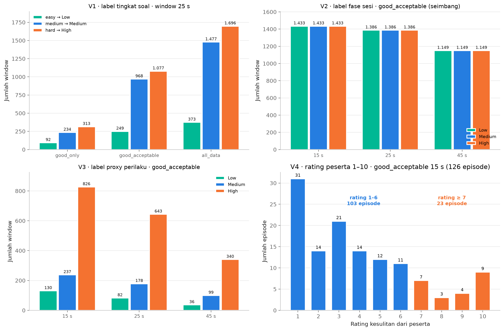

*Gambar 1. Sebaran kelas pada keempat dataset. V1 dan V3 tidak seimbang; good_acceptable V2 diseimbangkan per kelas; V4 dihitung per episode.*

### 3.2 Fitur sensor per window

| Kelompok | Fitur | Jumlah |
|---|---|---:|
| HRV | `rmssd_ms`, `sdnn_ms` | 2 |
| Mata (eye) | `blink_rate_per_minute`, `ear_left_mean`, `ear_left_std`, `ear_right_mean`, `ear_right_std`, `iris_size_estimate_mean`, `iris_size_estimate_std` | 7 |
| Perubahan iris | `iris_size_delta_mean` | 1 |
| Posisi kepala | `head_pitch_mean`, `head_pitch_std`, `head_yaw_mean`, `head_yaw_std` | 4 |
| Baseline HRV | `rmssd_baseline_ratio` | 1 |
| Pandangan dan status mata | `gaze_x_norm_mean/std`, `gaze_y_norm_mean/std`, rasio fixation, saccade, transition, unclassified | 8 |

| Profil fitur | Isi | Jumlah fitur |
|---|---|---:|
| core10 | HRV + mata + perubahan iris | 10 |
| core9 | core10 tanpa `iris_size_delta_mean` | 9 |
| core_head | core10 + posisi kepala | 14 |
| core9_head4_base | core9 + posisi kepala + baseline HRV | 14 |
| validated_fusion | core_head + pandangan dan status mata; hanya rekaman dengan validasi pandangan lolos | 22 |

Sumber: `v2_session_phase/window_15s_step_5s/feature_columns.json`.

### 3.3 V1 · label tingkat soal (`v1_active_task`)

| Aspek | Ketentuan |
|---|---|
| Label | Window saat pengerjaan aktif diberi label menurut set soal: easy → Low, medium → Medium, hard → High |
| Window | 25 detik, step 5 detik; HRV dari cache window 25 detik |
| Kelayakan peserta | Daftar tinjauan tim: 5 peserta *proposed_good* (good_only) dan 8 *questionable* (ditambah ke good_acceptable) |
| Kelayakan window | good: coverage mata ≥95%, face/EAR ≥95%, pandangan valid ≥90%, iris ≥90%, clipping ≤5%; acceptable: 80% / 80% / 70% / 70% / clipping ≤20% |

| View | Window | Low (easy) | Medium | High (hard) | Peserta |
|---|---:|---:|---:|---:|---:|
| good_only | 639 | 92 | 234 | 313 | 5 |
| good_acceptable | 2.294 | 249 | 968 | 1.077 | 13 |
| all_data | 3.546 | 373 | 1.477 | 1.696 | 18 |

Sumber: `v1_active_task/{good_only,good_acceptable,all_data}.csv`, `v1_active_task/QUALITY_REPORT.md`.

### 3.4 V2 · label fase sesi (`v2_session_phase`)

| Aspek | Ketentuan |
|---|---|
| Label Low | Pengerjaan aktif easy/demo, pre-task setelah kalibrasi, serta feedback/rating/rest setelah tugas easy |
| Label Medium / High | Pengerjaan aktif medium / hard, serta feedback/rating setelah tugas tersebut |
| Fase opsional | Rest/post-task hanya dipakai sampai 45 detik setelah pengerjaan terakhir berhenti |
| Window dikeluarkan | Interrupted, kalibrasi/baseline, konteks tugas tidak terlacak, window yang melintasi dua label, timestamp ambigu |
| HRV | Dihitung ulang dari RR mentah pada tiap panjang window |
| Kelayakan inti (`feature_aware_quality_v1`) | good: coverage mata ≥95%, face/EAR ≥95%, iris ≥90%; acceptable: 80% / 80% / 70%; keduanya: coverage RR ≥80%, ≥10 pasangan RR, umur RR terakhir ≤3 detik |
| Lonjakan RR (`exclude_local_rr_jump_v1`) | Window dengan RR yang menyimpang >250 ms dari median lokal dikeluarkan dari view curated |
| Seleksi seimbang (`balanced_primary_v1`) | good_acceptable berisi jumlah window yang sama per kelas; window pengerjaan aktif/pre-task didahulukan |

| Window | View | Low | Medium | High | Total | Peserta |
|---|---|---:|---:|---:|---:|---:|
| 15 s | good_only | 820 | 1.207 | 1.180 | 3.207 | 20 |
| 15 s | good_acceptable | 1.433 | 1.433 | 1.433 | 4.299 | 22 |
| 15 s | all_data | 1.897 | 3.199 | 3.136 | 8.232 | 22 |
| 25 s | good_only | 796 | 1.025 | 1.038 | 2.859 | 20 |
| 25 s | good_acceptable | 1.386 | 1.386 | 1.386 | 4.158 | 21 |
| 25 s | all_data | 1.830 | 3.151 | 3.098 | 8.079 | 22 |
| 45 s | good_only | 726 | 813 | 790 | 2.329 | 19 |
| 45 s | good_acceptable | 1.149 | 1.149 | 1.149 | 3.447 | 21 |
| 45 s | all_data | 1.716 | 3.055 | 3.022 | 7.793 | 22 |

| Window | Interrupted | Konteks tidak terlacak | Di luar batas fase opsional | Timestamp ambigu | Lonjakan RR (dikeluarkan dari curated) |
|---|---:|---:|---:|---:|---:|
| 15 s | 73 | 158 | 104 | 7 | 43 |
| 25 s | 73 | 247 | 118 | 11 | 75 |
| 45 s | 73 | 405 | 146 | 19 | 147 |

| Window | Low dari pengerjaan aktif | Low dari window campuran (mixed) | Low pre-task | Low feedback/rest |
|---|---:|---:|---:|---:|
| 15 s | 707 | 671 | 40 | 15 |
| 25 s | 470 | 880 | 28 | 8 |
| 45 s | 229 | 906 | 12 | 2 |

Seluruh window Medium dan High pada good_acceptable berasal dari pengerjaan aktif, kecuali 183 window Medium campuran pada 45 detik.

| Window | Variasi antar-rerata sesi / total | Variasi antar-rerata kelas / total |
|---|---|---|
| 15 s | RMSSD 69,75% · EAR kiri 85,39% · iris 87,06% | RMSSD 0,09% · EAR kiri 2,71% · iris 0,17% |
| 25 s | RMSSD 76,05% · EAR kiri 87,39% · iris 89,24% | RMSSD 0,05% · EAR kiri 2,57% · iris 0,53% |
| 45 s | RMSSD 79,11% · EAR kiri 89,32% · iris 91,97% | RMSSD 0,31% · EAR kiri 1,68% · iris 1,43% |

Nilai variasi adalah eta-squared satu faktor (deskriptif).

Sumber: `v2_session_phase/window_*/{good_only,good_acceptable,all_data}.csv`, `v2_session_phase/QUALITY_REPORT.md`.

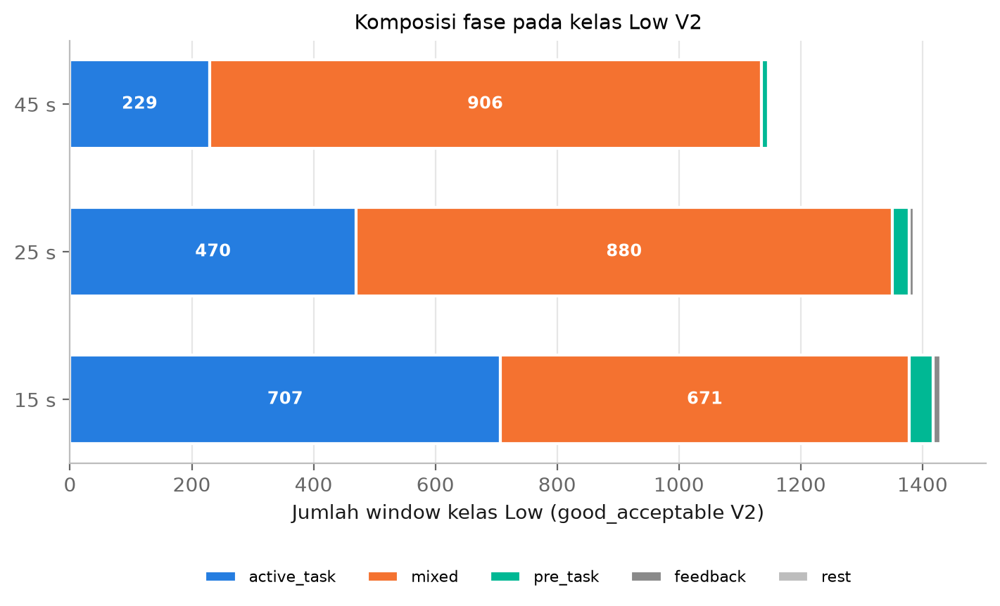

*Gambar 2. Komposisi fase pada kelas Low good_acceptable V2.*

### 3.5 V3 · proxy perilaku (`v3_behavioral_proxy`)

| Label | Bukti hasil pengerjaan | Bukti waktu aktif (relatif terhadap persentil 33⅓ dan 66⅔ peserta Train pada soal yang sama) |
|---|---|---|
| Low | Jawaban manual pertama benar, tanpa kesalahan | ≤ batas bawah |
| Medium | Benar setelah 1–2 kesalahan manual | Di antara batas bawah dan atas |
| High | ≥3 kesalahan manual (boleh belum selesai) | > batas atas |
| Tidak berlabel | Bukti bertentangan, referensi < 5 peserta, atau jejak peristiwa tidak valid | — |

Label hanya diberikan bila kedua bukti sejalan (kebijakan `behavioral_concordance_v2`). Referensi waktu dihitung hanya dari peserta Train; pada evaluasi per peserta, referensi dan label dihitung ulang setiap fold.

| Keputusan episode | Episode |
|---|---:|
| Berlabel (bukti sejalan) | 82 (Low 43 · Medium 17 · High 22) |
| Referensi kurang | 163 |
| Bukti bertentangan atau kurang | 112 |
| Jejak peristiwa tidak valid | 1 |
| **Total** | **358** |

| Split peserta | Peserta | Kode peserta | Episode berlabel Low / Medium / High | Episode tidak berlabel |
|---|---:|---|---|---:|
| Train | 16 | P01, P03, P04, P07, P09, P10, P11, P12, P13, P14, P15, P17, P19, P20, P21, P22 | 20 / 10 / 16 | 199 |
| Validation | 3 | P02, P05, P16 | 5 / 3 / 4 | 33 |
| Test | 3 | P06, P08, P18 | 18 / 4 / 2 | 44 |

| Window | View | Low | Medium | High | Total | Peserta |
|---|---|---:|---:|---:|---:|---:|
| 15 s | good_only | 111 | 184 | 516 | 811 | 18 |
| 15 s | good_acceptable | 130 | 237 | 826 | 1.193 | 21 |
| 15 s | all_data | 174 | 256 | 1.003 | 1.433 | 21 |
| 25 s | good_only | 75 | 143 | 410 | 628 | 16 |
| 25 s | good_acceptable | 82 | 178 | 643 | 903 | 20 |
| 25 s | all_data | 109 | 187 | 773 | 1.069 | 21 |
| 45 s | good_only | 35 | 89 | 227 | 351 | 14 |
| 45 s | good_acceptable | 36 | 99 | 340 | 475 | 18 |
| 45 s | all_data | 48 | 99 | 399 | 546 | 19 |

Episode yang memiliki window good_acceptable 15 s: 66 (Low 28 · Medium 16 · High 22). Episode High mencakup 33,3% episode tetapi 69,2% window, karena episode High lebih panjang.

Sumber: `v3_behavioral_proxy/episode_labels.csv`, `participant_splits.csv`, `window_*/…csv`, `v3_behavioral_proxy/QUALITY_REPORT.md`.

### 3.6 V4 · rating peserta (`v4_self_reported_rating`)

| Aspek | Nilai |
|---|---|
| Baris log CodeArrange yang diperiksa | 500 |
| Rating yang cocok dengan episode | 164 episode dari 17 peserta (127 setelah jawaban benar, 37 setelah waktu habis) |
| Episode tanpa rating | 194 (rekaman P01, P06, P09, P13, P19 tidak memiliki rating yang cocok) |
| good_acceptable 15 s | 1.693 window · 126 episode · 17 peserta |
| good_only / all_data 15 s | 1.299 / 2.082 window |
| Episode overload (rating ≥ 7) | 23 episode dari 12 peserta (18,3%) |

| Rating | Episode | Peserta | Window |
|---:|---:|---:|---:|
| 1 | 31 | 9 | 186 |
| 2 | 14 | 8 | 104 |
| 3 | 21 | 10 | 222 |
| 4 | 14 | 8 | 163 |
| 5 | 12 | 10 | 110 |
| 6 | 11 | 9 | 201 |
| 7 | 7 | 5 | 251 |
| 8 | 3 | 3 | 52 |
| 9 | 4 | 4 | 202 |
| 10 | 9 | 6 | 202 |
| **Total** | **126** | **17** | **1.693** |

| Set soal | Episode | Overload (rating ≥ 7) |
|---|---:|---:|
| easy | 55 | 3 |
| medium | 53 | 9 |
| hard | 18 | 11 |

| Panjang window | Window | Episode |
|---:|---:|---:|
| 15 s | 1.693 | 126 |
| 25 s | 1.328 | 100 |
| 45 s | 792 | 64 |

Hanya window 15 s yang diterbitkan sebagai CSV; 25/45 s dicatat sebagai ringkasan cakupan.

Sumber: `v4_self_reported_rating/episode_ratings.csv`, `window_15s_step_5s/good_acceptable.csv`, `coverage_by_window.csv`, `QUALITY_REPORT.md`.

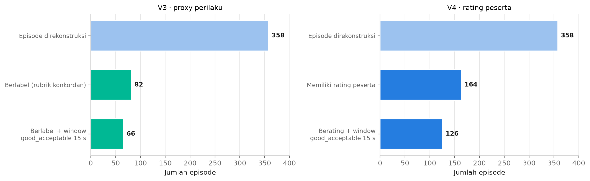

*Gambar 3. Jumlah episode dari rekonstruksi sampai dataset good_acceptable 15 detik.*

### 3.7 Perbedaan antarversi

| Aspek | V1 | V2 | V3 | V4 |
|---|---|---|---|---|
| Sumber label | Tingkat set soal | Fase sesi + tingkat soal | Waktu aktif relatif + kesalahan | Rating peserta |
| Fase yang dipakai | Pengerjaan aktif | Aktif, pre-task, feedback/rating/rest (terbatas) | Pengerjaan aktif dalam satu episode | Pengerjaan aktif dalam satu episode |
| Unit target | Window | Window | Episode | Episode |
| Penyeimbangan kelas | Tidak | Ya (good_acceptable) | Tidak (bobot Train tersedia) | Tidak |
| Peserta (good_acceptable 15 s) | 13 (25 s) | 22 | 21 | 17 |
| Label bergantung split | Tidak | Tidak | Ya (referensi dari Train) | Tidak |
| Bentuk target pada pemodelan akhir | — | — | High vs Low+Medium | Overload (≥ 7) vs 1–6 |

### 3.8 Cakupan peserta per dataset

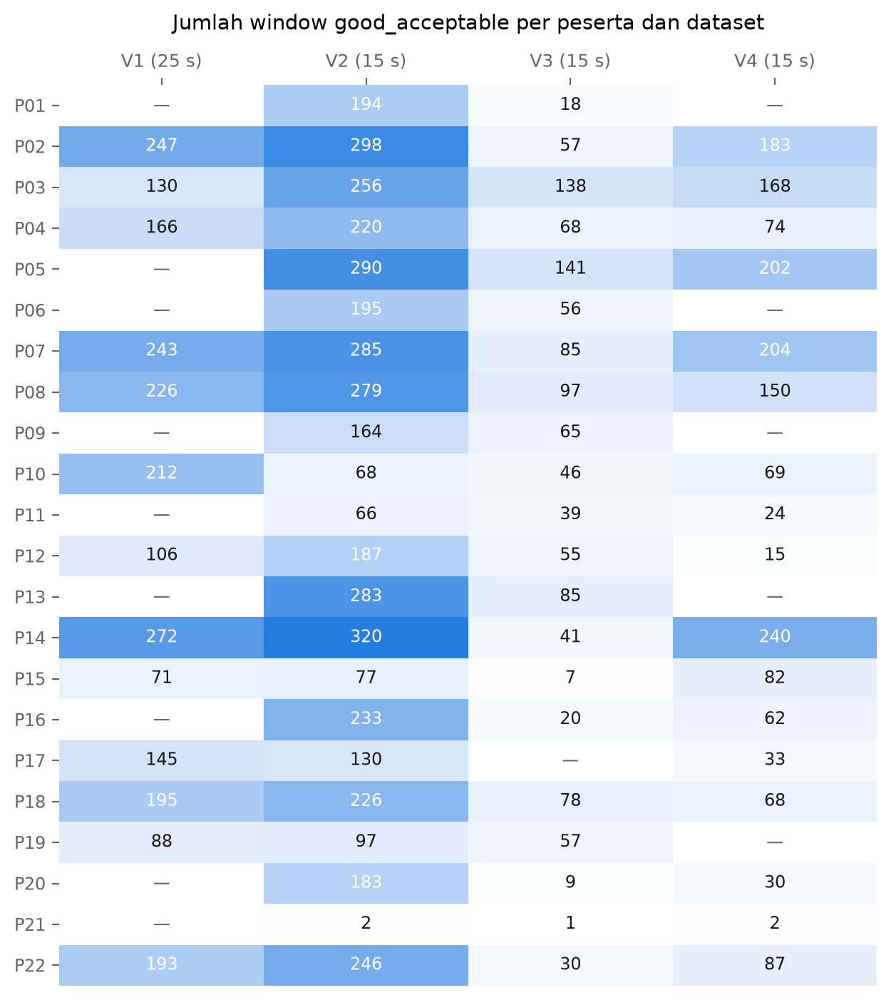

*Gambar 4. Jumlah window good_acceptable per peserta (V1 25 s; V2, V3, V4 15 s). Tanda "—" berarti peserta tidak tercakup.*

### 3.9 Versi dataset yang dipakai setiap batch

| Batch | Dataset | View dan window | Jumlah window |
|---|---|---|---|
| 01 (old-dataset) | V1 | good_acceptable 25 s | 2.294 |
| 01 (new-dataset) | V2, versi awal (13 peserta curated) | good_only / good_acceptable / all_data × 15/25/45 s | good_acceptable: 3.011 / 2.711 / 2.118 |
| 02, 03 | V2, versi setelah penambahan rekaman (sebelum kebijakan fitur inti) | good_acceptable 15/25/45 s | 3.579 / 3.214 / 2.527 (21 peserta) |
| 04, 05 | V2, versi `feature_aware_quality_v1` + pengecualian lonjakan RR (sebelum seleksi seimbang) | good_acceptable 15/25/45 s | 5.253 / 4.608 / 3.509 |
| 06 (seri v3/exp01–02) | V2, versi Batch 05 | good_acceptable 25 s | Subset RMSSD: 2.454 Train + 721 validation; subset eye: 671 + 99 |
| 06–07 (V3) | V3 | good_acceptable 15 s + riwayat dari V2 | 1.193 window · 66 episode |
| 06–08 (V4) | V4 | good_acceptable 15 s (+ riwayat dari V2 all_data pada Batch 07–08) | 1.693 window · 126 episode |

Sumber: `SUMMARY.md` tiap batch; `models/batch-05/PLAN.md`; `models/batch-06/v3/SUMMARY.md`.

## 4. Pemodelan

### 4.1 Ikhtisar delapan batch

| Batch | Waktu | Dataset | Target | Protokol evaluasi | Eksperimen | Hasil utama |
|---|---|---|---|---|---|---|
| 01 | ≤ 15 Nov 2026 | V1; V2 versi awal | Low/Medium/High (window) | Blok waktu 120 s (GroupKFold 5) dan TimeSeriesSplit; peserta sama di train/test | 1 notebook V1 + 9 notebook V2 | 58% / macro-F1 0,57 (V2 25 s good_only, XGBoost, blok waktu) |
| 02 | 19–20 Nov 2026 | V2 (3.579/3.214/2.527) | Low/Medium/High (window) | Blok waktu 120 s per sesi, split 70/15/15, purge 45 s | exp01 tabular, exp02 neural | Test 47,41% / macro-F1 47,02% (MLP 15 s) |
| 03 | 20 Nov 2026 | V2 (sama dengan Batch 02) | Low/Medium/High (window) | Blok waktu 120 s + CV 5 fold di Train; validation akhir; test | exp01 tabular, exp02 neural | Test 45,91% / macro-F1 44,86% (HistGradientBoosting 15 s) |
| 04 | 21–22 Nov 2026 | V2 (5.253/4.608/3.509) | Low/Medium/High (window) | Blok 240 s, purge 105 s, CV 5 fold; validation akhir; test | exp01, exp03, exp04 selesai | Test 44,80% / macro-F1 41,77% (TabM 45 s) |
| 05 | 22 Nov 2026 | V2 (sama dengan Batch 04), 25 s | Low/Medium/High (window) | Blok 240 s, guard 45 s, CV 5 fold; satu model terkunci untuk test | exp01 (3 tahap) | Test 37,92% / macro-F1 37,59% (Extra Trees session-robust) |
| 06 | 23–25 Nov 2026 | V2 25 s; V3; V4 | Tiga kelas; rating 1–10; biner | LOPO; split peserta V3; Dev/Test V4 | 13 eksperimen seri `v3/` + 3 eksperimen seri utama | V4 biner rating ≥ 7: AUC 0,778 (core9) dan 0,781 (core9_head4_base), LOPO 17 peserta |
| 07 | 25 Nov 2026 | V3; V4 | V3 High vs Non-High; V4 overload | LOPO dengan ambang di dalam fold | exp01–exp04 | V4 core9: AUC 0,778, balanced accuracy 0,741–0,763 (LOPO 17) |
| **08 ★** | **27 Nov 2026** | **V4 (+ V2 sebagai input pendukung); V3 untuk validasi silang** | **Overload rating ≥ 7 (episode)** | **Nested LOPO 17 peserta** | **exp01–exp04** | **A-ens AUC 0,826 / BalAcc 0,768; B3 AUC 0,890 / BalAcc 0,840** |

Penomoran batch mengikuti nama folder `models/batch-0X`.

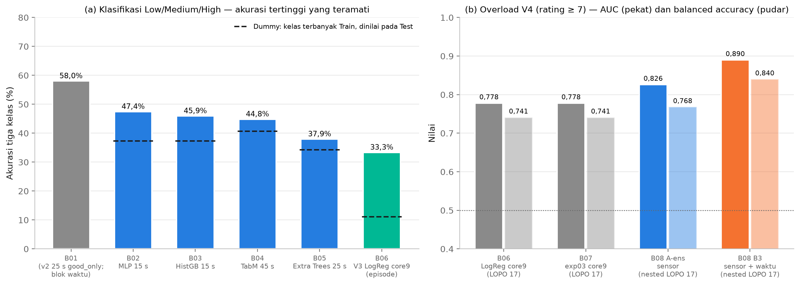

*Gambar 5. (a) Akurasi tertinggi tiga kelas Batch 01–06; garis putus-putus = Dummy kelas terbanyak Train pada test yang sama. Batch 01 memakai blok waktu dengan peserta yang sama di train/test. (b) Tugas overload V4: AUC dan balanced accuracy pada LOPO 17 peserta.*

### 4.2 Batch 01 · Baseline awal

**Dataset:** old-dataset = V1 good_acceptable 25 s (2.294 window); new-dataset = V2 versi awal, 9 kombinasi (good_only / good_acceptable / all_data × 15 / 25 / 45 s). **Target:** Low/Medium/High per window. **Fitur:** subset fitur sensor (HRV, rasio baseline, kedipan/EAR, iris, posisi kepala, pandangan, status mata). **Evaluasi:** blok waktu 120 detik (GroupKFold 5) dan TimeSeriesSplit 5 fold; peserta yang sama dapat muncul di train dan test.

| Kode | Perlakuan | Evaluasi |
|---|---|---|
| RF-T | Random Forest 100 tree, max_depth 5, class weight | TimeSeriesSplit 5 fold |
| XGB-T | XGBoost 100 tree, max_depth 4 | TimeSeriesSplit 5 fold |
| XGB-W | XGBoost + sample weight seimbang | Blok waktu 120 s |
| RF-R | Random Forest + EAR gabungan, rolling 3 window, delta RMSSD | Blok waktu |
| XGB-R | XGBoost + fitur rolling, sample weight, subsample 0,8 | Blok waktu |
| XGB-S | XGBoost + SMOTE (k = 5) di fold training | Blok waktu |
| Binary XGB | Medium vs High (Low dikeluarkan) | Blok waktu |
| IF-05 / IF-25 / OC-SVM | Isolation Forest / One-Class SVM: Low vs Elevated (Medium+High) | 80% awal Elevated untuk training |

| Dataset | XGB-W | RF-R | XGB-R | XGB-S |
|---|---|---|---|---|
| V1 25 s good_acceptable (old-dataset) | 54% / 0,46 | 48% / 0,41 | 53% / 0,45 | 53% / 0,45 |
| V2 15 s all_data | 47% / 0,47 | 45% / 0,45 | 46% / 0,46 | 46% / 0,46 |
| V2 15 s good_acceptable | 46% / 0,45 | 41% / 0,40 | 44% / 0,43 | 45% / 0,45 |
| V2 15 s good_only | 49% / 0,47 | 50% / 0,47 | 51% / 0,49 | 50% / 0,48 |
| V2 25 s all_data | 49% / 0,48 | 48% / 0,48 | 50% / 0,49 | 51% / 0,50 |
| V2 25 s good_acceptable | 51% / 0,50 | 48% / 0,47 | 50% / 0,49 | 50% / 0,49 |
| V2 25 s good_only | 53% / 0,52 | 54% / 0,53 | **58% / 0,57** | 57% / 0,56 |
| V2 45 s all_data | 54% / 0,54 | 51% / 0,50 | 56% / 0,55 | 55% / 0,54 |
| V2 45 s good_acceptable | 55% / 0,53 | 50% / 0,49 | 54% / 0,53 | 54% / 0,53 |
| V2 45 s good_only | 53% / 0,50 | 49% / 0,46 | 51% / 0,49 | 53% / 0,51 |

Isi sel: akurasi rata-rata fold / macro-F1 (blok waktu 120 s).

| Uji tambahan | Hasil |
|---|---|
| TimeSeriesSplit (RF-T / XGB-T), V2 | Akurasi 18–37%; V1: sekitar 31% / 34% |
| Biner Medium vs High, V2 | Akurasi 56–69% (tertinggi 69% pada 25 s dan 45 s good_only); V1: 61% |
| Novelty Low vs Elevated, V2 | Akurasi 33–57%; recall Low 3–48%; di bawah tebakan konstan Low (61,6–71,3%) |
| Proporsi window test beririsan dengan training (blok waktu) | 15 s: 11,3–12,8%; 25 s: 21,9–23,5%; 45 s: 38,3–46,5% |

Sumber: `models/batch-01/old-dataset/SUMMARY.md`, `models/batch-01/new-dataset/SUMMARY.md`.

### 4.3 Batch 02 · Model tabular dan deep learning

**Dataset:** V2 good_acceptable 15/25/45 s (3.579 / 3.214 / 2.527 window; 21 peserta). **Target:** Low/Medium/High per window. **Fitur:** fusion 23 (21 fitur eye + RMSSD/SDNN), eye-only, HRV-only. **Evaluasi:** blok waktu 120 s per sesi, target 70/15/15, purge 45 s; peserta yang sama dapat muncul di train/validation/test; finalist di-refit pada train + validation sebelum test.

| Eksperimen | Isi | Kandidat validation |
|---|---|---:|
| exp01 · tabular | Logistic Regression, SVM RBF, KNN, Random Forest, Extra Trees, HistGradientBoosting, XGBoost, CatBoost; tuning, seleksi fitur (MI/PCA), balancing (ROS/SMOTE), interaksi, hierarchy, soft voting, late fusion | 210 |
| exp02 · neural | MLP, MLP residual, Transformer tabular; 2 preset × 3 window × eye/fusion; seed 42/17/2026; voting | 54 |

| Eksperimen | Window | Finalist | Akurasi validation | Akurasi test | Macro-F1 test | Balanced accuracy test | Dummy test |
|---|---|---|---:|---:|---:|---:|---:|
| exp01 | 15 s | Soft voting LR interaksi + Extra Trees + Random Forest | 50,36% | 46,77% | 46,40% | 46,83% | 37,28% |
| exp01 | 25 s | Logistic Regression fusion, C = 10 | 54,90% | 31,21% | 31,39% | 32,25% | 30,50% |
| exp01 | 45 s | Late fusion LR eye + RF HRV (utama) | 60,92% | 35,21% | 33,37% | 34,83% | 36,98% |
| exp02 | 15 s | MLP fusion 64–32 | 51,64% | **47,41%** | **47,02%** | 47,57% | 37,28% |
| exp02 | 25 s | Voting MLP fusion + Transformer eye | 60,98% | 42,08% | 40,94% | 43,50% | 30,50% |
| exp02 | 45 s | Voting Transformer fusion + MLP residual eye (utama) | 61,84% | 45,86% | 45,82% | 46,39% | 36,98% |

Dummy = kelas terbanyak train + validation, dinilai pada test yang sama. Test: 464 / 423 / 338 window.

| Pemeriksaan pasca-run (diagnosis) | Hasil |
|---|---|
| Pemusatan fitur per sesi (statistik training) pada LR fusion | Akurasi test +19,18 s.d. +23,40 poin |
| Kalibrasi probabilitas SVM (fusion 25 s) | Akurasi test turun 43,50% → 25,30% |
| Refit train + validation | Akurasi test keenam finalist turun 2,37–10,17 poin |

Sumber: `models/batch-02/SUMMARY.md`, `models/batch-02/DIAGNOSIS.md`.

### 4.4 Batch 03 · Normalisasi sensor dan seleksi model

**Dataset:** sama dengan Batch 02. **Target:** Low/Medium/High per window. **Fitur:** fusion 23, nonspatial 11, relative 27. **Normalisasi:** global, session-centered, session-standardized. **Evaluasi:** blok waktu 120 s, purge 45 s; CV 5 fold di Train untuk seleksi; validation akhir; test memakai bundle yang sama dengan validation (tanpa refit).

| Eksperimen | Isi | Konfigurasi |
|---|---|---:|
| exp01 · tabular | LR, SVM, HistGradientBoosting, XGBoost, CatBoost × 3 normalisasi × 2 kelompok fitur; fitur relatif; class weight; kontrol eye-only/HRV-only | 151 (755 hasil fold) |
| exp02 · neural | MLP, residual MLP, Transformer × 3 normalisasi × 2 kelompok fitur; regularisasi; rata-rata 3 seed | 93 (465 hasil fold) |

| Eksperimen | Window | Model akhir | Akurasi train | Akurasi validation | Akurasi test | Macro-F1 test | Balanced accuracy test | Dummy test |
|---|---|---|---:|---:|---:|---:|---:|---:|
| exp01 | 15 s | HistGradientBoosting fusion, global | 88,98% | 61,07% | **45,91%** | **44,86%** | 45,67% | 37,28% |
| exp01 | 25 s | SVM RBF relative, global, class weight (utama) | 89,49% | 62,58% | 42,08% | 40,87% | 43,26% | 38,06% |
| exp01 | 45 s | Hard voting 3 konfigurasi | 82,06% | 53,62% | 38,46% | 37,33% | 38,45% | 36,98% |
| exp02 | 15 s | Residual MLP nonspatial, class weight, 3 seed | 74,63% | 58,04% | 37,93% | 36,06% | 39,02% | 37,28% |
| exp02 | 25 s | Residual MLP nonspatial, seed 42 | 79,35% | 60,94% | 35,22% | 34,06% | 36,66% | 38,06% |
| exp02 | 45 s | Residual MLP nonspatial, 3 seed (utama) | 97,65% | 66,49% | 44,08% | 43,83% | 43,89% | 36,98% |

Sumber: `models/batch-03/SUMMARY.md`.

### 4.5 Batch 04 · Optimasi model

**Dataset:** V2 versi `feature_aware_quality_v1` + pengecualian lonjakan RR, good_acceptable 15/25/45 s (5.253 / 4.608 / 3.509 window). **Target:** Low/Medium/High per window. **Fitur:** core10 dan core_head 14 (exp01 juga eye-only, HRV-only, fitur turunan, seleksi fitur). **Evaluasi:** blok waktu 240 s, purge 105 s, CV 5 fold di Train (dengan pengulangan untuk shortlist), validation akhir, test tanpa refit. Test: 768 / 683 / 529 window.

| Eksperimen (penamaan SUMMARY) | Folder notebook | Isi | Konfigurasi CV | Bentuk model di validation akhir |
|---|---|---|---:|---:|
| exp01 · tabular | `exp01/` | LR, LDA, KNN, SVM, forest/boosting; fitur turunan, MI/PCA, ablation sensor, class weight, ROS, SMOTE, ordinal/hierarchy, ensemble | 512 | 30 |
| exp02 · acuan dan riwayat statistik | (tidak tersedia di lokal) | Tidak memiliki hasil lengkap | — | — |
| exp03 · deep learning tabular | `exp02/` | MLP, residual MLP, TabM, Transformer; regularisasi, class weight, ensemble seed | 287 | 57 |
| exp04 · model urutan sensor | `exp03/` | GRU dan TCN kausal; riwayat 15/30/60 s; pembanding MLP dan HistGradientBoosting | 157 | 48 |

| Eksperimen | Window | Model pilihan validation | Akurasi validation | Akurasi test | Macro-F1 test | Dummy test |
|---|---|---|---:|---:|---:|---:|
| exp01 | 15 s | Stacking | 41,54% | 28,78% | 28,50% | 32,81% |
| exp01 | 25 s | SVM RBF core | 42,83% | 31,63% | 31,87% | 34,26% |
| exp01 | 45 s | CatBoost core | 42,26% | 38,37% | 36,57% | 40,64% |
| exp03 | 15 s | TabM core-head | 42,69% | 36,07% | 26,50% | 32,81% |
| exp03 | 25 s | Residual MLP core | 40,67% | 33,24% | 31,99% | 34,26% |
| exp03 | 45 s | TabM core-head, 5 seed | 49,61% | **44,80%** | **41,77%** | 40,64% |
| exp04 | 15 s | Stacking | 40,07% | 34,11% | 33,73% | 32,81% |
| exp04 | 25 s | Hard voting | 44,20% | 34,26% | 33,72% | 34,26% |
| exp04 | 45 s | GRU core, riwayat 60 s, 5 seed | 52,76% | 40,08% | 26,21% | 40,64% |

| Kontrol | Hasil |
|---|---|
| exp04 HistGradientBoosting + ringkasan riwayat 60 s (45 s) | Akurasi test 44,42%, macro-F1 42,02% |
| exp04 TCN riwayat 15 s (25 s) | Akurasi test 44,07%, macro-F1 43,92% |
| 1-nearest-neighbor, split baris acak vs blok purged (di dalam Train) | OOF 84,17–98,39% vs 41,40–49,00% |

Sumber: `models/batch-04/SUMMARY.md`, `models/batch-04/README.md`.

### 4.6 Batch 05 · Evaluasi terkunci

**Dataset:** V2 sama dengan Batch 04, window 25 s, 10 fitur core. **Target:** Low/Medium/High per window. **Evaluasi:** blok 240 s, guard 45 s; fitting 2.724 window (Low 924 · Medium 875 · High 925), validation 870, test referensi 683 (Low 238 · Medium 211 · High 234); CV 5 fold; satu model dikunci sebelum test.

| Tahap | Isi |
|---|---|
| Tahap 1 | Membekukan dataset, split, fold, dan monitor epoch |
| Tahap 2 | LR, Extra Trees, HistGradientBoosting × normalisasi global / session-centered / session-robust; learning curve (71 fitting) |
| Tahap 3 | MLP 64/32 tiga seed dengan tiga aturan checkpoint; kontrol Extra Trees (72 fitting, 5.760 epoch); evaluasi satu model terkunci |

| Model (tahap 2, OOF) | Normalisasi | Akurasi OOF | Macro-F1 OOF |
|---|---|---:|---:|
| Extra Trees | Session-robust | **47,03%** | **46,86%** |
| Logistic Regression | Session-centered | 44,64% | 43,97% |
| HistGradientBoosting | Session-robust | 44,49% | 44,44% |
| Logistic Regression | Session-robust | 44,27% | 43,91% |
| Extra Trees | Session-centered | 42,80% | 42,66% |
| HistGradientBoosting | Session-centered | 40,79% | 40,80% |
| HistGradientBoosting | Global | 35,43% | 35,48% |
| Extra Trees | Global | 34,03% | 34,11% |
| Logistic Regression | Global | 31,39% | 31,32% |
| Dummy | — | 29,88% | 23,55% |

| Model terkunci: Extra Trees session-robust | Akurasi | Macro-F1 |
|---|---:|---:|
| OOF | 47,03% | 46,86% |
| Validation | 44,83% | 43,90% |
| Test referensi | 37,92% | 37,59% |

Recall test: Low 80/238 (33,61%), Medium 69/211 (32,70%), High 110/234 (47,01%). Neural terbaik (MLP session-robust, checkpoint macro-F1): OOF 45,26% / 45,08%; validation 34,02%.

Sumber: `models/batch-05/SUMMARY.md`, `models/batch-05/PLAN.md`.

### 4.7 Batch 06 · Pemodelan V3 dan V4

Batch 06 terdiri dari dua seri: seri `models/batch-06/v3/exp01–exp13` dan seri utama (`exp01_v3_behavioral_proxy`, `v4/exp02_v4_self_reported_rating`, `v4/exp03_v4_binary_overload`).

#### 4.7.1 Seri `v3/` · exp01–exp02 (V2, baseline sensor)

**Dataset:** V2 good_acceptable 25 s (versi Batch 05), 10 fitur core. **Target:** Low/Medium/High per window. **Evaluasi:** OOF dengan satu peserta ditahan di dalam Train; validation historis.

| Eksperimen | Subset | Model | Akurasi OOF mentah → relatif baseline | Macro-F1 OOF mentah → relatif | Dummy OOF |
|---|---|---|---|---|---:|
| exp01 | RMSSD (19 peserta, 2.454 window) | Logistic Regression | 37,73% → 39,41% | 35,59% → 38,15% | 26,12% |
| exp01 | RMSSD | Extra Trees | 35,66% → 37,33% | 34,03% → 35,10% | 26,12% |
| exp01 | RMSSD + acuan eye (4 peserta, 671 window) | Logistic Regression | 34,43% → 31,59% | 32,56% → 26,78% | 39,34% |
| exp01 | RMSSD + acuan eye | Extra Trees | 35,77% → 41,43% | 33,96% → 39,85% | 39,34% |
| exp02 | Ablasi pada subset eye (Extra Trees) | Mentah / RMSSD saja / eye saja / gabungan | 35,77% / 38,15% / 31,74% / 41,43% | — | — |

Validation exp01: RMSSD LR 36,34% → 39,39% (721 window); RMSSD + eye ET 52,53% → 65,66% (99 window, tanpa contoh Medium).

#### 4.7.2 Seri `v3/` · exp03–exp06 (V3 tiga kelas dan V4 rating, per episode)

**Dataset:** V3 good_acceptable 15 s (split resmi 16/3/3 peserta) dan V4 good_acceptable 15 s (LOPO 17 peserta). **Fitur:** 10 core (exp06 juga posisi kepala dan selisih terhadap riwayat sesi).

| Eksperimen | Dataset / evaluasi | Model | Benar | Akurasi | Macro-F1 | MAE rating | Dalam ±1 |
|---|---|---|---:|---:|---:|---:|---:|
| exp03 | V3 validation, 11 episode | Extra Trees core | 5/11 | 45,45% | 0,324 | — | — |
| exp03 | V3 test, 18 episode | Extra Trees core | 4/18 | 22,22% | 0,178 | — | — |
| exp03 | V3 test | Dummy High | 2/18 | 11,11% | 0,067 | — | — |
| exp04 | V4 LOPO, 126 episode | Extra Trees core | 19/126 | 15,08% | 0,091 | 3,183 | 29,37% |
| exp04 | V4 LOPO | Logistic ordinal | 7/126 | 5,56% | 0,062 | 2,675 | 30,16% |
| exp04 | V4 LOPO | Dummy modus / median | 31 / 20 | 24,60% / 15,87% | 0,040 / 0,032 | 2,992 / 2,317 | 35,71% / 38,89% |
| exp05 | V3 validation, unit episode | Logistic, window pertama / median episode | 5/11 | 45,45% | 0,357 | — | — |
| exp05 | V4 LOPO, unit episode | Logistic median episode | 17/126 | 13,49% | 0,067 | 3,056 | 29,37% |
| exp05 | V4 LOPO | Regresi kuantil (window pertama / median) | 20/126 | 15,87% | 0,032 | 2,317 | 38,89% |
| exp06 | V3 validation | SVC core + head relatif riwayat | 5/11 | 45,45% | 0,429 | — | — |
| exp06 | V3 validation | Eye mentah → diperluas | 6 → 4 | 54,55% → 36,36% | 0,432 → 0,178 | — | — |
| exp06 | V4 LOPO | SVC core mentah | 28/126 | 22,22% | — | 2,659 | 38,10% |
| exp06 | V4 LOPO | SVR core + head relatif | 15/126 | 11,90% | — | 2,238 | 40,48% |

#### 4.7.3 Seri `v3/` · exp07–exp13 (V3 biner High vs Non-High, per episode)

**Dataset:** V3; kandidat window dari V2 all_data 15 s (good/acceptable) dalam satu episode aktif. **Unit:** median fitur per episode, relatif terhadap riwayat sesi sebelum episode (≤12 window, minimal 3). **Evaluasi:** LOPO di dalam 15 peserta Train (37 episode; label dan referensi dihitung ulang per fold) dan validation 3 peserta (11 episode). **Mayoritas (Non-High):** LOPO 56,8% (21/37), validation 63,6% (7/11).

| Eksperimen | Perlakuan | Benar LOPO | AUC LOPO | Benar validation | AUC validation | High terdeteksi / alarm palsu (validation) |
|---|---|---:|---:|---:|---:|---|
| exp07 | Eye tiga kelas → dipetakan biner | 10/37 | — | 9/11 | — | 3/4 · 1/7 |
| exp07 | Core + head relatif tiga kelas → dipetakan biner | 23/37 | — | 7/11 | — | 3/4 · 3/7 |
| exp07 | Core + head relatif, biner langsung (SVC RBF) | 26/37 | — | 6/11 | — | 3/4 · 4/7 |
| exp08 | exp07 biner + ambang dipilih di dalam fold (LOPO); ambang dari Train penuh = 0,5 (validation) | 26/37 | — | 7/11 | — | 2/4 · 2/7 |
| exp09 | RBF eye + HRV + posisi kepala (acuan) | 26/37 | 0,699 | 6/11 | 0,607 | — |
| exp09 | Linear eye + HRV + posisi kepala | 21/37 | 0,530 | 6/11 | 0,571 | — |
| exp09 | RBF eye + HRV | 20/37 | 0,622 | 6/11 | 0,571 | — |
| exp09 | RBF posisi kepala saja | 28/37 | 0,717 | 7/11 | 0,750 | — |
| exp10 | L2 global core9 + head + baseline (resep V4) | 11/37 | 0,283 | 9/11 | 0,750 | 3/4 · 1/7 |
| exp11 | A · median fitur per episode | 26/37 | 0,699 | 6/11 | 0,607 | 3/4 · 4/7 |
| exp11 | B · rata-rata skor per window | 17/37 | 0,515 | 6/11 | 0,571 | 3/4 · 4/7 |
| exp12 | HRV 45 s, waktu akhir berpasangan | 24/37 | 0,673 | 6/11 | 0,679 | 4/4 · 5/7 |
| exp13 | Normalisasi personal IQR riwayat | 25/37 | 0,690 | 9/11 | 0,714 | 4/4 · 2/7 |

Test V3 (3 peserta, 18 episode, 2 High; mayoritas Non-High 88,9%): exp11 11/18 (61,1%), AUC 0,500; exp13 9/18 (50,0%), AUC 0,406.

Sumber: `models/batch-06/v3/SUMMARY.md`, `models/batch-06/v3/exp02/SUMMARY.md`, `models/batch-06/v3/exp05–exp13/README.md`, `models/batch-06/v3/report/test_metrics.csv`, `models/batch-06/EVALUASI_V3_V4.md`.

#### 4.7.4 Seri utama · exp01–exp03

**exp01 (V3 tiga kelas):** V3 good_acceptable 15 s, split resmi; model per window terkunci `LogisticRegression · core9 · causal_session_robust · class_balanced`.

| Evaluasi | Akurasi | Balanced accuracy | Macro-F1 | Dummy (kelas terbanyak window) |
|---|---:|---:|---:|---:|
| Test, window | 35,50% | 34,05% | 33,50% | Macro-F1 22,67% |
| Test, episode (18 episode) | 33,33% | 36,11% | 30,13% | Akurasi 11,11%, macro-F1 6,67% |

Kelas terbanyak episode Test (Low) = 12/18 (66,7%).

**exp02 (V4):** V4 good_acceptable 15 s; Dev 13 peserta (99 episode) dan Test 4 peserta (27 episode: P04, P05, P21, P22).

| Track | Target | Model terkunci | Dev | Test window | Test episode | Dummy test episode |
|---|---|---|---|---|---|---|
| A | Regresi rating 1–10 | Ridge · core9_head4_base · causal_session_robust | MAE 2,330 | MAE 2,768; R² −0,326 | MAE 2,528; R² −0,136; Spearman −0,196 | MAE 2,969 |
| B | 3 kelas (1–3 / 4–6 / 7–10) | LogReg · core10 · causal_session_robust | Akurasi 43,43%; macro-F1 41,75% | Akurasi 36,16%; macro-F1 35,49% | Akurasi 37,04%; BalAcc 35,95%; macro-F1 34,53% | Akurasi 18,52%; macro-F1 10,42% |
| C1 | Biner 1–3 vs 7–10 | LogReg · core9_head4_base · global_robust | Episode AUC 0,739; BalAcc 72,54%; akurasi 70,00% | AUC 0,562; BalAcc 53,96% | AUC 0,714; BalAcc 62,14%; akurasi 63,16% | AUC 0,500 |

Kelas terbanyak episode Test: Track B 1–3 = 14/27 (51,9%); Track C1 non-overload = 14/19 (73,7%). Klasifikasi langsung 10 rating (GroupKFold 5): akurasi window 14,0–14,1%.

**exp03 (V4 biner overload, LOPO 17 peserta):**

| Skema | Model | AUC window | AUC episode (CI 95%) | BalAcc episode | Akurasi episode | Mayoritas episode | Uji Mann-Whitney p |
|---|---|---:|---|---:|---:|---:|---:|
| 1–6 vs 7–10 (126 episode) | LogReg L2 · core9_head4_base · global_robust | 0,739 | 0,781 (0,647–0,894) | 69,73% | 69,84% | 81,7% | 1,3 × 10⁻⁵ |
| 1–6 vs 7–10 | LogReg nested C · core9_head4_base · global_robust | 0,739 | 0,773 (0,637–0,889) | 70,26% | 81,75% | 81,7% | 2,2 × 10⁻⁵ |
| 1–6 vs 7–10 | LogReg L2 · core9 · global_robust | 0,691 | 0,778 (0,644–0,895) | 74,06% | 65,87% | 81,7% | 1,6 × 10⁻⁵ |
| 1–3 vs 7–10 (89 episode) | LogReg L2 · core9_head4_base · global_robust | 0,743 | 0,777 (0,610–0,924) | 68,21% | 69,66% | 74,2% | 4,1 × 10⁻⁵ |
| 1–5 vs 6–10 (126 episode) | Extra Trees dangkal · core9 · causal_session_robust | 0,583 | 0,643 | 60,84% | 56,35% | 73,0% | 0,0070 |

Sumber: `models/batch-06/SUMMARY.md`, `models/batch-06/outputs/exp0*_*/RESULTS.md`. Kolom mayoritas dihitung dari `v4_self_reported_rating/window_15s_step_5s/good_acceptable.csv`.

### 4.8 Batch 07 · Keandalan riwayat V3, kalibrasi ambang V4, evaluasi silang

**Dataset:** V3 good_acceptable 15 s (exp01–02, exp04) dan V4 good_acceptable 15 s (exp03–04); riwayat sensor dari V2 all_data 15 s (good/acceptable). **Evaluasi:** LOPO; ambang dipilih di dalam fold (inner-LOPO).

| Eksperimen | Dataset | Isi |
|---|---|---|
| exp01 | V3 | SVM RBF, LogReg L2, Extra Trees pada median episode relatif riwayat bersih (all_data); 15 peserta Train (37 episode) + validation |
| exp02 | V3 | Riwayat bersih vs terkurasi; normalisasi personal IQR; ensemble SVM + Extra Trees; ambang dalam fold (bal_acc, recall75) |
| exp03 | V4 | 6 kandidat (per-window LogReg core9/full14 global & causal, Extra Trees, median episode SVM/ET) × 5 kebijakan ambang; Dev LOPO 13, LOPO penuh 17, Test historis 4 |
| exp04 | V3 ∩ V4 | 40 episode yang memiliki kedua label (15 peserta); model V3 dan V4 pada peserta held-out yang sama |

| Eksperimen | Evaluasi | Konfigurasi | AUC | Balanced acc. | Akurasi | Mayoritas | Recall positif | Alarm palsu |
|---|---|---|---:|---:|---:|---:|---:|---:|
| exp01 | V3 LOPO (37 ep) | Extra Trees · center_only | 0,786 | 67,56% | 64,86% | 56,8% | 14/16 | 11/21 |
| exp01 | V3 LOPO (37 ep) | SVM RBF · center_only | 0,768 | 69,20% | 67,57% | 56,8% | 13/16 | 9/21 |
| exp01 | V3 LOPO (37 ep) | LogReg L2 | 0,616 | 63,69% | 62,16% | 56,8% | 12/16 | 10/21 |
| exp02 | V3 LOPO (37 ep) | SVM RBF · personal_iqr · ambang bal_acc | 0,783 | 68,45% | 67,57% | 56,8% | 12/16 | 8/21 |
| exp02 | V3 validation (11 ep) | SVM RBF · center_only · ambang bal_acc | 0,750 | 66,07% | 63,64% | 63,6% | 3/4 | 3/7 |
| exp02 | V3 test historis (18 ep) | SVM RBF · center_only · ambang 0 | 0,500 | 53,13% | 55,56% | 88,9% | 1/2 | 7/16 |
| exp03 | V4 Dev LOPO (99 ep) | LogReg core9 global · ambang 0,50 | 0,739 | 75,31% | 66,67% | 81,8% | 16/18 | 31/81 |
| exp03 | V4 LOPO 17 (126 ep) | LogReg core9 global · ambang 0,50 | 0,778 | 74,06% | 65,87% | 81,7% | 20/23 | 40/103 |
| exp03 | V4 LOPO 17 (126 ep) | LogReg core9 global · ambang fa_cap25 | 0,778 | 76,28% | 77,78% | 81,7% | 17/23 | 22/103 |
| exp03 | V4 LOPO 17 (126 ep) | LogReg full14 global · ambang Youden | 0,781 | 73,15% | 80,95% | 81,7% | 14/23 | 15/103 |
| exp03 | V4 test historis (27 ep) | LogReg core9 global · ambang 0,50 | 0,773 | 60,45% | 48,15% | 81,5% | 4/5 | 13/22 |
| exp03 | V4 test historis (27 ep) | LogReg full14 global · ambang fa_cap25 | 0,745 | 73,18% | 81,48% | 81,5% | 3/5 | 3/22 |
| exp04 | V3∩V4 LOPO (40 ep) | V4 LogReg core9 → rating ≥ 7 | 0,774 | 72,58% | 57,50% | 77,5% | — | — |
| exp04 | V3∩V4 LOPO (40 ep) | V3 SVM RBF → V3 High | 0,727 | 62,23% | 57,50% | 72,5% | 8/11 | 14/29 |

Kesepakatan label V3 High dan rating ≥ 7 pada 40 episode irisan: 34/40 (85,0%); Spearman rating vs durasi aktif +0,633, vs kesalahan manual +0,640.

Sumber: `models/batch-07/exp0*/outputs/*/metrics.csv`, `models/batch-07/SUMMARY.md`, `models/batch-07/DIAGNOSIS.md`.

### 4.9 ★ Batch 08 · Model Terbaik

**Dataset:** V4 good_acceptable 15 s (1.693 window, 126 episode, 17 peserta) untuk exp01–exp03. V2 all_data 15 s dipakai sebagai input pendukung: (a) median riwayat sensor ≤12 window sebelum tugas dimulai dan (b) ±4.300 window pengerjaan aktif 22 peserta untuk melatih skor bantu "kesulitan". V3 dan irisan V3∩V4 dipakai di exp04. **Target:** overload = rating ≥ 7 (23 episode) vs 1–6 (103 episode), per episode. **Evaluasi:** nested LOPO 17 peserta; seleksi konfigurasi, statistik ensemble, kalibrasi, stacker, dan ambang hanya dari inner-LOPO 16 peserta lainnya.

| Eksperimen | Dataset | Isi |
|---|---|---|
| exp01 · referensi | V4 | Reproduksi model Batch 06/07 (LogReg core9 global C = 0,5, ambang 0,50) dan pembanding tanpa sensor |
| exp02 · model utama | V4 + V2 (pendukung) | Pool 16 konfigurasi; Track A (sensor) dan Track B (sensor + waktu tugas berjalan); ensemble dan stacking; uji permutasi; sensitivitas ambang overload |
| exp03 · deteksi dini | V4 (prediksi exp02) | AUC pada tugas yang masih berjalan (T = 30–300 s); simulasi alarm online |
| exp04 · validasi silang | V3; V3 ∩ V4 | Pipeline yang sama pada label V3 per fold; skor A-ens pada 40 episode irisan |

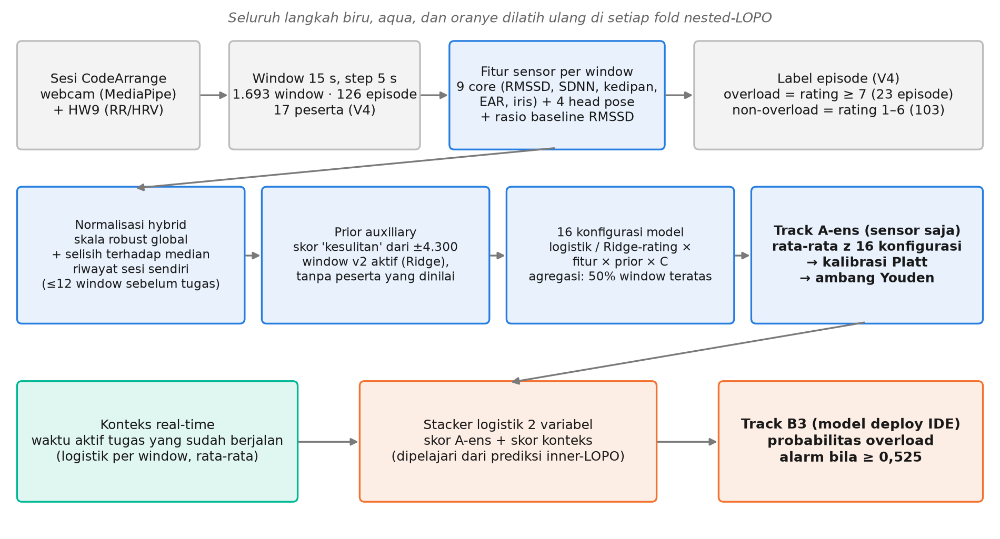

*Gambar 6. Pipeline pemodelan Batch 08.*

#### 4.9.1 Komponen pipeline

| Komponen | Pilihan |
|---|---|
| Fitur | core9 atau core9_head4_base (dipilih di pool) |
| Normalisasi | Hybrid: skala robust global + selisih terhadap median riwayat sesi sendiri sebelum tugas (fallback median fitting) |
| Prior auxiliary | Skor Ridge kesulitan protokol (easy 0 / medium 1 / hard 2) dari window V2 aktif peserta fitting; ya atau tidak |
| Model per window | Logistic Regression L2 (target biner) atau Ridge (target rating 1–10); C = 0,1 atau 0,5; bobot setara episode |
| Agregasi episode | Rata-rata 50% window dengan skor tertinggi |
| Track A-ens | Rata-rata skor z dari 16 konfigurasi → kalibrasi Platt seimbang → ambang Youden (inner-OOF) |
| Track B3 | Regresi logistik 2 variabel atas skor A-ens + skor konteks (logistik log waktu aktif tugas berjalan) |
| Ronde | 3 ronde: 648 konfigurasi (ronde 1) → 16 konfigurasi + stacking (ronde 2) → ensemble 16 konfigurasi (ronde 3, final) |

#### 4.9.2 Hasil utama (exp02 ronde 3, nested LOPO 17 peserta, 126 episode)

| Model | Input | AUC (CI 95%) | PR-AUC | Balanced acc. (CI 95%) | Akurasi | Recall · alarm palsu | Presisi | AUC dalam peserta |
|---|---|---|---:|---|---:|---|---:|---:|
| **Track A-ens** | Sensor | **0,826** (0,690–0,925) | 0,596 | **0,768** (0,634–0,881) | 78,6% | 17/23 · 21/103 | 44,7% | 0,712 |
| **Track B3** | Sensor + waktu tugas | **0,890** (0,772–0,967) | 0,753 | **0,840** (0,752–0,911) | **84,9%** | 19/23 · 15/103 | 55,9% | 0,885 |
| Track A (seleksi 1 konfigurasi) | Sensor | 0,802 (0,663–0,904) | 0,533 | 0,760 (0,659–0,854) | 74,6% | 18/23 · 27/103 | 40,0% | 0,702 |
| Track B (1 model sensor + waktu) | Sensor + waktu | 0,867 (0,763–0,947) | 0,701 | 0,806 (0,683–0,900) | 84,9% | 17/23 · 13/103 | 56,7% | 0,840 |
| Track B2 (stacking seleksi) | Sensor + waktu | 0,887 (0,775–0,959) | 0,685 | 0,855 (0,746–0,928) | 87,3% | 19/23 · 12/103 | 61,3% | 0,925 |
| Track B-ens | Sensor + waktu | 0,905 (0,813–0,964) | 0,751 | 0,843 (0,752–0,912) | 82,5% | 20/23 · 19/103 | 51,3% | 0,906 |
| Referensi Batch 06/07 (LogReg core9, 0,50) | Sensor | 0,778 | 0,493 | 0,741 | 65,9% | 20/23 · 40/103 | 33,3% | 0,645 |
| Konteks saja (log waktu berjalan) | Waktu | 0,818 | 0,476 | 0,811 | 80,2% | 19/23 · 21/103 | 47,5% | 0,909 |
| Tebakan mayoritas | — | 0,500 | 0,183 | 0,500 | 81,7% | 0/23 · 0/103 | — | — |

Model utama ronde 3 (A-ens dan B3) ditetapkan sebelum hasil ronde 3 dihitung. CI 95% berasal dari bootstrap per peserta (2.000 ulangan).

| Pembanding non-sensor (126 episode) | AUC |
|---|---:|
| Menit sejak episode pertama dalam sesi | 0,819 |
| Durasi aktif akhir episode | 0,816 |
| Jumlah window episode | 0,808 |
| Tingkat set soal | 0,776 |
| Pernah timeout | 0,736 |

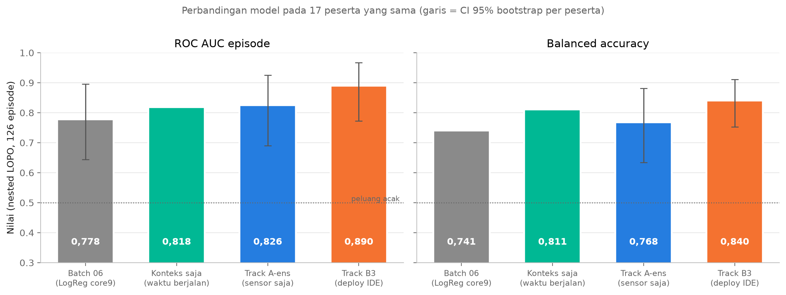

*Gambar 7. AUC dan balanced accuracy model Batch 08 dibanding referensi dan konteks saja.*

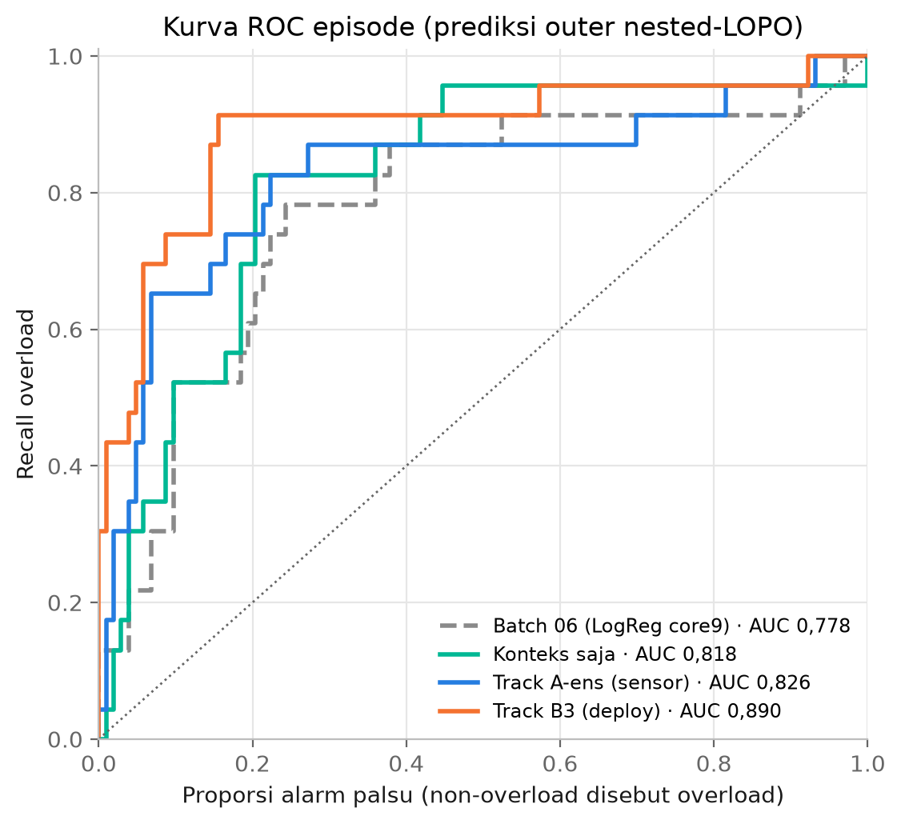

*Gambar 8. Kurva ROC tingkat episode.*

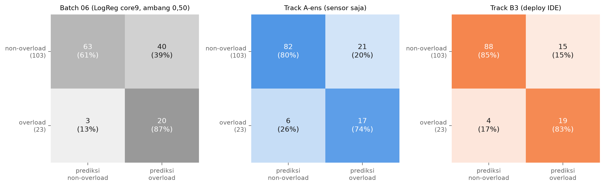

*Gambar 9. Matriks kebingungan referensi, Track A-ens, dan Track B3.*

#### 4.9.3 Uji statistik

| Uji | Hasil |
|---|---|
| Permutasi label rating 200×, seluruh pipeline nested diulang (Track A-ens) | 0/200 ≥ AUC asli; p = 0,005 (AUC dan balanced accuracy); AUC null rata-rata 0,465, persentil-95 0,638, maksimum 0,736 |
| A-ens di atas tingkat soal + log durasi + menit dalam sesi (likelihood ratio) | AUC 0,884 → 0,946; χ² = 24,07; p = 9,3 × 10⁻⁷ |
| A-ens di atas model waktu berjalan | AUC 0,818 → 0,894; χ² = 22,74; p = 1,9 × 10⁻⁶ |
| B3 di atas model waktu berjalan | AUC 0,818 → 0,890; χ² = 21,75; p = 3,1 × 10⁻⁶ |
| A-ens vs referensi (bootstrap berpasangan per peserta) | ΔAUC +0,048 (−0,050 s.d. +0,143; p = 0,141); ΔBalAcc +0,027 (−0,103 s.d. +0,146) |
| B3 vs referensi | ΔAUC +0,112 (−0,005 s.d. +0,243; p = 0,029); ΔBalAcc +0,100 (−0,014 s.d. +0,206; p = 0,042) |
| B3 vs konteks saja | ΔAUC +0,072 (−0,018 s.d. +0,156; p = 0,058); ΔBalAcc +0,029 (−0,048 s.d. +0,104) |
| Korelasi skor sensor vs durasi di dalam kelas yang sama | Spearman ≈ 0,00 |

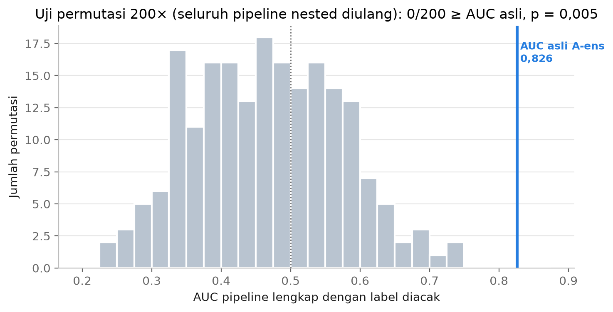

*Gambar 10. Distribusi AUC dengan label diacak dibanding AUC asli Track A-ens.*

#### 4.9.4 Riwayat ronde (exp02)

| Ronde | Pool | Track sensor AUC / BalAcc | Track sensor + waktu AUC / BalAcc |
|---|---|---|---|
| 1 | 648 konfigurasi; seleksi 1 per fold | 0,799 / 0,760 (Track A) | 0,835 / 0,780 (Track B) |
| 2 | 16 konfigurasi + stacking | 0,802 / 0,760 (Track A) | 0,887 / 0,855 (Track B2) |
| 3 (final) | Ensemble 16 konfigurasi | 0,826 / 0,768 (A-ens) | 0,890 / 0,840 (B3) |

#### 4.9.5 Sensitivitas definisi overload (Track A, seleksi tunggal)

| Definisi | Episode positif | AUC | Balanced accuracy |
|---|---:|---:|---:|
| Rating ≥ 6 | 34 | 0,669 | 0,619 |
| **Rating ≥ 7** | **23** | **0,802** | **0,760** |
| Rating ≥ 8 | 16 | 0,776 | 0,676 |

#### 4.9.6 Deteksi dini dan alarm online (exp03)

| T (detik aktif) | Episode berjalan (overload) | AUC A-ens (CI 95%) | AUC B3 (CI 95%) |
|---:|---|---|---|
| 30 | 98 (18) | 0,836 (0,665–0,959) | 0,850 (0,679–0,953) |
| 60 | 70 (20) | 0,877 (0,721–0,971) | 0,900 (0,765–0,982) |
| 90 | 47 (20) | 0,902 (0,757–0,987) | 0,898 (0,742–1,000) |
| 120 | 35 (18) | 0,863 (0,692–0,972) | 0,824 (0,579–0,965) |
| 180 | 22 (11) | 0,777 (0,556–0,948) | 0,736 (0,488–0,938) |

| Aturan alarm (minimal 2 window) | Recall overload | Alarm palsu | Balanced acc. | Median waktu alarm | Median waktu sebelum episode berakhir |
|---|---:|---:|---:|---:|---:|
| B3 | 82,6% | 13,6% | 0,845 | 63 s | 147 s |
| Timer saja (alarm palsu 13,6%) | 56,5% | 13,6% | 0,715 | 165 s | — |
| A-ens | 69,6% | 22,3% | 0,736 | 23 s | 160 s |
| Timer saja (alarm palsu 22,3%) | 78,3% | 22,3% | 0,780 | 97 s | — |

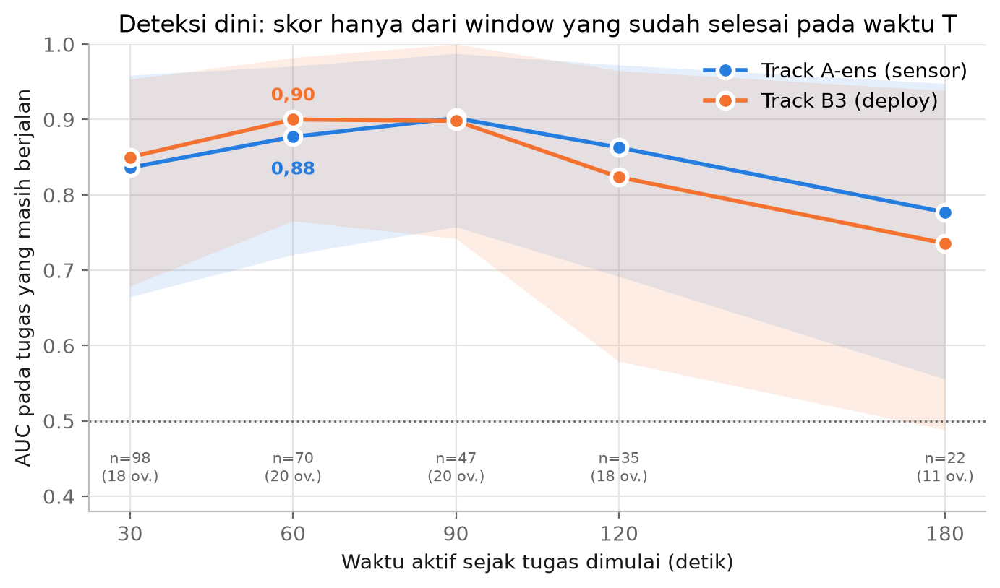

*Gambar 11. AUC pada tugas yang masih berjalan pada waktu T.*

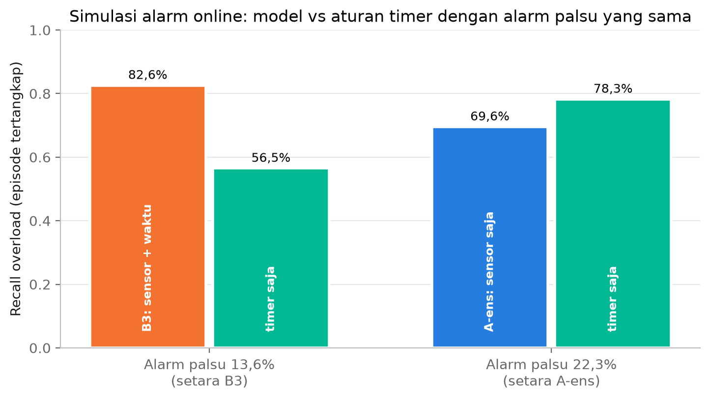

*Gambar 12. Recall alarm online dibanding aturan timer dengan alarm palsu yang sama.*

#### 4.9.7 Validasi silang V3 (exp04)

| Evaluasi | Episode (High) | AUC | Balanced acc. | Mayoritas | Spearman skor vs durasi (Non-High) |
|---|---|---:|---:|---:|---:|
| V3 LOPO Train (ensemble 8 konfigurasi biner) | 37 (16) | 0,432 | 0,542 | 56,8% | 0,240 |
| V3 validation | 10 (3) | 0,095 | 0,500 | 70,0% | −0,214 |
| V3 test historis | 18 (2) | 0,656 | 0,594 | 88,9% | 0,118 |

| Target pada 40 episode irisan V3∩V4 | Positif | AUC skor A-ens (CI 95%) | Referensi Batch 07 (V4 LogReg core9) |
|---|---:|---|---:|
| V3 High | 11 | 0,784 (0,548–0,949) | 0,712 |
| Rating ≥ 7 | 9 | 0,928 (0,813–1,000) | 0,774 |
| Keduanya tinggi | 7 | 0,922 (0,758–1,000) | 0,788 |
| Salah satu tinggi | 13 | 0,821 (0,606–0,958) | 0,721 |

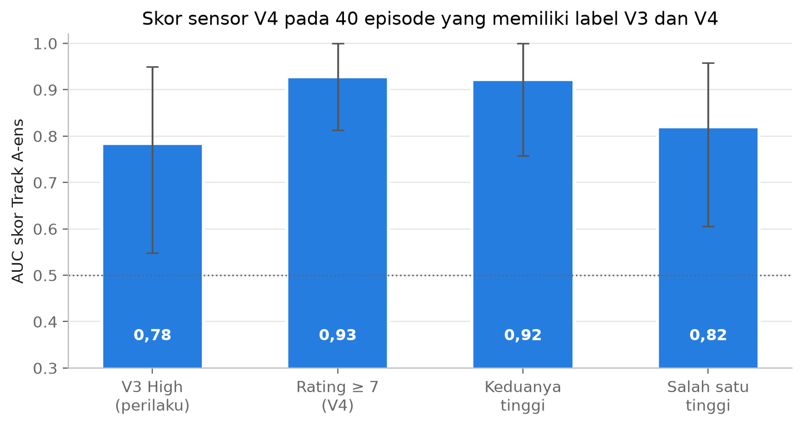

*Gambar 13. AUC skor A-ens pada 40 episode irisan V3∩V4.*

#### 4.9.8 Model final

| Aspek | Nilai |
|---|---|
| Berkas | `models/batch-08/final_model/b8_overload_model.json` (parameter), `b8_inference.py` (inferensi numpy) |
| Data latih | 17 peserta, 126 episode, 1.693 window |
| Ambang alarm | 0,525 (Youden pada prediksi out-of-fold) |
| Verifikasi | Selisih maksimum inferensi JSON vs scikit-learn 3,6 × 10⁻¹⁵ |
| Lingkungan | Python 3.14.6, scikit-learn 1.7.2, pandas 3.1.1, numpy 2.5.5, scipy 1.18.1 |

Sumber: `models/batch-08/exp0*/outputs/*/` (run resmi: `reference_20261127T031942Z_2fb708e7`, `nested_round3_20261127T031955Z_8703732e`, `early_20261127T032946Z_96acf8b7`, `v3check_20261127T033440Z_4cf196ee`), `models/batch-08/ROUNDS.md`.

## 5. Lampiran

### 5.1 Definisi metrik dan protokol

| Istilah | Definisi |
|---|---|
| Akurasi | Proporsi prediksi benar |
| Macro-F1 | Rata-rata F1 setiap kelas |
| Balanced accuracy | Rata-rata recall setiap kelas |
| AUC | Luas di bawah kurva ROC; peluang skor positif > skor negatif |
| PR-AUC | Average precision; nilai acuan = proporsi positif (0,183 pada V4 overload) |
| Mayoritas / Dummy | Selalu menebak satu kelas: kelas terbanyak Train (Dummy) atau kelas terbanyak pada data yang dinilai (mayoritas) |
| Blok waktu | Split berdasarkan blok waktu dalam sesi; peserta yang sama dapat berada di train dan test |
| LOPO | Leave-one-participant-out: satu peserta dinilai oleh model yang dilatih tanpa datanya |
| Nested LOPO | LOPO dengan seluruh pemilihan model/ambang dilakukan oleh LOPO kedua di dalam data latih |
| OOF | Out-of-fold: prediksi setiap baris dari fold yang tidak memakainya untuk fitting |
| AUC dalam peserta | Rata-rata AUC dihitung per peserta yang memiliki kedua kelas |
| CI 95% | Persentil 2,5–97,5 bootstrap per peserta |

### 5.2 Pemetaan folder dan judul dokumen batch

| Folder | Judul di dokumen batch |
|---|---|
| `models/batch-01` | Batch 00 (eksperimen awal) |
| `models/batch-02` | Batch-03: Model Tabular dan Deep Learning |
| `models/batch-03` | Batch-04: Normalisasi Sensor dan Seleksi Model |
| `models/batch-04` | Batch 04: Optimasi Model |
| `models/batch-05` | Batch 05 |
| `models/batch-06` | Batch 06 (V3 & V4) |
| `models/batch-07` | Batch 07 |
| `models/batch-08` | Batch 08 |

### 5.3 Berkas sumber

| Bagian | Berkas |
|---|---|
| Dataset | `analysis_sessions/dataset_fusion/output/` (folder `v1_active_task`, `v2_session_phase`, `v3_behavioral_proxy`, `v4_self_reported_rating`) |
| Protokol tugas | `codearrange-web/puzzles/`, `codearrange-web/puzzles/master_config.json` |
| Batch 01–05 | `models/batch-0X/SUMMARY.md`, `DIAGNOSIS.md`, `PLAN.md` |
| Batch 06 | `models/batch-06/SUMMARY.md`, `EVALUASI_V3_V4.md`, `v3/SUMMARY.md`, `v3/exp*/README.md`, `outputs/` |
| Batch 07 | `models/batch-07/exp0*/outputs/*/metrics.csv`, `SUMMARY.md`, `DIAGNOSIS.md` |
| Batch 08 | `models/batch-08/exp0*/outputs/*/`, `SUMMARY.md`, `ROUNDS.md`, `final_model/` |
