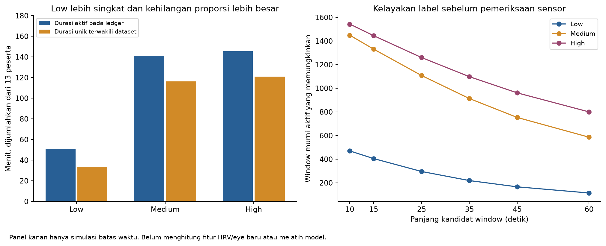
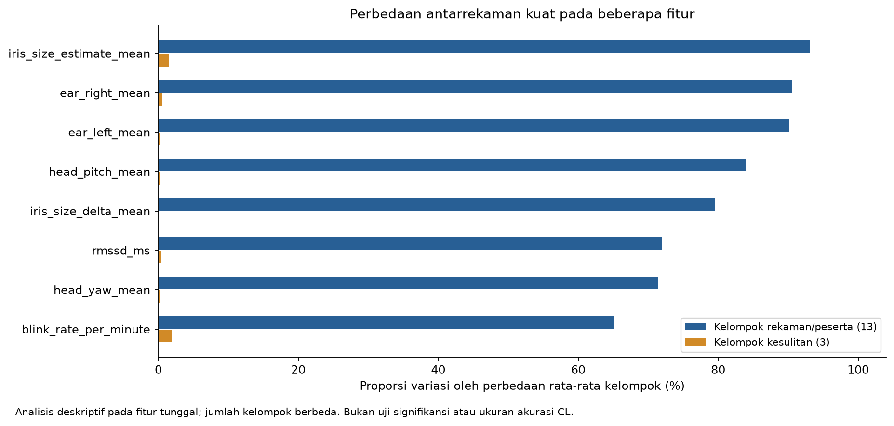

# Diagnosis Batch 01 dan Prioritas Batch Berikutnya

## Cakupan versi

Seluruh angka diagnosis ini merujuk dataset v1 dan hasil batch-01 yang tetap diarsipkan. Dataset v2 kemudian dibangun dengan aturan fase dan target `cognitive_load_label` yang baru; angka v1 di bawah bukan distribusi terkini v2. Pekerjaan dataset sudah selesai, sedangkan evaluasi model v2 dan penerimaan Low tambahan belum dijalankan. Rencana lanjutan terbaru ada pada [batch-02](../batch-02/PLAN.md).

## Ringkasan keputusan

**Batch-01 sudah selesai dieksekusi. Hasilnya belum cukup baik untuk menyatakan model mampu mengklasifikasikan cognitive load tiga tingkat lintas programmer.** Dua hal ini perlu dibedakan: penyelesaian eksperimen dan keberhasilan model.

Audit lanjutan ini memeriksa dataset, ledger tugas, pengukuran sensor, kode pipeline yang dipakai saat training, manifest fold, dan prediksi test. Audit juga menjalankan penghitungan ulang fitur sampel, analisis variasi antarrekaman, simulasi kelayakan window, serta probe identitas rekaman. Tidak ada perubahan pada data sumber, model terlatih, atau hasil exp01 sampai exp12.

Kesimpulan yang paling kuat adalah:

1. Low memiliki kesempatan perekaman lebih kecil sesuai protokol: easy 5 menit, medium 12 menit, hard 15 menit, dan sebagian peserta sengaja melewati easy. Window 25 detik dan pergantian fase menambah kehilangan relatif Low. Ini konsekuensi keterwakilan data, bukan bukti kegagalan pelaksanaan atau recorder.
2. Fitur mengandung perbedaan antarrekaman yang kuat. Beberapa fitur lebih mencerminkan offset rekaman/peserta daripada perubahan kesulitan dalam rekaman. Ini menjadi indikasi kuat masalah representasi untuk generalisasi antarpeserta.
3. Kualitas “good/acceptable” mengukur kelengkapan dan clipping, tetapi tidak mensyaratkan akurasi spasial gaze. Sebanyak 12 dari 13 peserta gagal pada validasi gaze asli dan dilanjutkan manual.
4. Model juga sering tertukar antara Medium dan High. Menambah Low saja belum menjawab masalah itu.
5. Ada ketidaksamaan kebijakan penerimaan baseline HRV antara perekaman dan pembangunan dataset. Dampaknya nyata pada fitur rasio satu peserta.
6. Pemilihan pipeline dari 154 kandidat belum berhasil mentransfer peringkat inner validation ke test. Memperluas pencarian model bukan prioritas pertama berikutnya.

**Imbalance terbukti ada, tetapi besar kontribusinya terhadap penurunan skor belum dapat dipastikan.** Percobaan class weight, ROS, dan SMOTE tidak memperbaiki macro-F1 pada konfigurasi yang sudah diuji. Hasil itu belum membuktikan bahwa tambahan rekaman Low asli tidak berguna. Tambahan rekaman dapat menambah keragaman yang tidak tersedia pada pengulangan/interpolasi data lama.

## Konteks penelitian yang menjadi acuan

Tujuan utama adalah satu classifier CL per window dari fitur eye tracking dan HRV selama pemrograman. Tujuannya bukan mengenali peserta, mengklasifikasikan soal, atau melatih satu model untuk setiap orang. CodeArrange merupakan instrumen pengambilan data dan penanda target. Metadata peserta/tugas boleh berada dalam CSV, tetapi tidak otomatis menjadi input classifier.

Pelurusan operator menetapkan dua fakta protokol: batas waktu easy/medium/hard memang 5/12/15 menit, dan sebagian peserta sengaja langsung mengerjakan medium/high karena keterbatasan waktu pelaksanaan. Batas waktu berbeda bukan galat sistem. Kelas yang tidak tersedia tidak otomatis berarti data hilang akibat perekaman. Pelurusan ini tidak menetapkan alasan spesifik untuk setiap sel nol; durasi singkat dan seleksi kualitas juga perlu dibedakan melalui bukti tiap sesi.

Batch-01 sudah memakai 26 fitur sensor melalui allowlist. `participant_id` dipakai untuk split/evaluasi, `difficulty_level` untuk target yang dipetakan menjadi CL, dan konteks sesi/soal untuk alignment, filtering, serta reset riwayat. ID peserta dan soal tidak dimasukkan sebagai fitur prediksi. Karena itu, temuan variasi antarrekaman membahas nilai sensor, bukan model yang membaca kolom nama.

Keputusan dataset: pertahankan tiga CSV sumber beserta metadata dan targetnya. Tidak perlu membuang kolom, mengubah label atau membuat data tambahan hanya untuk pelurusan konteks. Pemisahan fitur/target/metadata dan ketergantungan inference perlu dijaga di pipeline. [Konteks penelitian dan peran kolom](../README.md#konteks-penelitian-dan-peran-kolom) menjadi acuan bersama untuk plan berikutnya.

### Kesesuaian batch-01 dan batas implementasinya

Audit kode dan konfigurasi run menunjukkan bahwa classifier batch-01 sudah berfokus pada sensor per window, bukan fitur identitas peserta atau soal. Fitting model yang berbeda pada 13 fold melatih ulang algoritma pada gabungan peserta training untuk evaluasi. Cara itu tidak membentuk 13 classifier personal yang masing-masing dilatih khusus untuk satu peserta.

Bagian yang belum sepenuhnya lepas dari konteks CodeArrange adalah preprocessing temporal. Exp09 memakai peserta/sesi/waktu/soal untuk membatasi riwayat. Bank exp12 membawa kandidat yang sama, dan dua outer fold benar-benar memilihnya: `fold_01` dengan tiga window dan `fold_02` dengan lima window. ID soal tidak menjadi angka input classifier, tetapi pipeline tersebut tetap membutuhkannya untuk menentukan reset. Ini ketergantungan operasional yang perlu dibedakan dari pemilihan fitur.

Model refit akhir exp12 merupakan SVM RBF original tanpa riwayat, sehingga jalur fitur/prediksinya tidak memakai konteks soal. Pernyataan ini berasal dari konfigurasi tersimpan dan inspeksi kode, bukan pengujian ulang inference bobot model pada langkah dokumentasi ini. Skor nested selection tetap menilai prosedur yang memilih pipeline berbeda per fold, bukan hanya model refit tersebut.

Untuk batch berikutnya, pertahankan inti sensor-only tersebut. Model utama per-window harus dapat memprediksi dari fitur sensor tanpa nama peserta, ID soal, set, atau batas waktu CodeArrange. Jika memakai riwayat, rancang batas waktu/stream/sesi yang tersedia dalam aktivitas pemrograman umum; jangan mengganti ketergantungan soal dengan reset yang diam-diam membutuhkan label CL. Metadata offline tetap disimpan untuk audit dan evaluasi. Pengujian transfer tugas tetap terpisah dari pengujian lintas peserta.

Jadi kita tidak mempunyai bukti bahwa batch-01 gagal karena classifier dilatih dengan tujuan mengenali peserta atau konteks lama yang keliru. Yang perlu diperbaiki adalah ketergantungan temporal untuk penggunaan umum, interpretasi protokol dalam laporan, dan masalah sensor/representasi yang sudah diaudit. Pelurusan konteks tidak membatalkan skor lama dan tidak membenarkan perubahan angka hasil tanpa eksperimen baru.

Bukti tersimpan: [allowlist dasar dataset](../../analysis_sessions/dataset_fusion/output/v1_active_task/feature_columns.json), [pilihan setiap fold exp12](outputs/exp12/20261114T083026316937Z_full_final_77bd4e91/selected_candidates.json), dan [konfigurasi refit akhir](outputs/exp12/20261114T083026316937Z_full_final_77bd4e91/final_model_config.json). Saat audit, pemeriksaan juga memakai `models/shared/estimators.py` dan `models/shared/experiments/features.py`. Tim kemudian menghapus seluruh `models/shared`; hasil inspeksi di atas merupakan catatan audit sebelum penghapusan, bukan klaim bahwa sumber tersebut masih tersedia.

## 1. Cakupan dan cara membaca tingkat bukti

Laporan ini melengkapi [ringkasan 12 eksperimen](SUMMARY.md), bukan mengganti angka evaluasinya.

| Tingkat bukti | Arti |
|---|---|
| Terverifikasi | Dapat dihitung kembali dari data, ledger, kode, atau prediksi yang tersedia |
| Indikasi kuat | Didukung lebih dari satu pemeriksaan, tetapi belum mengisolasi sebab-akibat |
| Belum terbukti | Memerlukan pengukuran atau eksperimen terkontrol baru |

Masalah data yang terverifikasi tidak otomatis menjadi penyebab tunggal skor rendah. Contohnya, kegagalan validasi gaze membatasi kepercayaan pada lokasi tatapan, tetapi belum mengukur berapa poin accuracy yang hilang karenanya. Menghapus gaze pada satu eksperimen juga belum mengisolasi pengaruh semua bentuk galat mata.

Audit memakai `good_acceptable.csv`: 2.294 window dari 13 peserta, dengan Low 249, Medium 968, dan High 1.077. Hash dataset tetap `bbb4c93eca30aab6b896db887dfbb981abffe118fce385d0f9bd3d28e786247e`.

## 2. Pemeriksaan teknis sebelum menuduh dataset atau model

| Pemeriksaan | Hasil |
|---|---|
| Status exp01 sampai exp12 | Semua `full`, `complete`, 13 outer fold per eksperimen |
| Penghitungan ulang metrik | Seluruh 55 konfigurasi cocok dengan prediksi test tersimpan |
| Kesesuaian label | `y_true` seluruh konfigurasi cocok dengan `difficulty_level` pada ID window sumber |
| Pemisahan peserta | 156 catatan outer fold diperiksa; tidak ada peserta train yang masuk test, termasuk pada inner split |
| Kemurnian fase/kelas | Seluruh 2.294 window mempunyai segmen ledger `active_task` dengan kesulitan yang sesuai |
| HRV setelah fusi | RMSSD dan SDNN seluruh 2.294 window cocok dengan `hrv.csv` sumber |
| Sampel agregasi mata | 39 window: pertama/tengah/terakhir dari 13 rekaman; mean/std EAR kiri/kanan dan blink count cocok dengan CSV frame mentah |
| Rasio baseline | Nilai yang tersedia cocok dengan RMSSD window dibagi baseline yang lolos aturan dataset |
| Kesesuaian kode training | Seluruh 17 file kode/schema pada identitas runtime exp12 cocok dengan file yang sekarang tersimpan |
| Integritas sumber | 1.290 file yang menjadi sumber audit tidak berubah selama pemeriksaan |

Sebanyak 156 catatan berarti 12 eksperimen memakai 13 fold yang sama, bukan 156 fold independen. Penghitungan ulang mata merupakan pemeriksaan sampel untuk lima fitur, bukan audit setiap fitur pada setiap frame. Kecocokan nilai HRV dengan sumber memeriksa penyalinan/alignment fusi, bukan membuktikan sensor atau rumus preprocessing bebas dari semua galat.

Inspeksi kode menunjukkan preprocessing dan resampling berjalan pada training partition. Audit ini tidak melatih ulang classifier CL atau memuat ulang bobot model. Tidak ditemukan kesalahan pemetaan label, pencampuran peserta, atau penyalinan HRV yang menjelaskan skor rendah pada cakupan tersebut.

Sumber: [fold_integrity.csv](diagnostics/results/fold_integrity.csv), [sensor_feature_reaggregation.csv](diagnostics/results/sensor_feature_reaggregation.csv), [runtime_source_check.csv](diagnostics/results/runtime_source_check.csv), dan [manifest audit](diagnostics/results/audit_manifest.json).

## 3. Keterwakilan Low mengikuti protokol dan geometri window

### 3.1 Batas waktu berbeda merupakan rancangan protokol

Protokol memberi easy maksimum 5 menit, medium 12 menit, dan hard 15 menit; peserta dapat selesai lebih cepat. Sebagian peserta memang tidak diberi easy. Perbedaan kesempatan perekaman tersebut menjelaskan konteks durasi aktif berikut. Kita tidak boleh menyimpulkan bahwa recorder salah, menuntut durasi set disamakan, atau menghapus peserta yang sengaja melewati easy.

Audit merekonstruksi fase dari `task_events.csv` pada 13 rekaman yang masuk dataset. Durasi di bawah hanya mencakup rentang perekaman HRV tugas. Pengerjaan yang tidak pernah direkam sensor tidak dihitung sebagai data tersedia.

Satu *span aktif* adalah interval pengerjaan tanpa feedback/rating/jeda. Pergantian soal yang langsung berlanjut dan tetap aktif pada kesulitan yang sama boleh berada di span yang sama. Audit tidak memasukkan rating atau istirahat agar baris Low bertambah.

| Kelas | Aktif menurut ledger (menit) | Span aktif | Span <25 detik | Window murni sebelum kualitas | Window terpilih | Durasi unik terwakili (menit) | Durasi aktif terwakili |
|---|---:|---:|---:|---:|---:|---:|---:|
| Low | 50,84 | 72 | 27 | 296 | 249 | 33,42 | 65,73% |
| Medium | 141,18 | 123 | 17 | 1108 | 968 | 116,42 | 82,46% |
| High | 145,69 | 102 | 15 | 1260 | 1077 | 120,92 | 83,00% |

“Durasi unik terwakili” adalah gabungan interval window terpilih. Window yang overlap tidak dijumlahkan berulang. Misalnya, dua window 25 detik dengan selisih 5 detik mewakili 30 detik, bukan 50 detik.

Pengerjaan Low tersedia sekitar 50,84 menit secara total, sedangkan Medium/High masing-masing sekitar 141,18 dan 145,69 menit. Angka itu merupakan keterwakilan aktual dari protokol dengan waktu/cakupan tugas berbeda. Konsekuensi statistiknya relevan untuk pemodelan, tetapi perbedaannya sendiri bukan bukti cacat akuisisi.

Sebanyak 27 dari 72 span Low lebih pendek daripada 25 detik. Span itu mencakup sekitar 451,78 detik pengerjaan Low yang tidak dapat membentuk satu window penuh. Feedback dan rating juga memutus window di sekitar batasnya. Karena itu, Low kehilangan proporsi durasi yang lebih besar.

### 3.2 Filter kualitas bukan satu-satunya sumber kehilangan Low

Dalam 13 peserta yang sama, sebelum filter kualitas terdapat 296 window Low, 1.108 Medium, dan 1.260 High. Filter mengeluarkan 47 Low, 140 Medium, dan 183 High. Bahkan jika 47 Low yang buruk dimasukkan kembali, Low hanya menjadi 296.

Seluruh `all_data.csv`, termasuk peserta di luar cohort dan window poor, juga hanya mempunyai 373 Low dibanding 1.477 Medium dan 1.696 High. Ini bukan alasan melonggarkan filter. Data yang tersedia memang tidak mempunyai cadangan Low bersih yang cukup untuk menyamai dua kelas lain hanya dengan mengubah daftar penerimaan.



### 3.3 Memendekkan window menambah kelayakan, belum tentu mutu fitur

Audit mensimulasikan batas window dengan langkah 5 detik pada ledger dan rentang perekaman yang sama. Simulasi ini hanya menghitung peluang window murni pengerjaan, sebelum memeriksa RR, coverage mata, atau mutu fitur.

| Panjang window | Low | Medium | High |
|---|---:|---:|---:|
| 10 detik | 470 | 1449 | 1543 |
| 15 detik | 405 | 1331 | 1445 |
| 25 detik | 296 | 1108 | 1260 |
| 35 detik | 219 | 913 | 1098 |
| 45 detik | 166 | 753 | 961 |
| 60 detik | 114 | 586 | 800 |

Window 10 detik membuka 470 peluang Low, tetapi Medium/High juga bertambah menjadi 1.449/1.543. Jadi memendekkan window belum membuat kelas seimbang. Sebaliknya, window lebih panjang makin mengurangi Low.

**Yang terbukti:** durasi dan cakupan tugas sesuai protokol memberi Low lebih sedikit kesempatan menghasilkan data; pemotongan fase menambah kehilangan yang terukur. **Yang belum terbukti:** panjang window baru yang akan memberi accuracy tertinggi atau besarnya manfaat menambah Low asli. Mengubah panjang window sensor berbeda dari mengubah batas waktu set CodeArrange.

HRV ultra-short memerlukan validasi per fitur dan kondisi. Studi primer melaporkan hasil yang berbeda menurut durasi, metrik, dan metode penilaian. Kita tidak dapat memilih 10 detik hanya karena jumlah barisnya lebih banyak, atau menyatakan 25 detik pasti tidak sah. Lihat [Muñoz dkk., 2015](https://pmc.ncbi.nlm.nih.gov/articles/PMC4586373/) dan [evaluasi validitas/reliabilitas HRV ultra-short, 2021](https://pubmed.ncbi.nlm.nih.gov/33856258/). Kedua studi itu bukan validasi khusus HW9 dalam tugas CodeArrange.

Sumber hitungan: [retention_by_class.csv](diagnostics/results/retention_by_class.csv), [active_duration_and_retention.csv](diagnostics/results/active_duration_and_retention.csv), [active_spans.csv](diagnostics/results/active_spans.csv), dan [window_geometry.csv](diagnostics/results/window_geometry.csv).

## 4. Fitur membawa ciri khas rekaman yang kuat

Kolom identitas bukan sumber fitur dalam classifier CL. Perbedaan di bagian ini terdapat pada angka HRV/eye itu sendiri. Menghapus `participant_id` dari CSV tidak mengubah angka tersebut, tetapi dapat menghilangkan informasi untuk memastikan orang yang sama tidak tercampur antara train dan test. Pemakaian peserta sebagai grup evaluasi mendukung model sensor yang berlaku lintas programmer, bukan menggeser tujuan menjadi pemodelan perorangan.

### 4.1 Variasi antarrekaman lebih besar daripada pengelompokan kelas

Audit menghitung proporsi variasi fitur yang dapat dijelaskan oleh perbedaan rata-rata kelompok. Untuk setiap fitur, audit membandingkan kelompok rekaman/peserta dengan kelompok kesulitan. Audit juga menghitung tambahan variasi kelas setelah mengendalikan rata-rata per peserta melalui regresi indikator.

| Fitur | Variasi oleh kelompok rekaman | Variasi oleh kelompok kesulitan | Efek kelas setelah mengendalikan rekaman |
|---|---:|---:|---:|
| `rmssd_ms` | 71,92% | 0,35% | 5,54% |
| `rmssd_baseline_ratio` | 62,29% | 0,03% | 7,33% |
| `ear_left_mean` | 90,14% | 0,33% | 1,42% |
| `ear_right_mean` | 90,57% | 0,54% | 0,66% |
| `iris_size_estimate_mean` | 93,09% | 1,54% | 0,04% |
| `head_pitch_mean` | 83,97% | 0,21% | 5,92% |

Dua kolom pertama memakai total variasi fitur sebagai pembagi. Kolom terakhir memakai sisa variasi setelah rata-rata peserta dikendalikan, sehingga pembaginya berbeda. Persentase tersebut bukan accuracy, tidak harus dijumlahkan, dan bukan hasil uji signifikansi.

Pada 25 fitur nonkonstan, pengelompokan rekaman menjelaskan lebih banyak variasi daripada pengelompokan kesulitan. Median proporsi antarrekaman sekitar 57,24%, sedangkan median proporsi berdasarkan kelas sekitar 0,54%. Namun jumlah kelompok juga berbeda, 13 versus 3, dan window tidak independen. Angka ini dipakai sebagai deskripsi, bukan p-value atau bukti bahwa fitur tidak berguna bagi model nonlinear.



### 4.2 Probe identitas rekaman dengan pemisahan waktu

Untuk memeriksa apakah pola antarrekaman bertahan di waktu lain, audit melakukan uji tambahan:

1. Menipiskan window menjadi interval yang tidak overlap. Tersisa 560 window.
2. Menggunakan separuh awal setiap rekaman sebagai training dan separuh akhir sebagai test.
3. Memastikan tidak ada interval sensor yang sama di dua bagian.
4. Menghitung imputasi, scaling, dan centroid dari training saja.
5. Menebak **asal rekaman**, bukan Low/Medium/High, berdasarkan centroid terdekat.

| Kelompok fitur | Accuracy identitas rekaman | Balanced accuracy | Window training | Window test |
|---|---:|---:|---:|---:|
| all | 83,10% | 85,24% | 276 | 284 |
| hrv | 42,96% | 46,51% | 276 | 284 |
| eye | 82,04% | 83,86% | 276 | 284 |

Pembanding uniform untuk 13 identitas adalah sekitar 7,69% balanced accuracy. Fitur mata mencapai sekitar 82,04% accuracy identitas dan 83,86% balanced accuracy. Ini menunjukkan bahwa ciri khas rekaman tetap kuat di separuh waktu lain, meskipun rentang tugasnya dapat berbeda.

Uji ini sengaja menggunakan orang/rekaman yang sama pada dua bagian. **Ini bukan evaluasi generalisasi CL dan bukan alasan mengganti LOPO dengan split baris acak.** Satu peserta hanya mempunyai satu rekaman pada cohort ini, sehingga kita belum dapat memisahkan pengaruh biologi individu dari kamera, posisi kepala, pencahayaan, atau kondisi sesi. Istilah “ciri rekaman” lebih tepat daripada menyatakan model mengenali identitas biologis seseorang.

ID rekaman menjadi target hanya pada probe diagnostik ini. Probe tidak menambahkan ID peserta sebagai input model CL dan tidak mengusulkan pengenalan identitas sebagai aplikasi penelitian.

### 4.3 Dampak yang terlihat pada prediksi CL

Pada konfigurasi macro-F1 tertinggi, recall Low nol pada 6 dari 11 peserta yang memiliki Low. Sebanyak 25 dari 38 Low yang benar berasal dari satu peserta. Artinya, kemampuan mengenali Low belum tersebar merata.

Pada rekaman P13, dataset berisi 50 Low dan 95 Medium, tanpa window High terpilih. Model exp04 `logistic_absolute` memberi 140 dari 145 window label High. Menambah bobot Low secara global belum tentu memindahkan batas keputusan ke lokasi yang sesuai untuk rekaman seperti ini.

StandardScaler global yang sudah dipakai hanya menyetarakan skala training secara keseluruhan. Cara itu belum menghilangkan offset individu/rekaman. Rasio baseline HRV juga belum menyelesaikan masalah ini: fitur rasio masih memiliki proporsi antarrekaman sekitar 62,29%.

**Status diagnosis:** perbedaan fitur antarrekaman dan kegagalan transfer prediksi terverifikasi. Pengaruhnya sebagai penghambat generalisasi merupakan indikasi kuat. Audit belum mengisolasi faktor akuisisi atau biologis penyebab perbedaan tersebut.

Sumber: [feature_variance.csv](diagnostics/results/feature_variance.csv), [recording_identity_probe.csv](diagnostics/results/recording_identity_probe.csv), serta metrik per peserta pada [hasil exp04](outputs/exp04/20261114T075931531202Z_full_final_ee23635b/class_metrics.csv).

## 5. Kelengkapan data mata berbeda dari akurasi gaze

Sebanyak 12 dari 13 peserta pada cohort gagal memenuhi ambang validasi gaze asli dan dilanjutkan melalui `accepted_manual`. Hanya satu peserta mempunyai `passed_thresholds=true` pada validasi terakhir.

Ambang asli yang didokumentasikan pada audit sensor adalah median error ≤180 px, P95 ≤350 px, dan sudut maksimum ≤300 px. Dataset good/acceptable tidak memakai kelulusan validasi itu sebagai syarat. Gate dataset memeriksa coverage, ketersediaan gaze/iris, face/EAR, dan clipping, ditambah daftar review peserta.

Dengan demikian, baris dengan gaze lengkap dan sedikit clipping tetap dapat mempunyai lokasi yang meleset. Nama `good_only` juga bukan sertifikasi akurasi spasial. Pada cohort good_acceptable, median error validasi peserta yang gagal berkisar sekitar 166 sampai 646 px.

Dampak yang perlu dipisahkan:

- Mean/std gaze dan fitur eye-state memakai estimasi posisi/perubahan tatapan. Galat pemetaan, jitter, dan clipping dapat memengaruhi maknanya.
- EAR, kedipan, dan HRV tidak otomatis salah hanya karena pemetaan gaze gagal.
- Validasi gaze mengukur pengujian titik tertentu saat kalibrasi. Hasil itu bukan persentase frame coding yang salah.

Fitur iris juga bukan diameter pupil. Kode menghitung geometri landmark iris relatif terhadap lebar mata. MediaPipe Iris dirancang untuk landmark iris dan estimasi kedalaman, dengan asumsi diameter iris yang relatif tetap. Menyamakan `iris_size` dengan pupil dilation akan memberi interpretasi fisiologis yang tidak didukung implementasi. Rujukan primer: [Google Research tentang MediaPipe Iris](https://research.google/blog/mediapipe-iris-real-time-iris-tracking-depth-estimation/).

Kegagalan ini membatasi kepercayaan pada makna beberapa fitur. Namun exp03 tanpa gaze/eye-state tidak memperbaiki macro-F1 XGBoost, sehingga kita belum dapat menyatakan gaze adalah satu-satunya penyebab skor rendah. Menghapus semua peserta yang gagal validasi juga akan menyisakan satu peserta pada cohort ini dan menghilangkan evaluasi lintas peserta yang layak.

Sumber: [sensor_admission.csv](diagnostics/results/sensor_admission.csv), [laporan kualitas dataset](../../analysis_sessions/dataset_fusion/output/v1_active_task/QUALITY_REPORT.md), [audit sensor terdahulu](../../analysis_sessions/20261029_saved_session_audit/AUDIT.md), [agregasi dataset](../../analysis_sessions/dataset_fusion/build_dataset.py), dan [implementasi geometri mata](../../eye_tracking_prototype/eye_tracking_prototype.py).

## 6. Baseline HRV diterima recorder, tetapi ditolak aturan dataset

Satu peserta, P08, mempunyai 193 window tanpa `rmssd_baseline_ratio`. Nilai RMSSD/SDNN tugas tetap tersedia.

Penelusuran menunjukkan:

| Komponen | Hasil |
|---|---|
| Status baseline di `hrv.csv` | `ready`, alasan `target_reached` |
| Durasi baseline | Sekitar 199,94 detik |
| Durasi RR diterima | Sekitar 122,53 detik |
| Coverage baseline | 61,28% |
| Batas minimum coverage builder | 80% |
| Akibat pada dataset | Baseline dianggap tidak usable; rasio 193 window menjadi kosong |

Recorder dapat mencapai target RR diterima 120 detik dengan menunggu lebih lama. Builder lalu memakai syarat tambahan coverage ≥80%. Jadi status `ready` dari recorder tidak menjamin baseline bisa dipakai untuk rasio pada pemodelan.

Ini perbedaan kebijakan yang terverifikasi, bukan kesalahan pembagian angka saat membuat CSV. Mengisi rasio dari nilai baseline yang ditolak tanpa mengubah kebijakan secara eksplisit akan menyembunyikan masalah kualitas.

Exp04 tanpa rasio baseline memberi macro-F1 0,3389 dibanding 0,3294 pada clean yang memakainya. Selisih itu belum membuktikan bahwa 193 nilai kosong menyebabkan perbedaan tersebut, karena penghapusan rasio memengaruhi semua peserta. Kita belum memiliki eksperimen yang mengisolasi baseline yang diperbaiki.

Perbaikan berikutnya perlu membedakan normalisasi dari baseline yang valid, fallback tanpa baseline, dan kebijakan pengulangan baseline saat akuisisi. Jangan memakai seluruh rekaman test atau label test untuk membentuk baseline.

Sumber: [sensor_admission.csv](diagnostics/results/sensor_admission.csv), [aturan penerimaan baseline pada builder](../../analysis_sessions/dataset_fusion/build_dataset.py), serta [alur baseline recorder](../../hrv_monitor_prototype/calibrate.py).

## 7. Imbalance bukan penjelasan lengkap atas kesalahan model

### 7.1 Model Logistic tidak sekadar menghindari Low

Terdapat 249 Low pada test gabungan. Perbandingan berikut memakai kontrol dan balancing Logistic pada fitur clean.

| Kondisi | Semua prediksi Low | Low yang benar | Salah memberi Low pada kelas lain | Precision Low | Recall Low | Macro-F1 tiga kelas |
|---|---:|---:|---:|---:|---:|---:|
| Kontrol | 447 | 45 | 402 | 10,07% | 18,07% | 0,3294 |
| Pemilihan class weight | 447 | 45 | 402 | 10,07% | 18,07% | 0,3294 |
| ROS | 838 | 67 | 771 | 8,00% | 26,91% | 0,3042 |
| SMOTE | 800 | 65 | 735 | 8,13% | 26,10% | 0,3085 |

Kontrol menebak Low pada sekitar 19,49% window, lebih besar daripada proporsi Low asli 10,85%. Masalahnya mencakup lokasi batas keputusan dan keterpisahan fitur, bukan hanya jumlah kesempatan model memberi label Low.

Sebaliknya, Extra Trees hanya menebak Low pada 21 window dan benar pada dua. Pola bias berbeda menurut model. Kita tidak dapat menempelkan diagnosis “semua model hanya menebak kelas mayoritas” pada seluruh batch.

### 7.2 Medium dan High belum terpisah dengan baik

Pada konfigurasi macro-F1 tertinggi, model menukar 351 Medium menjadi High dan 480 High menjadi Medium. Totalnya 831 window. Accuracy pada window yang label acuannya Medium/High hanya sekitar 43,37%, dengan prediksi Low tetap dihitung salah.

Angka ini bukan evaluasi binary classifier yang dilatih ulang. Angka itu menunjukkan bahwa kegagalan model tiga kelas juga terjadi pada data dari dua kelas besar.

Median RMSSD High lebih tinggi daripada Medium pada 8 dari 11 rekaman yang memiliki keduanya, dan lebih rendah pada tiga rekaman. Ini memperlihatkan bahwa arah perubahan fitur tunggal tidak seragam. Kita tidak boleh langsung membalik label berdasarkan anggapan bahwa satu ukuran HRV harus mengikuti arah tertentu pada semua orang. Model nonlinear tetap mungkin memanfaatkan kombinasi fitur; audit ini belum membuktikan kelas sepenuhnya tidak dapat dipisahkan.

### 7.3 Apa yang dapat disimpulkan tentang penambahan Low

Penambahan **rekaman Low asli** tetap beralasan karena durasi, keragaman rekaman, dan jumlah blok aktif Low terbatas. ROS/SMOTE hanya mengolah informasi lama, sehingga hasilnya tidak menjawab manfaat peserta/rekaman baru.

Tetapi menaikkan jumlah baris Low secara sintetis bukan solusi yang telah terbukti pada data ini. Jumlah kelas yang sama juga bukan syarat yang menjamin model baik. Ukur hasil melalui macro-F1, recall/precision per kelas, dan generalisasi per peserta, bukan melalui keseimbangan hitungan saja.

Sumber: [class_errors.csv](diagnostics/results/class_errors.csv), [arah perubahan dalam rekaman](diagnostics/results/within_recording_class_direction.csv), dan [confusion matrix exp04](outputs/exp04/20261114T075931531202Z_full_final_ee23635b/logistic_absolute_confusion_counts.csv).

## 8. Ukuran informasi dan pemilihan pipeline masih terbatas

### 8.1 Overlap menambah baris tanpa menambah peserta

Window 25 detik dengan langkah 5 detik berbagi 80% rentang waktu pada tetangga langsung. Penipisan yang tidak overlap menyisakan 560 window, termasuk 66 Low pada hasil diagnostik exp12.

Angka 560 bukan estimasi jumlah sampel independen secara statistik. Dua window yang tidak overlap masih dapat berkorelasi, dan jumlah peserta tetap 13. Sebaliknya, overlap juga tidak menjadi kebocoran train/test lintas peserta pada LOPO yang sudah diverifikasi.

### 8.2 Kandidat terbaik di inner belum tentu baik untuk peserta test

Pada exp12, macro-F1 inner kandidat terpilih berkisar 0,3494 sampai 0,3803. Rata-rata outer macro-F1 tiga kelas per peserta hanya sekitar 0,2131. Rata-rata ini berbeda dari macro-F1 OOF gabungan 0,2695 karena cara agregasinya berbeda.

Pada perbandingan per-fold dengan Logistic kontrol, nested selection lebih baik pada enam peserta, lebih buruk pada lima, dan sama pada dua. Penurunan pada sejumlah peserta besar cukup untuk menurunkan skor gabungan. Jadi hasilnya bukan “semua fold gagal”, tetapi keputusan seleksi belum memberi peningkatan keseluruhan yang konsisten.

Peringkat inner memakai kelompok peserta yang berbeda dari outer test, jumlah training berbeda, dan tiga kelompok validasi. Audit ini tidak memisahkan pengaruh banyaknya kandidat, komposisi peserta, atau shift fitur secara kausal. Memilih kandidat dari outer leaderboard setelah melihat hasil juga tidak memperbaiki validitas seleksi.

### 8.3 Fitur duplikat sudah ditemukan, tetapi bukan penjelasan utama

Audit numerik memverifikasi:

- `blink_rate_per_minute = 2.4 * blink_count` untuk window 25 detik, sampai galat pembulatan numerik.
- `iris_size_delta_std` sama dengan `iris_size_estimate_std`, sampai galat numerik. Pengurangan baseline konstan tidak mengubah standard deviation.
- `eye_state_other_ratio` konstan nol.

Exp04 clean sudah menghapus ketiganya dan tidak mengubah hasil dibanding original untuk model yang diuji. Jadi redundansi nyata, tetapi penghapusan itu bukan perbaikan yang terbukti menyelesaikan performa.

Sumber: [selection_transfer.csv](diagnostics/results/selection_transfer.csv), [redundant_features.csv](diagnostics/results/redundant_features.csv), dan [hasil exp12](outputs/exp12/20261114T083026316937Z_full_final_77bd4e91/RESULTS.md).

## 9. Label proxy dan urutan tugas membatasi kesimpulan penelitian

Pada 11 rekaman yang menjalankan ketiga kesulitan, urutannya selalu easy, medium, lalu hard. Dua rekaman lain hanya mempunyai sebagian urutan tersebut. Operator mengonfirmasi bahwa sebagian peserta memang sengaja melewati easy; urutan parsial tidak otomatis berarti recorder gagal. Ada pula rekaman yang sempat membuka hard tetapi tidak menghasilkan window hard terpilih, sehingga tidak semua kelas nol dapat dijelaskan hanya oleh keputusan melewati easy.

Karena kesulitan terikat posisi waktu, dataset ini tidak dapat memisahkan efek kesulitan dari adaptasi, kelelahan, atau perubahan kondisi sepanjang sesi secara bersih. Kita belum membuktikan bahwa salah satu efek itu menyebabkan skor rendah. Confounding urutan merupakan keterbatasan desain yang terverifikasi.

Label yang dipakai tetap berasal dari kesulitan tugas. Laporan kualitas dataset menyatakan tidak ada label keadaan kognitif independen yang dikumpulkan sebagai ground truth. Data ini mendukung pengujian prediksi kondisi tugas sebagai proxy CL, tetapi belum membuktikan bahwa setiap easy benar-benar Low pada individu yang mengerjakannya.

Meningkatkan accuracy pada label tugas dan memvalidasi bahwa label mewakili cognitive load merupakan dua pekerjaan berbeda. Tujuan akhir tetap klasifikasi CL pada pemrograman secara umum. Evaluasi aktivitas di luar CodeArrange belum tersedia.

Sumber: [task_order.csv](diagnostics/results/task_order.csv) dan [definisi target pada laporan dataset](../../analysis_sessions/dataset_fusion/output/v1_active_task/QUALITY_REPORT.md).

## 10. Daftar masalah menurut kekuatan bukti

| Masalah | Bukti yang tersedia | Kesimpulan yang aman |
|---|---|---|
| Low kurang terwakili sesuai protokol waktu/cakupan | Easy/medium/hard 5/12/15 menit, sebagian peserta sengaja melewati easy; Low terpilih 249 window | Konsekuensi statistik desain, bukan kegagalan recorder; manfaat tambahan Low asli perlu diuji |
| Pemotongan fase lebih merugikan Low | Hanya 65,73% durasi aktif Low terwakili vs 82,46%/83,00% | Efek mekanisme window terverifikasi |
| Perbedaan antarrekaman kuat | Variasi fitur dan probe identitas waktu-terpisah | Indikasi kuat hambatan generalisasi; asal biologis/perangkat belum terpisah |
| Gaze tidak tervalidasi pada sebagian besar cohort | 12/13 gagal ambang asli dan dilanjutkan manual | Risiko mutu fitur spasial terverifikasi; besar dampak pada skor belum diisolasi |
| Kebijakan baseline berbeda antarkomponen | Baseline ready dengan coverage 61,28% ditolak builder | Missing rasio dan ketidaksamaan kebijakan terverifikasi |
| Medium/High juga sulit dikenali | 831 pertukaran langsung pada konfigurasi teratas | Kesalahan tidak hanya berasal dari Low |
| Pemilihan pipeline belum mentransfer hasil inner | Skor nested dan variasi per-fold | Prosedur yang diuji belum memberi peningkatan; penyebab seleksi belum tunggal |
| Redundansi fitur | Dua hubungan numerik dan satu kolom konstan | Terverifikasi, sudah dicoba dibersihkan tanpa perbaikan skor |
| Urutan tugas terikat kesulitan | Urutan tiga tingkat sama pada 11 rekaman | Confounding desain; belum terbukti sebagai penyebab penurunan accuracy |
| Label CL hanya proxy tugas | Definisi target dan ketiadaan validasi independen | Batas validitas target, bukan bukti semua label salah |
| Kebocoran peserta atau label tertukar | Tidak ditemukan pada pemeriksaan manifest/prediksi | Jangan menganggapnya penyebab tanpa bukti baru |
| “Metadata peserta/CodeArrange masuk sebagai fitur dan menyebabkan skor rendah” | Allowlist batch-01 hanya berisi fitur sensor; ID/konteks digunakan di luar input classifier | Bukan penjelasan yang didukung pipeline ini; menghapus metadata tidak menghilangkan variasi sensor |
| “Algoritma pasti salah” atau “butuh model lebih kompleks” | Enam keluarga model sudah dicoba | Belum ada bukti mendukung diagnosis itu |

Kita dapat memastikan sejumlah masalah pengukuran, keterwakilan, dan representasi. Kita belum dapat membagi penurunan accuracy menjadi persentase sebab masing-masing tanpa eksperimen terkontrol.

## 11. Prioritas batch berikutnya

Prioritas berikut merupakan gambaran pekerjaan dari diagnosis, bukan hasil eksperimen baru. Rencana lanjutannya sekarang tersedia pada [PLAN batch-02](../batch-02/PLAN.md), mencakup sekitar lima anggota tim baru dan kemungkinan sesi easy tambahan dari peserta lama. Dataset tambahan, notebook, dan training batch-02 belum dibuat pada tahap penulisan rencana tersebut.

### Prioritas 0: pertahankan model sensor per-window dan kunci kontrak evaluasi

Goal tetap klasifikasi CL dari eye tracking dan HRV. Jangan mengubahnya menjadi klasifikasi peserta, klasifikasi set, atau kewajiban satu model personal per orang. Pisahkan `X` sensor, `y` label proxy CL, dan metadata operasional melalui allowlist. Untuk pelurusan konteks ini, CSV sumber dan pemetaan label tidak perlu diubah.

Pertahankan LOPO sebagai evaluasi utama untuk programmer yang tidak masuk training. Identitas peserta lintas sesi harus dikelompokkan bersama. Pakai macro-F1 sebagai metrik utama, disertai balanced accuracy, precision/recall/F1 per kelas, confusion matrix, dan hasil per peserta.

Grup peserta digunakan untuk evaluasi, bukan fitur yang wajib diketahui saat prediksi. Model utama per-window harus dapat menerima fitur sensor tanpa nama peserta, ID soal, set atau batas waktu CodeArrange. Bila memakai riwayat, definisikan batas waktu/stream yang dapat tersedia di luar CodeArrange. Exp09 lama memakai soal untuk reset riwayat; metadata tersebut bukan fitur numerik, tetapi ketergantungan operasionalnya tidak otomatis cocok untuk aplikasi pemrograman umum.

Untuk batch-02, gunakan seluruh dataset terbaru sebagai sumber evaluasi mandiri dan bekukan manifest test antarkonfigurasi di batch itu. Tidak perlu membandingkan skor dengan batch-00/batch-01. Penurunan jumlah peserta/window test tidak boleh disamarkan sebagai peningkatan model; perbandingan kandidat window harus melaporkan coverage.

Nyatakan bahwa label kesulitan masih proxy CL. Jangan mengganti label berdasarkan prediksi model atau memaksa label fisiologis agar mengikuti dugaan arah HRV.

**Hasil yang diperlukan:** versi dataset, manifest peserta/window, definisi target, dan aturan pembandingan yang disepakati. Evaluasi grouped sesuai dengan tujuan generalisasi yang dijelaskan pada [dokumentasi scikit-learn](https://scikit-learn.org/stable/modules/cross_validation.html#cross-validation-iterators-for-grouped-data).

### Prioritas 1: perbaiki representasi antarrekaman dan pisahkan mutu tiap kelompok sensor

Gunakan model referensi yang tetap untuk membandingkan fitur absolut dengan representasi yang mengurangi offset rekaman. Kandidat yang layak dirancang meliputi fitur perubahan/relatif terhadap baseline yang valid, atau subset yang mengurangi dominasi mean geometris seperti EAR/iris/head pose. Ini perlu diuji, bukan langsung membuang semua fitur tersebut.

Jika baseline peserta target dipakai, baseline harus berasal dari fase yang tersedia sebelum prediksi, tanpa label tugas dan tanpa membaca masa depan. Audit kecukupannya terlebih dahulu. Whole-session centering pada seluruh test bukan pengganti baseline online yang sah.

Normalisasi dari baseline sensor yang valid tidak sama dengan melatih classifier berbeda untuk setiap orang. Ini kandidat representasi bagi model umum, bukan kewajiban personalisasi atau penambahan ID peserta ke fitur.

Pisahkan fitur gaze/eye-state dari EAR/kedipan dan HRV. Periksa ulang kriteria kualitas agar “frame tersedia” tidak ditafsirkan sebagai “lokasi benar”. Untuk data lama, gunakan ablation dan analisis sensitivitas yang terdefinisi. Jangan menyisakan satu peserta dengan menghapus 12 rekaman secara membabi buta.

Selaraskan interpretasi dan kebijakan baseline HRV: ready recorder, usable builder, serta fallback model. Jangan mengisi rasio baseline yang ditolak sebagai angka seolah-olah kualitasnya baik.

**Hasil yang diperlukan:** bukti apakah representasi baru memperbaiki prediksi per peserta pada fold yang sama, bukan hanya menurunkan statistik identitas rekaman.

### Prioritas 2: uji window dari RR/eye mentah dengan validasi mutu fitur

Pertahankan 25 detik/step 5 sebagai kontrol. Tentukan kandidat pendek/panjang yang terbatas setelah memeriksa jumlah pasangan RR, coverage, dan kestabilan RMSSD/SDNN. Simulasi geometri dalam laporan ini membantu menghitung biaya kehilangan data, tetapi belum memilih pemenang. Eksperimen ini mengubah interval sensor, bukan menyamakan batas waktu easy/medium/hard yang memang berbeda dalam protokol.

Penghitungan ulang fitur dari RR/eye mentah sudah dilaksanakan pada dataset v2, dengan varian 15/25/45 detik dan step 5. Protokol v2 memberi Low pada easy/practice/demo aktif serta pre-task setelah kalibrasi, feedback, rating, jeda, dan post-task; active medium/hard tetap Medium/High. Semua bagian window harus memiliki target yang sama. Lihat [laporan v2](../../analysis_sessions/dataset_fusion/output/v2_session_phase/QUALITY_REPORT.md). Ini persiapan dataset, bukan hasil training atau perubahan angka batch-01.

Pertimbangkan perbedaan kebutuhan temporal eye dan HRV jika satu panjang window tidak memberi kompromi yang baik. Detail alignment dan aturan labelnya perlu ditetapkan sebelum implementasi. Evaluasi harus memisahkan perubahan mutu fitur dari perubahan cohort test.

**Hasil yang diperlukan:** kandidat window yang mempertahankan data Low sambil memenuhi syarat sensor, lalu perbandingan model terkontrol. Jangan memilih window dari jumlah baris saja.

### Prioritas 3: tambah rekaman Low asli setelah protokol dan kualitas dikunci

Pengambilan Low tambahan tetap beralasan dan dapat dipersiapkan paralel. Rencanakan jumlah sesi/tugas dan durasi aktif yang dapat menghasilkan window dengan kualitas layak dalam protokol yang disetujui. Total waktu duduk atau membuka halaman tidak sama dengan durasi aktif. Jangan menyamakan waktu semua set atau menganggap peserta yang sengaja melewati easy sebagai sesi rusak hanya demi keseimbangan jumlah baris.

Jika sumber daya hanya memungkinkan Low, catat batas tersebut. Pertahankan kondisi perangkat, pencahayaan, baseline, dan prosedur sedekat mungkin dengan data lama. Pengambilan baru yang seluruhnya Low berisiko membuat batch/tanggal/perangkat berkaitan dengan label. Bila memungkinkan, gunakan kembali peserta lama agar kelas Low tidak hanya berasal dari kelompok orang yang berbeda.

Semua sesi orang yang sama tetap berada dalam satu grup evaluasi. Saat orang tersebut menjadi test, sesi tambahannya tidak boleh masuk training. Peserta baru yang hanya mempunyai Low memerlukan pelaporan cakupan kelas yang jelas, bukan dianggap sebagai pengujian tiga kelas lengkap.

Rencana batch-02 tidak mencakup pembandingan sebelum–sesudah tambahan Low. Gabungkan data yang valid, audit dataset terbaru, lalu evaluasi seluruhnya dengan baseline dan manifest batch-02 sendiri. Asal lama/tambahan tetap dicatat untuk provenance, bukan kondisi eksperimen terpisah.

**Hasil yang diperlukan:** tambahan blok aktif dan keragaman Low yang berkualitas, beserta provenance dan evaluasi internal dataset terbaru. Manfaat penambahan data sebelum–sesudah tidak menjadi klaim hasil batch-02.

### Prioritas 4: baru bandingkan balancing dan model pada representasi/data yang diperbaiki

Gunakan kontrol tanpa balancing. Class weight, ROS, dan SMOTE tetap merupakan kondisi terpisah. Ulangi penilaiannya jika representasi atau dataset berubah, bukan karena mengharapkan menjalankan ulang konfigurasi lama memberi skor baru.

Mulai dengan sedikit model referensi dan bank parameter terbatas. Tunda pencarian gabungan yang luas sampai ada perlakuan yang memperbaiki hasil pada sebagian besar peserta atau metrik gabungan tanpa merusak Low/kelas lain. Hindari memilih seed atau kandidat menggunakan outer test.

Resampling tetap dilakukan pada training fold setelah preprocessing yang sesuai. [Dokumentasi imbalanced-learn](https://imbalanced-learn.org/stable/common_pitfalls.html) menjelaskan kebocoran jika seluruh dataset di-resample sebelum split.

**Hasil yang diperlukan:** peningkatan yang dapat diatribusikan pada satu perubahan, dengan perbandingan berpasangan dan ketidakpastian tingkat peserta.

### Prioritas 5: validasi makna label dan cakupan aplikasi

Untuk data berikutnya, pertimbangkan ukuran beban kognitif independen yang sesuai rancangan penelitian serta pengaturan urutan tugas yang mengurangi keterikatan kesulitan dengan waktu. Protokol baru perlu disepakati tim, bukan diterapkan diam-diam pada data lama.

Setelah hasil lintas peserta cukup kuat dalam CodeArrange, siapkan pengujian pada aktivitas pemrograman lain. Langkah itu diperlukan sebelum menyimpulkan model dapat dipakai pada coding/debugging di IDE secara umum.

**Hasil yang diperlukan:** bukti validitas target dan transfer tugas, bukan hanya skor klasifikasi kesulitan soal.

## 12. Catatan reproduksi dan serah-terima

Audit tambahan tersimpan terpisah dari `outputs/exp01` sampai `exp12`.

| Lokasi | Kegunaan |
|---|---|
| [audit_batch01.py](diagnostics/audit_batch01.py) | Mengulang pemeriksaan arsip, durasi, geometri window, variasi fitur, dan probe identitas |
| [test_audit_batch01.py](diagnostics/test_audit_batch01.py) | Tujuh fixture untuk rumus metrik, union interval, thinning, dan probe waktu-terpisah |
| [results/](diagnostics/results/) | CSV bukti per peserta/kelas/fitur dan manifest hash sumber |
| [figures/](diagnostics/figures/) | Dua grafik diagnosis dari tabel audit |
| [SUMMARY.md](SUMMARY.md) | Rekap konfigurasi dan hasil asli 12 eksperimen |

Perintah historis dari root repositori saat dependensi audit masih lengkap:

```powershell
python models/batch-01/diagnostics/test_audit_batch01.py
python models/batch-01/diagnostics/audit_batch01.py
```

**Status setelah pembersihan:** `models/shared` sudah dihapus. Kedua perintah di atas bergantung pada file di folder tersebut dan tidak dapat dijalankan dari kondisi repositori sekarang tanpa pemulihan. Script dan hasil audit tetap disimpan sebagai arsip; catatan 42 tes berikut merujuk validasi sebelum penghapusan, bukan pengujian ulang saat pembersihan.

Audit memerlukan NumPy, pandas, SciPy, dan Matplotlib. Run diagnosis ini memakai Python 3.14.6, NumPy 2.5.1, pandas 3.0.3, dan SciPy 1.18.0. Environment ini berbeda dari environment training tersimpan. Audit tidak memuat model terlatih dan tidak mengklaim mereproduksi fitting dari environment baru.

Validasi yang selesai pada penulisan laporan: tujuh tes audit, 22 tes dataset fusion, dan 13 tes penanda aktivitas/sinkronisasi, total 42 tes. Tes fusion/sinkronisasi memakai fixture sementara, bukan mengubah sesi penelitian. Pemeriksaan syntax script juga lulus.

Batas yang harus dipertahankan tim atau LLM berikutnya:

- Goal utama adalah satu classifier CL berbasis fitur sensor per window. Peserta dan CodeArrange menyediakan metadata operasional, bukan sasaran prediksi.
- Batas waktu easy/medium/hard 5/12/15 menit dan sebagian peserta melewati easy merupakan kondisi protokol yang disengaja, bukan otomatis kesalahan akuisisi.
- Pertahankan metadata sumber untuk audit/split, tetapi jangan masukkan ID, nama set/soal atau batas waktu set ke fitur model utama. Jangan menambahkan label duplikat atau mengganti target hanya karena metadata masih ada di CSV.
- Jadikan laporan ini masukan untuk plan terpisah di batch-02. Jangan mengubah angka batch-01.
- Jangan menganggap simulasi geometri sebagai hasil model dengan window baru.
- Jangan mengutip accuracy probe identitas rekaman sebagai accuracy cognitive load.
- Jangan menyamakan iris landmark dengan pupil diameter, atau quality tier dengan akurasi gaze.
- Jangan memakai label test, seluruh masa depan rekaman test, maupun orang test untuk fitting preprocessing/model.
- Jangan menambahkan data sintetis sebelum split atau menilai sintetis sebagai pengukuran peserta baru.
- Jangan membandingkan macro-F1 rata-rata per peserta dengan macro-F1 OOF gabungan tanpa menjelaskan perbedaan agregasi.
- Jangan menghapus peserta/fitur hanya karena menurunkan outer test yang sudah dilihat.
- Rancang setup batch-02 agar dapat direproduksi tanpa mengubah versi kode yang mendasari arsip batch-01. Setup eksekusi lama yang pernah dihapus tidak dipulihkan oleh audit ini.
- Catat identitas peserta tetap sensitif. Alias pada grafik tidak menganonimkan CSV sumber maupun manifest.

Bukti saat ini mendukung perubahan data/representasi yang terarah dan pengambilan Low tambahan yang terkontrol. Bukti tersebut belum mendukung janji bahwa satu perbaikan tertentu akan menaikkan accuracy ke angka tertentu.
