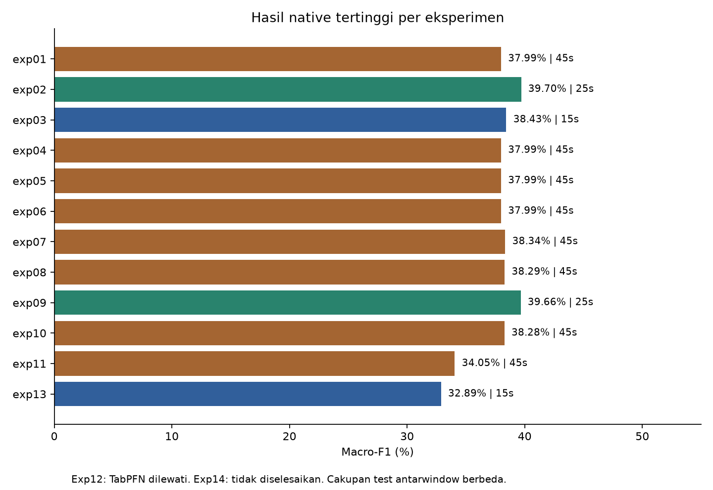
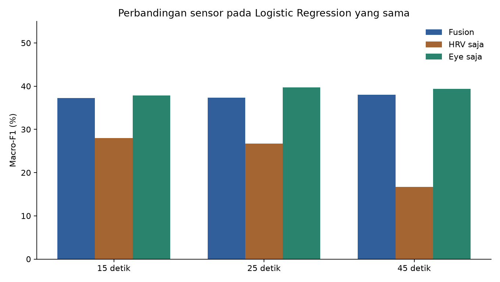
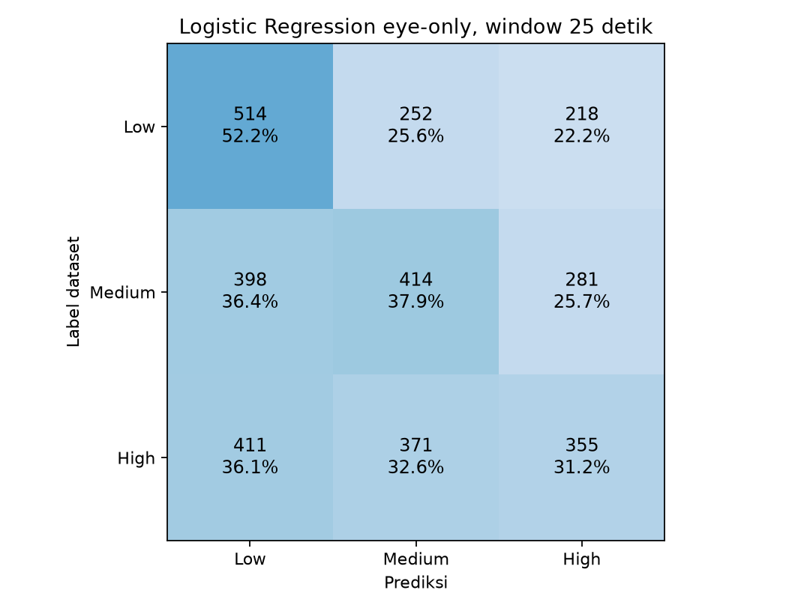

# Batch-02: Hasil Eksperimen Cognitive Load

Tanggal rekap: 19 November 2026.

## Ringkasan

Kandidat dengan **Macro-F1 tertinggi** pada hasil exp01–exp13 adalah **Logistic Regression dengan 21 fitur eye tracking, window 25 detik, step 5 detik**, dari exp02. Kandidat ini mencapai **Macro-F1 39,70%, accuracy 39,92%, dan balanced accuracy 40,45%** pada 3.214 prediksi out-of-fold (OOF).

Kandidat dengan **accuracy tertinggi** memakai konfigurasi eye-only yang sama pada window 45 detik: **accuracy 40,92% dan Macro-F1 39,42%**. Rekap ini memakai Macro-F1 sebagai ukuran utama karena metrik tersebut memberi bobot yang sama kepada Low, Medium, dan High.

**Hasil tersebut belum baik untuk klasifikasi CL yang dapat diandalkan.** Kandidat terbaik masih salah pada 1.931 dari 3.214 window, atau 60,08%. Recall High hanya 31,22%. Performa membaik terhadap Dummy, tetapi model belum memisahkan ketiga kelas dengan kuat pada evaluasi lintas peserta.

Dari 13 notebook yang selesai, **12 eksperimen menghasilkan model dan prediksi evaluasi**. Exp12 selesai dengan seluruh kandidat TabPFN dilewati, sehingga tidak menghasilkan skor. Tim menghentikan exp14 karena durasi komputasinya dan tidak memasukkan hasil parsialnya ke peringkat ini.



## 1. Sumber hasil dan pemeriksaan kelengkapan

Tim menyimpan unduhan Google Drive dalam dua bagian:

- `outputs/outputs-20261119T044432Z-1-001/outputs/`
- `outputs/outputs-20261119T044432Z-1-002/outputs/`

Audit membaca keduanya sebagai satu kumpulan file berdasarkan path relatif `expXX/<run_id>/...`. File ringkasan suatu run dapat berada di bagian pertama sementara status atau metriknya berada di bagian kedua. Audit tidak memindahkan atau menimpa kedua folder asli.

Hasil pemeriksaan:

| Pemeriksaan | Hasil |
|---|---|
| File dalam gabungan logis kedua bagian | 15.352 file, sekitar 2,90 GB |
| Path file yang muncul pada kedua bagian | 0 |
| Notebook exp01–exp13 | Tidak menyimpan traceback error; run ID pada teks output cocok dengan hasil ekspor |
| Baris ringkasan konfigurasi–window–cakupan | 408 |
| Hasil dengan cakupan native | 396 baris, seluruhnya OOF lengkap |
| Hasil dengan cakupan paired | 12 baris, seluruhnya OOF lengkap |
| Pasangan konfigurasi–window native unik | 333; kontrol yang diulang pada beberapa eksperimen tidak dihitung sebagai konfigurasi baru |
| Accuracy, Macro-F1, balanced accuracy, confusion matrix | Cocok dengan perhitungan ulang dari prediksi OOF |
| Endpoint dan label OOF | Cocok dengan dataset terkait; tidak ada endpoint ganda dalam satu hasil konfigurasi |
| Metrik subset window tidak overlap | Cocok dengan perhitungan ulang dari subset prediksi terkait |
| Release input | Sama pada seluruh run: `5cbfc8880194ad4cdd99` |
| Kontrol Logistic Regression yang diulang | Label prediksinya identik antar-eksperimen pada window yang sama |

Seluruh run memakai seed 42. Metadata exp01 mencatat fingerprint kode berbeda dari exp02–exp13. Audit tetap menemukan hash release yang sama serta prediksi kontrol yang identik. Exp11 dan exp13 mencatat PyTorch 2.11.0 dengan CUDA, sedangkan eksperimen tabular mencatat PyTorch 2.14.1 dan tidak menggunakan cabang neural tersebut. Rincian versi, status, dan sumber file tersedia dalam [audit.json](reports/audit.json).

Status `complete_with_skips` pada exp01–exp11 dan exp13 memuat satu catatan `no_test_support` untuk satu peserta pada window 45 detik. Cakupan view tersebut memang 20 peserta, sedangkan view 15 dan 25 detik mencakup 21 peserta. Audit tidak menemukan kekurangan prediksi pada baris dataset yang seharusnya dievaluasi.

### Artefak model yang tersedia secara lokal

Unduhan memuat 248 file `.joblib` pada exp01 dan 1.860 pada exp02. Pada exp03–exp13, unduhan yang tersedia **tidak memuat folder checkpoint maupun file bobot model**, meskipun status run mencatat penyimpanan tersinkron di Drive. Laporan, CSV prediksi, metrik, dan grafik cukup untuk rekap ini, tetapi tidak menggantikan bobot dan cache untuk inference atau resume. Keberadaan artefak tersebut di Drive belum diperiksa dalam audit lokal ini.

Audit tidak memuat file `.joblib` dan tidak menjalankan training ulang.

## 2. Dataset dan cara membaca evaluasi

Ketiga input utama memakai `good_acceptable.csv` dari dataset v2 setelah penggantian selektif Mon dan Alif. Hash sembilan file dataset/seleksi yang tercatat pada release cocok dengan file lokal saat audit.

| Window / step | Jumlah window | Low | Medium | High | Peserta |
|---|---:|---:|---:|---:|---:|
| 15 / 5 detik | 3.579 | 1.062 | 1.266 | 1.251 | 21 |
| 25 / 5 detik | 3.214 | 984 | 1.093 | 1.137 | 21 |
| 45 / 5 detik | 2.527 | 908 | 728 | 891 | 20 |

Dataset menyediakan 26 fitur sensor sebagai daftar awal. Tiap konfigurasi dapat memakai subsetnya. Nama peserta, ID sesi, kesulitan, fase, dan identitas soal tetap berfungsi sebagai metadata, bukan fitur prediksi utama. Label mengikuti kebijakan fase sesi pada dataset v2.

Evaluasi memakai leave-one-participant-out: satu peserta menjadi test dan peserta lainnya menjadi sumber training serta inner validation. Prediksi test dari seluruh giliran kemudian digabung untuk menghitung metrik OOF. Angka pada tabel laporan ini merupakan **metrik dari gabungan prediksi**, bukan rata-rata sederhana skor setiap peserta.

Ada dua cakupan evaluasi:

- **Native:** memakai semua endpoint yang lolos pada masing-masing panjang window. Jumlah baris dan cakupannya berbeda antarwindow.
- **Paired:** memakai 2.138 endpoint sesi/waktu/label yang sama pada ketiga panjang window. Exp04 menyediakan perbandingan terkontrol ini.

Peringkat utama di bawah memakai hasil native. Perbandingan paired dibahas terpisah. Skor native 25 dan 45 detik tidak berasal dari test set yang persis sama.

## 3. Rekap masing-masing eksperimen

Tabel ini mengambil hasil native dengan Macro-F1 tertinggi pada setiap eksperimen. Beberapa baris memilih kontrol yang sama karena perlakuan tambahannya tidak melampaui kontrol tersebut.

| Eksperimen | Yang diuji | Kandidat native terbaik | Window | Accuracy | Macro-F1 |
|---|---|---|---:|---:|---:|
| [exp01](exp01/EyeHeartCognitiveLoad.ipynb) | Baseline Dummy, Logistic Regression, XGBoost | Logistic Regression, fusion bersih | 45 s | 39,73% | 37,99% |
| [exp02](exp02/EyeHeartCognitiveLoad.ipynb) | Kelompok fitur, eye/HRV/fusion, baseline ratio | Logistic Regression, eye-only | 25 s | 39,92% | **39,70%** |
| [exp03](exp03/EyeHeartCognitiveLoad.ipynb) | Normalisasi, scaler, missing values, winsorization | Logistic Regression, centering kausal N3 | 15 s | 38,56% | 38,43% |
| [exp04](exp04/EyeHeartCognitiveLoad.ipynb) | Cakupan native/paired, kepadatan training step 5/10 s | Logistic Regression, native, step 5 s | 45 s | 39,73% | 37,99% |
| [exp05](exp05/EyeHeartCognitiveLoad.ipynb) | Riwayat sensor 0/15/30 s | Logistic Regression, tanpa tambahan riwayat | 45 s | 39,73% | 37,99% |
| [exp06](exp06/EyeHeartCognitiveLoad.ipynb) | Seleksi korelasi, mutual information, PCA | Logistic Regression, tanpa seleksi tambahan | 45 s | 39,73% | 37,99% |
| [exp07](exp07/EyeHeartCognitiveLoad.ipynb) | Bobot kelas/rekaman, ROS, SMOTE, keputusan kelas | Logistic Regression + SMOTE | 45 s | 39,89% | 38,34% |
| [exp08](exp08/EyeHeartCognitiveLoad.ipynb) | Tujuh keluarga algoritma dan variasi parameter | Logistic Regression, C=10 | 45 s | 39,97% | 38,29% |
| [exp09](exp09/EyeHeartCognitiveLoad.ipynb) | Late fusion dan voting | Late fusion Logistic Regression | 25 s | 39,83% | 39,66% |
| [exp10](exp10/EyeHeartCognitiveLoad.ipynb) | Struktur ordinal dan hierarchy | Ordinal Logistic Regression, C=10 | 45 s | 39,81% | 38,28% |
| [exp11](exp11/EyeHeartCognitiveLoad.ipynb) | MLP dan FT-Transformer | FT-Transformer, fusion bersih | 45 s | 34,90% | 34,05% |
| [exp12](exp12/EyeHeartCognitiveLoad.ipynb) | TabPFN | Seluruh kandidat dilewati | — | — | — |
| [exp13](exp13/EyeHeartCognitiveLoad.ipynb) | GRU dan pembanding temporal pada fitur inti | Logistic Regression + history 15 s | 15 s | 34,06% | 32,89% |

Angka mentah beserta konfigurasi, skor per kelas, dan sumber file tersedia di [leaderboard.csv](reports/leaderboard.csv). Tabel tersebut menyimpan 408 hasil, termasuk kontrol berulang dan hasil paired.

### Exp01: baseline

Kontrol Logistic Regression pada fitur fusion bersih mencapai Macro-F1 37,27%, 37,34%, dan 37,99% pada window 15, 25, dan 45 detik. Seluruhnya melampaui konfigurasi XGBoost baseline yang diuji.

Dummy yang memilih kelas paling sering pada data training memperoleh accuracy 26,80%, 32,45%, dan 21,80% pada tiga window tersebut. Nilai ini mengikuti distribusi training pada masing-masing fold, sehingga tidak sama dengan persentase kelas terbesar pada seluruh dataset.

### Exp02: pemilihan kelompok fitur

Eksperimen ini menghasilkan kandidat terbaik keseluruhan berdasarkan Macro-F1. Konfigurasi eye-only 25 detik memakai 21 fitur: blink rate, EAR, iris, head pose, gaze, dan eye-state ratios yang dipilih. Konfigurasi itu menghapus tiga fitur HRV serta `blink_count` dan `eye_state_other_ratio` dari allowlist awal.

Untuk membandingkan sensor dengan perlakuan yang sama, berikut hasil Logistic Regression C=1, median imputation, StandardScaler, tanpa baseline ratio dan balancing:

| Input | Macro-F1 15 s | Macro-F1 25 s | Macro-F1 45 s |
|---|---:|---:|---:|
| Fusion bersih | 37,27% | 37,34% | 37,99% |
| HRV saja | 28,04% | 26,76% | 16,71% |
| Eye tracking saja | 37,81% | **39,70%** | **39,42%** |



Angka HRV di tabel ini berlaku untuk Logistic Regression tersebut. Kandidat HRV-only terbaik dari seluruh variasi exp02 adalah XGBoost pada 45 detik, dengan Macro-F1 36,96% dan accuracy 38,31%. Jadi, hasil audit tidak mendukung kesimpulan bahwa semua model HRV hanya mencapai 16–28%. Hasilnya tetap belum melampaui kandidat eye-only terbaik.

### Exp03: normalisasi dan nilai kosong

Centering kausal N3 memberi Macro-F1 terbaik pada ketiga window dalam exp03: 38,43%, 37,90%, dan 38,14%. N3 menambahkan fitur relatif terhadap median riwayat sensor sebelumnya, bukan memakai informasi masa depan atau label peserta test. Kenaikan terhadap kontrol fusion ada, tetapi belum melampaui hasil eye-only exp02.

### Exp04: window dan kepadatan data training

Pada native, kontrol step 5 detik tetap menjadi kandidat terbaik. Pada 2.138 endpoint paired yang sama, Logistic Regression step 5 detik memperoleh:

| Window | Accuracy paired | Macro-F1 paired |
|---|---:|---:|
| 15 s | 40,60% | 38,59% |
| 25 s | 39,43% | 37,70% |
| 45 s | 37,98% | 36,13% |

Dalam perbandingan paired ini, window 15 detik lebih baik untuk konfigurasi fusion yang diuji. Hasil tersebut berbeda dari peringkat native eye-only, sehingga kita belum dapat menetapkan satu panjang window sebagai pemenang untuk seluruh konfigurasi. Pengurangan kepadatan training ke step 10 detik tidak melampaui step 5 detik pada kandidat paired terbaik tiap window.

### Exp05: tambahan riwayat sensor

Pada 15 detik, history 30 detik memberi Macro-F1 37,36%, dibanding kontrol 37,27%. Pada 25 dan 45 detik, kontrol tanpa tambahan history tetap terbaik. Penambahan history belum memberi keuntungan yang konsisten pada konfigurasi yang diuji.

### Exp06: seleksi fitur dan PCA

Kontrol tanpa seleksi tambahan menjadi yang terbaik pada ketiga window. Seleksi berdasarkan korelasi, mutual information, serta PCA tidak memperbaiki hasil kontrol dalam eksperimen ini. Temuan ini berlaku untuk perlakuan seleksi tersebut. Exp02 tetap menunjukkan bahwa mengubah kelompok sensor dapat membantu.

### Exp07: balancing dan keputusan kelas

SMOTE memberi Macro-F1 terbaik pada 15 dan 45 detik, yaitu 38,00% dan 38,34%. Random oversampling memberi yang terbaik pada 25 detik, yaitu 38,28%. Pada 45 detik, kenaikan SMOTE terhadap kontrol sebesar 0,35 poin persentase Macro-F1.

Balancing membantu beberapa konfigurasi, tetapi kenaikannya belum cukup untuk menjadikan model kuat. Dataset saat ini juga tidak memiliki selisih proporsi kelas sejauh versi awal penelitian, sehingga jumlah Low bukan penjelasan tunggal yang memadai untuk skor batch ini.

### Exp08: pilihan algoritma

Logistic Regression C=10 pada 45 detik mengungguli keluarga lain yang diuji di exp08. Macro-F1 terbaik per keluarga adalah Logistic Regression 38,29%, XGBoost 33,74%, HistGradientBoosting 33,51%, Extra Trees 32,87%, Random Forest 32,29%, CatBoost 31,77%, dan SVM 31,08%.

Exp08 memakai kelompok fitur kontrol, bukan seluruh kombinasi kelompok fitur exp02. Karena itu hasil XGBoost exp02 dengan fitur HRV-only atau subset lain tidak harus sama dengan hasil XGBoost di exp08.

### Exp09: late fusion dan voting

Late fusion Logistic Regression pada 25 detik mencapai Macro-F1 39,66% dan accuracy 39,83%. Model membangun cabang HRV dan eye secara terpisah, lalu menggabungkan probabilitas dengan bobot 25% HRV dan 75% eye. Kandidat voting terbaik mencapai Macro-F1 35,16%.

Selisih Macro-F1 late fusion terhadap eye-only terbaik hanya 0,04 poin persentase. Kita belum mempunyai bukti bahwa salah satunya unggul secara konsisten. Eye-only lebih sederhana dan tidak membutuhkan kedua sensor untuk inference konfigurasi tersebut.

### Exp10: ordinal dan hierarchy

Ordinal Logistic Regression C=10 pada 45 detik menjadi yang terbaik di exp10, dengan Macro-F1 38,28%. Struktur ordinal mempelajari batas Low terhadap Medium/High serta Low/Medium terhadap High. Hierarchy memisahkan Low terhadap Medium/High dan kemudian Medium terhadap High. Kedua pendekatan tetap menghasilkan tiga kelas; hasilnya belum melampaui kandidat terbaik exp02 atau exp09.

### Exp11: MLP dan FT-Transformer

Kedua jenis neural menghasilkan prediksi OOF lengkap. FT-Transformer terbaik memperoleh Macro-F1 34,05% pada 45 detik. MLP terbaik memperoleh Macro-F1 32,38% pada 15 detik. Pada data dan konfigurasi training ini, peningkatan kompleksitas neural belum memberikan hasil yang lebih baik daripada Logistic Regression.

### Exp12: TabPFN belum menghasilkan evaluasi

Status mencatat `training_performed=false`, nol baris ringkasan, dan 124 kandidat/fold dilewati dengan alasan `skipped_dependency`. Metadata tidak mencatat paket TabPFN maupun checkpoint yang aktif. Satu event lain adalah `no_test_support` pada 45 detik.

Exp12 bukan model dengan skor nol dan tidak masuk peringkat. Notebook selesai menjalankan pemeriksaan serta pencatatan skip, tetapi tidak menguji kemampuan TabPFN pada dataset ini.

### Exp13: GRU dan pembanding temporal

GRU menghasilkan OOF lengkap, dengan Macro-F1 terbaik 28,92% pada 25 detik dan accuracy 29,96%. Pembanding terbaik dalam exp13 adalah Logistic Regression pada fitur inti dengan history 15 detik, Macro-F1 32,89% pada window 15 detik.

Exp13 membatasi fitur pada kelompok inti. Perbandingan dengan exp11 atau eye-only exp02 juga mencakup perbedaan kelompok fitur, sehingga selisih skor tidak dapat dikaitkan hanya dengan arsitektur GRU.

## 4. Kandidat terbaik dan hasil per kelas

| Pengaturan | Nilai |
|---|---|
| Eksperimen | exp02 |
| Model | Logistic Regression, C=1, solver lbfgs |
| ID konfigurasi | `logistic_499f533391d1cfa0` |
| Kelompok fitur | Eye-only, kode F6, 21 fitur |
| Window / step | 25 / 5 detik |
| Nilai kosong | Median dari data training |
| Scaling | StandardScaler dari data training |
| History / seleksi tambahan | Tidak ada |
| Balancing | Tidak ada |
| Jumlah test OOF | 3.214 window dari 21 peserta |
| Accuracy | 39,92% |
| Macro-F1 | 39,70% |
| Balanced accuracy | 40,45% |

Daftar fitur dan konfigurasi lengkap tersedia dalam [winner_metrics.json](reports/winner_metrics.json).

| Kelas | Jumlah | Precision | Recall | F1 |
|---|---:|---:|---:|---:|
| Low | 984 | 38,85% | 52,24% | 44,56% |
| Medium | 1.093 | 39,92% | 37,88% | 38,87% |
| High | 1.137 | 41,57% | 31,22% | 35,66% |

Confusion matrix berikut memakai baris sebagai label dataset dan kolom sebagai prediksi:

| Label / prediksi | Low | Medium | High |
|---|---:|---:|---:|
| Low | 514 | 252 | 218 |
| Medium | 398 | 414 | 281 |
| High | 411 | 371 | 355 |



Model mengenali 514 dari 984 Low, 414 dari 1.093 Medium, dan 355 dari 1.137 High. Sebanyak 411 High justru diprediksi Low. Recall yang rendah pada Medium dan High membatasi kegunaan model, meskipun jumlah kelas pada view ini relatif berdekatan.

### Sensitivitas hasil

- **Window utama tanpa overlap:** pada subset 818 window, accuracy 40,83% dan Macro-F1 40,58%. Skor tetap berada pada kisaran yang sama.
- **Variasi antar-peserta:** accuracy per peserta berkisar 8,63–85,71%, dengan median 43,01%. Skor 85,71% berasal dari hanya 7 window dan dua kelas. Dari 21 peserta, 13 mempunyai ketiga kelas pada view 25 detik. Rentang tersebut perlu dibaca bersama jumlah dan cakupan kelas, bukan sebagai peringkat kualitas peserta.
- **Bootstrap berbasis peserta:** 2.000 pengambilan ulang kelompok peserta, seed 42, memberi interval persentil 95% Macro-F1 sebesar 31,76–44,74% dan accuracy 33,30–45,18%.
- **Eye-only versus late fusion:** interval selisih Macro-F1 adalah −0,46 sampai +0,64 poin persentase. Interval mencakup nol.
- **Eye-only versus kontrol fusion:** kenaikan teramati 2,36 poin persentase Macro-F1, dengan interval selisih −0,80 sampai +6,86 poin persentase. Interval juga mencakup nol.

Bootstrap tersebut memakai prediksi OOF tetap dan mengubah komposisi peserta, tanpa fitting ulang. Interval tidak mengoreksi pemilihan pemenang dari banyak konfigurasi. Rincian per peserta tersedia di [best_per_participant.csv](reports/best_per_participant.csv).

## 5. Penilaian keseluruhan

**Kandidat terbaik saat ini layak menjadi pembanding penelitian, tetapi belum layak disebut model CL yang baik atau siap digunakan untuk keputusan individual.** Dasar penilaian ini adalah tingkat kesalahan 60,08%, recall High 31,22%, selisih kecil antara kandidat teratas, dan variasi hasil antarrekaman. Rekap ini tidak memakai batas accuracy universal seperti 80% untuk menyatakan kelayakan; tim belum menetapkan kriteria operasional tersebut.

Temuan yang dapat ditarik dari hasil yang sudah ada:

1. **Pemilihan kelompok sensor lebih membantu daripada beberapa perubahan algoritma.** Eye-only dan late fusion yang memberi bobot lebih besar pada eye berada di posisi teratas.
2. **Imbalance bukan satu-satunya masalah yang perlu ditangani.** Proporsi kelas sekarang relatif berdekatan. ROS/SMOTE dan pembobotan belum menghasilkan kenaikan besar pada percobaan ini.
3. **Model kompleks belum memberi keuntungan.** FT-Transformer, MLP, GRU, voting, dan hierarchy yang diuji belum melampaui kandidat sederhana terbaik.
4. **Tambahan history dan seleksi otomatis belum konsisten membantu.** Beberapa peningkatan kecil muncul, tetapi kontrol tetap memenangkan beberapa eksperimen.
5. **Pemilihan window bergantung pada konfigurasi dan cakupan evaluasi.** Native eye-only 25 detik memimpin Macro-F1, native eye-only 45 detik memimpin accuracy, sementara paired fusion di exp04 lebih baik pada 15 detik.

Hasil ini belum menetapkan penyebab tunggal seperti sensor rusak, label salah, atau satu algoritma yang selalu tidak cocok. Rekap menunjukkan perlakuan mana yang sudah diuji dan batas hasilnya. Penjelasan sebab-akibat memerlukan pemeriksaan sumber atau percobaan yang memisahkan faktor tersebut.

### Arti “model terbaik” dalam laporan ini

Peringkat ini memilih **konfigurasi dengan skor OOF teramati tertinggi**. Tim memilihnya setelah melihat banyak hasil outer-test, sehingga angka pemenang dapat mengandung optimisme pemilihan. Evaluasi terpisah atau prosedur seleksi nested diperlukan untuk menilai proses pemilihan konfigurasi itu sendiri. Penjelasan metode tersedia pada [dokumentasi nested cross-validation scikit-learn](https://scikit-learn.org/stable/auto_examples/model_selection/plot_nested_cross_validation_iris.html).

Tim belum menyelesaikan refit/deployment exp14. Bobot dari salah satu fold exp02 juga hanya mewakili training yang mengecualikan peserta test fold tersebut. Karena itu laporan ini tidak menunjuk satu file fold sebagai model final yang dilatih pada seluruh dataset.

Tim dapat menyelesaikan pembahasan exp01–exp13 tanpa memaksakan exp14. Jika membutuhkan kandidat untuk penggunaan lanjutan, langkah terfokus adalah memilih eye-only 25 detik dan late fusion 25 detik sebagai dua pembanding, menilai keduanya pada data uji independen, lalu melakukan refit konfigurasi yang diputuskan. Tidak perlu mengulang seluruh pencarian exp14 untuk sekadar membuat satu model kandidat.

## 6. Berkas pendamping dan reproduksi rekap

| Berkas | Isi |
|---|---|
| [leaderboard.csv](reports/leaderboard.csv) | 408 hasil beserta skor kelas dan konfigurasi |
| [best_per_experiment.csv](reports/best_per_experiment.csv) | Kandidat native terbaik pada 12 eksperimen yang menghasilkan prediksi |
| [dataset_counts.csv](reports/dataset_counts.csv) | Jumlah window, kelas, dan peserta pada tiga input |
| [audit.json](reports/audit.json) | Status run, hash release/kode, environment, lokasi sumber pada dua bagian ekspor, dan pemeriksaan notebook |
| [winner_metrics.json](reports/winner_metrics.json) | Metrik kandidat terbaik, fitur, confusion matrix, subset nonoverlap, serta bootstrap |
| [recipes.json](reports/recipes.json) | Arti ID konfigurasi yang dirujuk hasil |
| [review_results.py](reports/review_results.py) | Script audit perhitungan dan pembuatan tabel/grafik; tidak melakukan training |

Untuk menghitung ulang berkas pendamping dari dua folder unduhan yang sama, jalankan dari root proyek:

```bash
python -B models/batch-02/reports/review_results.py
```

Script memerlukan NumPy, pandas, dan Matplotlib. Script hanya menulis tabel audit dan gambar dalam `reports`; ia tidak mengubah dataset, notebook, atau output asli. Dokumen Markdown ini memuat penilaian dan penjelasan hasil, bukan output training otomatis.

CSV sumber dan rincian per peserta memuat identitas penelitian. Tim perlu memperhatikan akses repositori saat membagikan artefak di luar kelompok penelitian.
