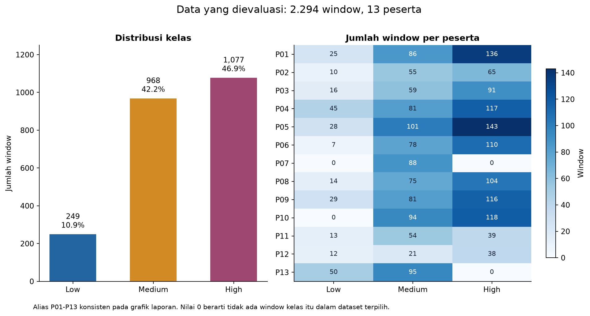
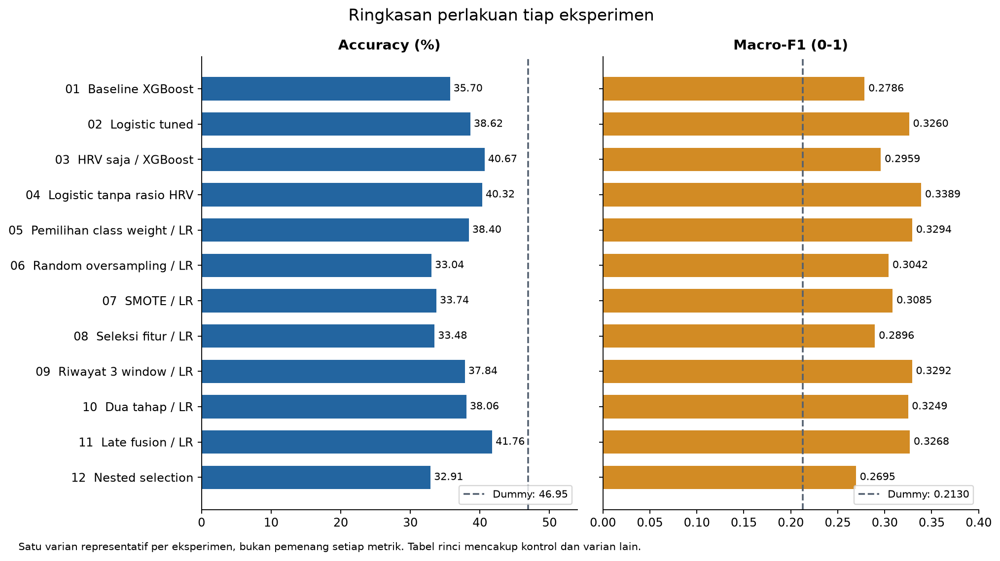
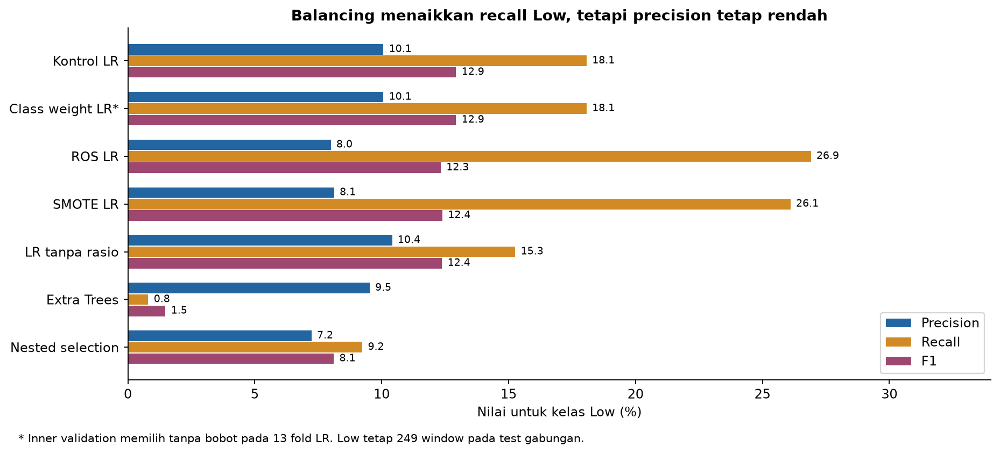
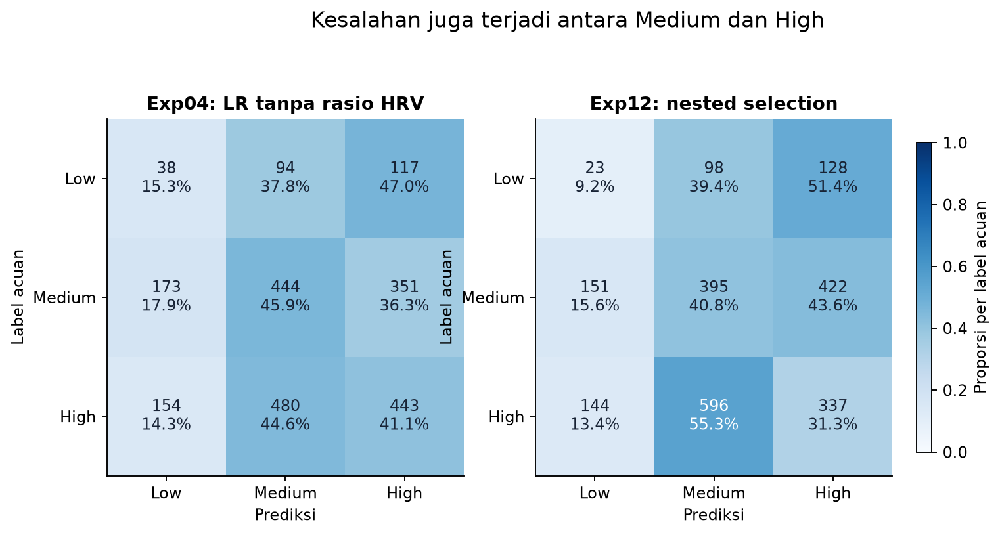
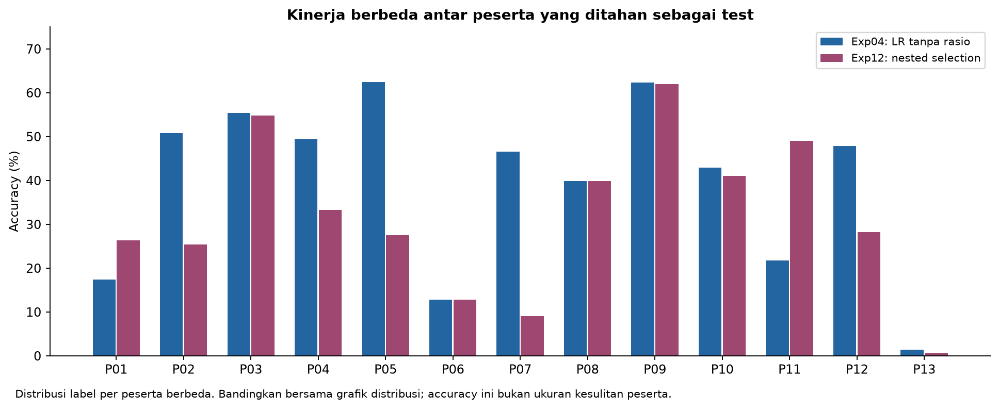

# Batch 01: Eksperimen Klasifikasi Cognitive Load

Analisis lanjutan berbasis audit dan uji diagnostik tersedia pada [DIAGNOSIS.md](DIAGNOSIS.md), termasuk prioritas untuk batch berikutnya.

## Kesimpulan utama

Batch ini mengevaluasi 12 eksperimen pada dataset `good_acceptable.csv`. Seluruh run berstatus `complete`, menggunakan mode `full`, dan mencakup 13 fold test berbasis peserta. Laporan ini membaca artefak eksekusi yang sudah tersimpan. Tidak ada training ulang atau perubahan dataset saat menyusun laporan.

Hasil terbaik pada perbandingan eksploratif adalah **macro-F1 0,3389** dari Logistic Regression tanpa rasio baseline HRV, dengan accuracy 40,32%. Extra Trees mencapai accuracy tertinggi di antara model terlatih, 42,63%, tetapi mengenali hanya 2 dari 249 window Low. Dummy yang selalu menebak High mencapai accuracy 46,95%. Karena itu, accuracy saja belum cukup untuk menilai model pada dataset ini.

Prosedur pemilihan pipeline melalui nested validation pada exp12 menghasilkan accuracy 32,91% dan macro-F1 0,2695. Menambah jumlah kandidat belum memperbaiki kemampuan prediksi pada peserta test. Batch ini belum menghasilkan model tiga kelas yang kuat untuk programmer yang datanya tidak masuk training.

Penanganan imbalance, perubahan fitur, pergantian algoritma, riwayat fitur, dua tahap klasifikasi, dan dua cara fusi sensor sudah diuji. **Penambahan rekaman Low asli dan perubahan panjang/langkah window sensor mentah belum diuji.** Hasil yang lemah juga mencakup Medium dan High, sehingga kekurangan Low belum menjelaskan seluruh kesalahan.

## Versi dataset dan pekerjaan sesudah batch ini

Batch-01 tetap memakai v1: 25 detik/step 5, hanya active-task, target dari difficulty. Seluruh hasil dan angka dalam laporan ini tidak diubah. Dataset v1 sudah dipindahkan byte-identik ke `analysis_sessions/dataset_fusion/output/v1_active_task/`. [Dataset v2](../../analysis_sessions/dataset_fusion/output/v2_session_phase/QUALITY_REPORT.md) kemudian disiapkan dengan tiga panjang window serta label berdasarkan fase sesi; belum ada training model v2. Ikuti [plan batch-02](../batch-02/PLAN.md) untuk evaluasi berikutnya, bukan notebook v1 langsung pada target baru.

## Kesesuaian implementasi dengan konteks penelitian

**Inti pemodelan batch-01 sudah sesuai dengan konteks yang diluruskan:** classifier memprediksi CL per window dari fitur eye tracking dan HRV. Model tidak memasukkan nama/ID peserta, ID soal, nama set, atau batas waktu set sebagai fitur. Kolom `difficulty_level` menjadi sumber label, bukan input prediksi. Pemisahan test menurut peserta dan penyimpanan hasil per peserta tidak berarti kita melatih classifier personal.

| Aspek | Yang benar-benar dijalankan pada batch-01 | Penilaian |
|---|---|---|
| Input classifier | Allowlist 26 fitur sensor, subset/transformasi, atau fitur riwayat yang berasal dari sensor | Sesuai fokus eye tracking + HRV |
| Label | `easy/medium/hard` dipetakan menjadi Low/Medium/High | Sesuai label penelitian saat ini, dengan batas proxy kesulitan tugas |
| Model dan evaluasi | Model dilatih pada gabungan peserta training, kemudian memprediksi setiap window test | Model umum; fitting ulang per fold merupakan evaluasi, bukan satu model personal per orang |
| Metadata | ID/waktu/konteks dipakai untuk split, alignment, filtering, audit, dan reset riwayat | Tidak menjadi fitur prediksi langsung |
| Varian temporal | Exp09 dan kandidat temporal exp12 memakai `puzzle_id`/konteks soal untuk mereset riwayat | Masih memiliki ketergantungan operasional CodeArrange; perlu rancangan batas stream generik untuk penggunaan umum |
| Model refit akhir exp12 | SVM RBF dengan fitur original dan tanpa riwayat temporal | Jalur fitur/prediksi tidak menggunakan identitas atau konteks soal; belum merupakan validasi aplikasi nyata di luar CodeArrange |

Pada exp12, dua dari 13 outer fold memilih kandidat temporal: `fold_01` memakai riwayat tiga window dan `fold_02` memakai lima window. Dengan demikian, skor nested selection mencakup dua pipeline dengan reset berbasis soal, meskipun model refit akhirnya non-temporal. Kita tidak boleh menyamakan seluruh prosedur exp12 dengan satu SVM akhir.

Pelurusan durasi 5/12/15 menit dan keputusan sebagian peserta melewati easy memperbarui interpretasi protokol, bukan mengubah fitur atau hasil training yang sudah selesai. Batch-01 tidak perlu dibatalkan atau dijalankan ulang hanya karena penjelasan konteks tersebut. Pemakaian di aktivitas pemrograman umum tetap memerlukan pengujian transfer, serta penyesuaian ketergantungan temporal bila dipilih. Rincian kondisi yang perlu dipertahankan dan diperbaiki terdapat pada [diagnosis implementasi](DIAGNOSIS.md#kesesuaian-batch-01-dan-batas-implementasinya).

## Navigasi

- [Kesesuaian implementasi dengan konteks penelitian](#kesesuaian-implementasi-dengan-konteks-penelitian)
- [Data, fitur, dan label](#data-fitur-dan-label)
- [Cara evaluasi dan membaca metrik](#cara-evaluasi-dan-membaca-metrik)
- [Perbandingan utama](#perbandingan-utama)
- [Rincian exp01 sampai exp12](#rincian-exp01-sampai-exp12)
- [Kesalahan kelas dan perbedaan peserta](#kesalahan-kelas-dan-perbedaan-peserta)
- [Pemeriksaan tambahan dan model refit](#pemeriksaan-tambahan-dan-model-refit)
- [Cakupan pengujian](#cakupan-pengujian)
- [Analisis keterbatasan hasil](#analisis-keterbatasan-hasil)
- [Arsip dan sumber hasil](#arsip-dan-sumber-hasil)

## Data, fitur, dan label

### Dataset yang digunakan

| Komponen | Nilai |
|---|---|
| Dataset training/evaluasi | `good_acceptable.csv` |
| Unit satu baris | Satu window fitur eye tracking dan HRV |
| Jumlah window | 2.294 |
| Jumlah peserta | 13 |
| Panjang window sensor | 25 detik |
| Langkah window | 5 detik |
| Kelas Low | 249 window, 10,85% |
| Kelas Medium | 968 window, 42,20% |
| Kelas High | 1.077 window, 46,95% |
| Fitur awal | 26 fitur sensor: 3 HRV dan 23 eye tracking |
| SHA256 dataset | `bbb4c93eca30aab6b896db887dfbb981abffe118fce385d0f9bd3d28e786247e` |

Window bertetangga berbagi 20 detik data jika tidak ada jeda. Jumlah 2.294 baris tidak berarti 2.294 pengukuran independen. Jumlah peserta tetap 13. Proporsi High sekitar 4,33 kali Low.

Grafik memakai alias P01 sampai P13 dengan urutan peserta yang konsisten di seluruh gambar. Alias ini hanya untuk penyajian laporan, bukan anonimisasi CSV sumber. Dua peserta tidak memiliki window Low dan dua peserta tidak memiliki window High dalam dataset terpilih. Satu peserta hanya memiliki Medium. Operator mengonfirmasi bahwa sebagian peserta sengaja tidak mengerjakan easy. Nilai nol juga dapat muncul karena durasi aktif terlalu singkat atau seleksi window, sehingga penyebab tiap kelas yang tidak tersedia perlu ditelusuri, bukan otomatis disebut kegagalan recorder.

### Protokol durasi dan cakupan tugas

Batas waktu set memang berbeda: easy 5 menit, medium 12 menit, dan hard 15 menit. Peserta dapat selesai lebih cepat. Sebagian peserta sengaja langsung mengerjakan medium/high karena keterbatasan waktu pelaksanaan. Ketimpangan durasi serta cakupan kelas ini merupakan kondisi protokol yang disengaja. Efeknya terhadap jumlah window dan evaluasi tetap dilaporkan, tetapi tidak menjadi alasan menyamakan durasi, membuat Low sintetis untuk sesi yang dilewati, atau membuang peserta tersebut.

Pelurusan ini tidak mengubah jumlah data, prediksi, atau skor batch-01. Acuan tujuan dan peran kolom terdapat pada [konteks penelitian](../README.md#konteks-penelitian-dan-peran-kolom).

Sumber: [ringkasan dataset yang dipakai run](outputs/exp12/20261114T083026316937Z_full_final_77bd4e91/dataset_summary.json), [laporan kualitas dataset](../../analysis_sessions/dataset_fusion/output/v1_active_task/QUALITY_REPORT.md), dan [builder dataset](../../analysis_sessions/dataset_fusion/build_dataset.py).

### Arti label dan tujuan model

Penelitian menargetkan satu model klasifikasi cognitive load per window sensor selama aktivitas pemrograman, bukan model terpisah per peserta atau pengenalan soal. CodeArrange berperan sebagai sarana pengambilan data. Kolom target pada dataset adalah `difficulty_level`, dengan pemetaan `easy=Low`, `medium=Medium`, dan `hard=High`.

Label tersebut merupakan **proxy berdasarkan kesulitan tugas**. Batch ini belum membuktikan bahwa setiap window easy menunjukkan beban kognitif rendah yang sama pada setiap peserta. Batch ini juga belum mengevaluasi transfer ke aktivitas lain, seperti menulis program di IDE, debugging, atau membaca kode bebas.

Pemisahan berdasarkan peserta mengukur kemampuan model pada programmer yang tidak masuk training, dalam konteks tugas pengambilan data yang tersedia. Pengujian itu belum mengukur kemampuan model pada jenis aktivitas pemrograman lain.

### Kelompok fitur

| Kelompok | Fitur yang masuk pemodelan awal |
|---|---|
| HRV | `rmssd_ms`, `sdnn_ms`, `rmssd_baseline_ratio` |
| Kedipan | `blink_count`, `blink_rate_per_minute` |
| EAR | Mean dan standard deviation EAR kiri/kanan |
| Iris | Mean dan standard deviation estimasi ukuran iris serta delta ukuran iris |
| Head pose | Mean dan standard deviation pitch/yaw |
| Gaze | Mean dan standard deviation koordinat gaze ternormalisasi X/Y |
| Eye state | Rasio fixation, saccade, transition, unclassified, dan other |

Identitas peserta, ID sesi, ID soal, timestamp, kesulitan tugas, dan penanda kualitas tidak menjadi fitur prediksi pada konfigurasi dasar. Runtime memakai sebagian metadata untuk membagi fold, membentuk ID window, dan mereset riwayat temporal. Daftar dasar 26 fitur sensor juga tersedia pada [allowlist dataset](../../analysis_sessions/dataset_fusion/output/v1_active_task/feature_columns.json); fitur aktual tiap run/fold tercatat dalam artefak preprocessing.

Metadata tetap disimpan bersama fitur dalam CSV untuk keperluan operasional dan audit. Batch-01 memakai allowlist sensor, bukan seluruh kolom CSV. Perbedaan fitur antarrekaman yang dibahas dalam laporan merujuk pada nilai sensor, bukan akibat model memasukkan nama peserta. Menghapus kolom identitas tidak menghilangkan perbedaan sensor tersebut.

Sebanyak 193 window tidak memiliki `rmssd_baseline_ratio`. Seluruhnya berasal dari satu peserta. Imputasi menangani nilai kosong saat training, tetapi belum menyelesaikan pertanyaan tentang konsistensi baseline antarrekaman.

## Cara evaluasi dan membaca metrik

### Pemisahan data

Evaluasi luar memakai leave-one-participant-out (LOPO). Dari 13 peserta, satu peserta menjadi test dan 12 lainnya menjadi training. Proses berulang 13 kali sampai setiap peserta mendapat giliran sebagai test. Model tidak memakai data peserta test untuk fitting pada fold tersebut.

Peserta menjadi unit pemisahan evaluasi, sedangkan prediksi tetap diberikan untuk setiap window berdasarkan sensor. Tidak ada kewajiban mengetahui nama peserta saat classifier utama memprediksi. Model sensor tidak berubah menjadi model perorangan karena pemeriksaan ini.

Pada eksperimen yang memilih parameter atau konfigurasi, runtime membagi peserta training lagi menjadi tiga inner group fold. Pemilihan kandidat memakai hasil inner validation. Konfigurasi fixed/kontrol tidak menjalankan pencarian sendiri.

Tahapan yang mempelajari distribusi data berjalan di training fold: penghapusan fitur seluruhnya kosong/konstan, imputasi median, scaling bila digunakan, seleksi fitur, serta balancing. Random oversampling dan SMOTE hanya menambah baris training sementara. CSV sumber dan test tetap memiliki data asli, termasuk total 249 Low pada gabungan test.

Prediksi test dari 13 fold digabung menjadi *out-of-fold predictions* (OOF). Metrik utama dalam laporan dihitung dari gabungan ini, bukan rata-rata sederhana accuracy peserta.

### Metrik

| Metrik | Cara membaca |
|---|---|
| Accuracy | Persentase semua window yang mendapat prediksi benar. Kelas besar lebih memengaruhi nilai ini. |
| Precision Low | Dari semua prediksi Low, proporsi yang label acuannya Low. |
| Recall Low | Dari seluruh window berlabel Low, proporsi yang berhasil dikenali. |
| F1 per kelas | Gabungan precision dan recall untuk kelas tersebut, dalam skala 0 sampai 1. |
| Macro-F1 | Rata-rata F1 Low, Medium, dan High dengan bobot kelas yang sama. Metrik utama perbandingan. |
| Balanced accuracy | Rata-rata recall tiap kelas. Dummy selalu High mendapat 33,33% pada gabungan tiga kelas. |
| Support | Jumlah window dengan label acuan kelas tersebut. |

Untuk peserta yang tidak memiliki suatu kelas, tabel per-kelas membiarkan metrik kelas itu kosong. Nilai kosong tidak berarti nol. Macro-F1 per peserta pada artefak memakai kelas yang hadir, sedangkan macro-F1 gabungan memakai ketiga kelas. Keduanya tidak dapat dipertukarkan.

### Kesetaraan perbandingan dan environment

Semua eksperimen memakai dataset dan isi manifest pembagian fold yang sama. Exp01 berjalan di Colab/Linux, Python 3.13.16. Exp02 sampai exp12 berjalan lokal di Windows, Python 3.14.6, dengan seed utama 42 dan runtime `final-v1`. Runtime, versi paket, seed, hash dataset, dan identitas manifest exp02 sampai exp12 cocok satu sama lain.

Kesamaan fold tidak berarti environment exp01 identik dengan exp02 sampai exp12. Metadata run menyimpan perbedaan itu. Perbandingan ini juga mencakup perubahan konfigurasi selain algoritma, sehingga setiap kesimpulan perlakuan perlu memakai kontrol yang sesuai.

## Perbandingan utama

Grafik berikut memakai satu varian yang mewakili perlakuan tiap eksperimen. Grafik tetap menampilkan ROS, SMOTE, dan perlakuan lain meskipun kontrolnya mendapat skor lebih tinggi. Rincian di bawah mencakup seluruh 55 baris konfigurasi yang dilaporkan, termasuk kontrol berulang. Jumlah itu bukan 55 penelitian independen.

| Pembanding | Accuracy | Balanced accuracy | Macro-F1 | Makna |
|---|---:|---:|---:|---|
| Dummy selalu High | 46,95% | 33,33% | 0,2130 | Tidak mengenali Low atau Medium |
| Extra Trees tuned, exp02 | 42,63% | 31,91% | 0,3045 | Accuracy tertinggi di antara model terlatih, recall Low hanya 0,80% |
| Logistic tanpa rasio baseline, exp04 | 40,32% | 34,09% | 0,3389 | Macro-F1 eksploratif tertinggi |
| Logistic kontrol clean | 38,40% | 33,42% | 0,3294 | Referensi perlakuan exp05 sampai exp11 |
| Nested selection, exp12 | 32,91% | 27,11% | 0,2695 | Evaluasi prosedur memilih pipeline dari inner fold |

Peringkat pada outer test membantu analisis eksploratif. Memilih pemenang dari peringkat ini lalu mengutip skor yang sama sebagai bukti final akan mengabaikan pengaruh pemilihan setelah melihat hasil. Exp12 menilai prosedur seleksi terpisah di dalam training, bukan mengambil pemenang dari tabel outer test.

Sumber pembanding: [baseline exp01](outputs/exp01/20261114T054940956475Z_full_d2dbf4b4/metrics.csv) dan [perbandingan exp02 sampai exp12](outputs/exp12/20261114T083026316937Z_full_final_77bd4e91/experiment_comparison.csv).

## Rincian exp01 sampai exp12

Angka pada tabel rinci memakai titik sebagai pemisah desimal agar cocok dengan CSV. F1 menggunakan skala 0 sampai 1. Nama varian mengikuti artefak hasil agar tim dapat menelusurinya.

### Exp01: baseline tanpa balancing atau riwayat

Tujuan: menyediakan pembanding sederhana dan skor XGBoost fixed pada protokol LOPO. Dummy memakai kelas terbanyak pada training fold. XGBoost memakai 300 pohon, depth 3, learning rate 0,05, dan tanpa tuning inner, balancing, atau rolling.

| Varian | Accuracy | Balanced accuracy | Macro-F1 | F1 Low |
|---|---:|---:|---:|---:|
| `dummy` | 46.95% | 33.33% | 0.2130 | 0.0000 |
| `xgboost` | 35.70% | 27.74% | 0.2786 | 0.0374 |

Dummy memilih High pada seluruh fold dan menghasilkan F1 Low nol. XGBoost memperbaiki macro-F1 dibanding Dummy, tetapi accuracy serta balanced accuracy belum baik. Baseline ini memperlihatkan mengapa accuracy 46,95% dari tebakan satu kelas tidak dapat dianggap model cognitive load yang memadai.

Sumber: [metrics.csv](outputs/exp01/20261114T054940956475Z_full_d2dbf4b4/metrics.csv), [class_metrics.csv](outputs/exp01/20261114T054940956475Z_full_d2dbf4b4/class_metrics.csv), [config.json](outputs/exp01/20261114T054940956475Z_full_d2dbf4b4/config.json) dan [notebook exp01](exp01/EyeHeartCognitiveLoad.ipynb).

### Exp02: perbandingan enam algoritma

Tujuan: menguji apakah keluarga model lain memberi pemisahan kelas yang lebih baik pada 26 fitur awal. Runtime mencoba Logistic Regression, SVM RBF, Random Forest, Extra Trees, XGBoost, dan CatBoost. Logistic/SVM memakai StandardScaler. Setiap model memilih parameter dari inner validation.

Pencarian mencakup enam nilai C untuk Logistic dan 12 kandidat per keluarga lain, total 66 kandidat. SVM mencoba C dan gamma. Model pohon mencoba sebagian kombinasi kedalaman, ukuran daun, sampling fitur, atau regularisasi sesuai keluarga. Random Forest, Extra Trees, XGBoost, dan CatBoost memakai 300 pohon/iterasi pada mode full. Ini pencarian terbatas, bukan seluruh kemungkinan hyperparameter.

| Varian | Accuracy | Balanced accuracy | Macro-F1 | F1 Low |
|---|---:|---:|---:|---:|
| `catboost` | 38.19% | 29.61% | 0.2921 | 0.0513 |
| `extra_trees` | 42.63% | 31.91% | 0.3045 | 0.0148 |
| `logistic` | 38.62% | 33.23% | 0.3260 | 0.1252 |
| `random_forest` | 41.28% | 31.10% | 0.3001 | 0.0269 |
| `svm` | 37.93% | 31.84% | 0.3175 | 0.1300 |
| `xgboost` | 35.70% | 27.71% | 0.2768 | 0.0350 |

Logistic memberi macro-F1 tertinggi pada eksperimen ini. Extra Trees memberi accuracy lebih tinggi, tetapi F1 Low hanya 0,0148 dan recall Low 2/249. Pemilihan algoritma berdasarkan accuracy saja akan mengutamakan model yang hampir tidak mengenali Low.

Sumber: [metrics.csv](outputs/exp02/20261114T072214212361Z_full_final_f78fc940/metrics.csv), [class_metrics.csv](outputs/exp02/20261114T072214212361Z_full_final_f78fc940/class_metrics.csv), [selected_candidates.json](outputs/exp02/20261114T072214212361Z_full_final_f78fc940/selected_candidates.json) dan [notebook exp02](exp02/EyeHeartCognitiveLoad.ipynb).

### Exp03: ablation kelompok sensor

Tujuan: menilai kontribusi kelompok fitur dengan satu XGBoost fixed. Lima kondisi adalah seluruh fitur, hanya HRV, hanya eye tracking, tanpa gaze/eye-state, dan tanpa iris. Parameter model tetap, sehingga hasil ini menilai kombinasi fitur dan XGBoost tersebut.

| Varian | Accuracy | Balanced accuracy | Macro-F1 | F1 Low |
|---|---:|---:|---:|---:|
| `eye` | 34.26% | 26.31% | 0.2578 | 0.0313 |
| `hrv` | 40.67% | 30.66% | 0.2959 | 0.0119 |
| `no_gaze_state` | 32.00% | 25.73% | 0.2579 | 0.0658 |
| `no_iris` | 35.96% | 28.91% | 0.2896 | 0.0676 |
| `original` | 35.70% | 27.74% | 0.2786 | 0.0374 |

HRV saja memberi macro-F1 0,2959, lebih tinggi daripada gabungan awal 0,2786. Namun F1 Low pada HRV saja hanya 0,0119. Menghapus gaze/eye-state sekaligus juga menurunkan hasil. Temuan ini belum membenarkan membuang eye tracking atau menetapkan satu sensor sebagai penyebab kegagalan.

Sumber: [metrics.csv](outputs/exp03/20261114T075720121316Z_full_final_fc6fa5f6/metrics.csv), [class_metrics.csv](outputs/exp03/20261114T075720121316Z_full_final_fc6fa5f6/class_metrics.csv), [selected_candidates.json](outputs/exp03/20261114T075720121316Z_full_final_fc6fa5f6/selected_candidates.json) dan [notebook exp03](exp03/EyeHeartCognitiveLoad.ipynb).

### Exp04: representasi dan pembersihan fitur

Tujuan: memeriksa redundansi, pilihan representasi HRV/EAR, serta sensitivitas scaling. Eksperimen memakai XGBoost fixed dan Logistic dengan C=1.

| Representasi | Perubahan dari fitur awal |
|---|---|
| `original` | 26 fitur awal |
| `clean` | Menghapus `blink_count`, `iris_size_delta_std`, dan `eye_state_other_ratio`; tersisa 23 sebelum filter training |
| `ear` | Dari clean, merata-ratakan mean EAR kiri/kanan dan standard deviation kiri/kanan menjadi dua kolom; 21 fitur |
| `absolute` | Dari clean, menghapus rasio baseline HRV, tetap memakai RMSSD/SDNN absolut dan fitur eye; 22 fitur |
| `ratio` | Dari clean, menghapus RMSSD/SDNN absolut, tetap memakai rasio baseline dan fitur eye; 21 fitur |
| `log` | Dari clean, menerapkan log1p pada RMSSD/SDNN; 23 fitur |
| `clean_robust` | Clean dengan RobustScaler, khusus Logistic |

Pada dataset ini `blink_count` berkorelasi 1,0 dengan `blink_rate_per_minute`, sesuai panjang window yang tetap. `eye_state_other_ratio` konstan. Penghapusan `iris_size_delta_std` merupakan kandidat pembersihan yang diuji, bukan klaim bahwa kolom itu konstan. Filter fitur kosong/konstan di training dapat mengurangi jumlah fitur lagi. Rata-rata standard deviation EAR kiri/kanan juga bukan standard deviation sinyal EAR gabungan yang dihitung ulang dari data mentah.

| Varian | Accuracy | Balanced accuracy | Macro-F1 | F1 Low |
|---|---:|---:|---:|---:|
| `logistic_absolute` | 40.32% | 34.09% | 0.3389 | 0.1238 |
| `logistic_clean` | 38.40% | 33.42% | 0.3294 | 0.1293 |
| `logistic_clean_robust` | 38.75% | 33.59% | 0.3311 | 0.1329 |
| `logistic_ear` | 33.57% | 30.16% | 0.2939 | 0.1421 |
| `logistic_log` | 38.62% | 32.95% | 0.3270 | 0.1166 |
| `logistic_original` | 38.40% | 33.42% | 0.3294 | 0.1293 |
| `logistic_ratio` | 38.19% | 32.26% | 0.3206 | 0.1070 |
| `xgboost_absolute` | 36.49% | 28.64% | 0.2847 | 0.0491 |
| `xgboost_clean` | 35.70% | 27.74% | 0.2786 | 0.0374 |
| `xgboost_ear` | 36.84% | 28.64% | 0.2866 | 0.0434 |
| `xgboost_log` | 35.70% | 27.74% | 0.2786 | 0.0374 |
| `xgboost_original` | 35.70% | 27.74% | 0.2786 | 0.0374 |
| `xgboost_ratio` | 35.35% | 27.29% | 0.2690 | 0.0317 |

Menghapus tiga kolom pada clean tidak mengubah skor kedua model dibanding original. Logistic tanpa rasio baseline menghasilkan macro-F1 tertinggi di batch ini, 0,3389. Selisih dari clean 0,3294 masih kecil dan belum mendapat uji keunggulan pada dataset independen. Log-transform serta EAR gabungan tidak memperbaiki macro-F1 Logistic. RobustScaler memberi perubahan kecil menjadi 0,3311.

Sumber: [metrics.csv](outputs/exp04/20261114T075931531202Z_full_final_ee23635b/metrics.csv), [class_metrics.csv](outputs/exp04/20261114T075931531202Z_full_final_ee23635b/class_metrics.csv), [selected_candidates.json](outputs/exp04/20261114T075931531202Z_full_final_ee23635b/selected_candidates.json) dan [notebook exp04](exp04/EyeHeartCognitiveLoad.ipynb).

### Exp05: class weight

Tujuan: menaikkan penalti kesalahan kelas minoritas tanpa menambah data. Kandidat mencakup tanpa bobot, bobot seimbang berdasarkan jumlah kelas training, dan bobot Low sebesar 2, 4, atau 8 dibanding kelas lain. Runtime menormalkan bobot per-sampel agar rata-ratanya satu.

Kontrol memakai fitur clean, StandardScaler, dan model fixed yang sama. Nama `balanced` di hasil berarti runtime memilih salah satu kandidat pembobotan. Nama itu tidak menjamin kandidat terpilih memakai bobot seimbang.

| Varian | Accuracy | Balanced accuracy | Macro-F1 | F1 Low |
|---|---:|---:|---:|---:|
| `logistic_balanced` | 38.40% | 33.42% | 0.3294 | 0.1293 |
| `logistic_control` | 38.40% | 33.42% | 0.3294 | 0.1293 |
| `xgboost_balanced` | 35.22% | 27.45% | 0.2776 | 0.0379 |
| `xgboost_control` | 35.70% | 27.74% | 0.2786 | 0.0374 |

Logistic memilih tanpa bobot pada seluruh 13 fold, sehingga prediksinya sama dengan kontrol. XGBoost memilih tanpa bobot pada delapan fold, balanced pada tiga fold, Low=2 pada satu fold, dan Low=4 pada satu fold. Pilihan itu belum meningkatkan macro-F1 gabungan.

Class weight termasuk penanganan imbalance. Metode ini tidak menghasilkan sampel baru.

Sumber: [metrics.csv](outputs/exp05/20261114T080208452073Z_full_final_492ebae3/metrics.csv), [class_metrics.csv](outputs/exp05/20261114T080208452073Z_full_final_492ebae3/class_metrics.csv), [selected_candidates.json](outputs/exp05/20261114T080208452073Z_full_final_492ebae3/selected_candidates.json) dan [notebook exp05](exp05/EyeHeartCognitiveLoad.ipynb).

### Exp06: random oversampling Low

Tujuan: menguji pengulangan contoh Low asli pada training fold. Target jumlah Low adalah 0,50, 0,75, atau 1,00 kali jumlah kelas terbesar pada training. Runtime tidak mengurangi Low jika jumlahnya sudah melewati target. Medium dan High tidak di-oversample.

| Varian | Accuracy | Balanced accuracy | Macro-F1 | F1 Low |
|---|---:|---:|---:|---:|
| `logistic_balanced` | 33.04% | 31.50% | 0.3042 | 0.1233 |
| `logistic_control` | 38.40% | 33.42% | 0.3294 | 0.1293 |
| `xgboost_balanced` | 32.78% | 26.20% | 0.2664 | 0.0477 |
| `xgboost_control` | 35.70% | 27.74% | 0.2786 | 0.0374 |

Logistic memilih rasio 0,50 pada seluruh fold. Recall Low naik dari 18,07% pada kontrol menjadi 26,91%, tetapi precision turun dari 10,07% menjadi 8,00%. Macro-F1 keseluruhan turun dari 0,3294 menjadi 0,3042. Mengulang contoh yang sama membuat model lebih sering menebak Low tanpa menambah keragaman peserta atau rekaman sensor.

Sumber: [metrics.csv](outputs/exp06/20261114T080703869427Z_full_final_af0adc34/metrics.csv), [class_metrics.csv](outputs/exp06/20261114T080703869427Z_full_final_af0adc34/class_metrics.csv), [selected_candidates.json](outputs/exp06/20261114T080703869427Z_full_final_af0adc34/selected_candidates.json) dan [notebook exp06](exp06/EyeHeartCognitiveLoad.ipynb).

### Exp07: SMOTE Low

Tujuan: menguji interpolasi fitur Low setelah preprocessing dan scaling pada training. Kandidat memakai rasio 0,50/0,75/1,00 dan jumlah tetangga 3/5. Runtime tidak menjalankan SMOTE pada validation/test dan tidak mengganti kandidat SMOTE gagal dengan ROS secara diam-diam.

| Varian | Accuracy | Balanced accuracy | Macro-F1 | F1 Low |
|---|---:|---:|---:|---:|
| `logistic_balanced` | 33.74% | 31.86% | 0.3085 | 0.1239 |
| `logistic_control` | 38.40% | 33.42% | 0.3294 | 0.1293 |
| `xgboost_balanced` | 33.39% | 26.94% | 0.2713 | 0.0616 |
| `xgboost_control` | 35.70% | 27.74% | 0.2786 | 0.0374 |

Logistic memilih rasio 0,50 pada 12 fold dan 0,75 pada satu fold. Recall Low 26,10% dan precision 8,13% belum memperbaiki F1 Low dibanding kontrol. Macro-F1 0,3085 berada di bawah kontrol 0,3294. SMOTE menambah titik sintetis di ruang fitur, tetapi belum membuktikan bahwa titik itu mewakili respons fisiologis baru.

Grafik menegaskan kompromi antara menemukan lebih banyak Low dan salah memberi label Low pada kelas lain. Perbaikan recall saja belum cukup untuk menyimpulkan balancing berhasil.

Sumber: [metrics.csv](outputs/exp07/20261114T081018595970Z_full_final_0035e939/metrics.csv), [class_metrics.csv](outputs/exp07/20261114T081018595970Z_full_final_0035e939/class_metrics.csv), [selected_candidates.json](outputs/exp07/20261114T081018595970Z_full_final_0035e939/selected_candidates.json) dan [notebook exp07](exp07/EyeHeartCognitiveLoad.ipynb).

### Exp08: seleksi fitur di dalam training

Tujuan: menguji penghapusan fitur berkorelasi dan pemilihan fitur yang berhubungan dengan target. Kandidat mencakup tanpa seleksi tambahan, batas korelasi absolut 0,90/0,95, dan 8/12/16 fitur teratas berdasarkan mutual information. Runtime memilih metode dari inner validation, setelah preprocessing training.

| Varian | Accuracy | Balanced accuracy | Macro-F1 | F1 Low |
|---|---:|---:|---:|---:|
| `logistic_selection` | 33.48% | 29.25% | 0.2896 | 0.0980 |
| `xgboost_selection` | 34.22% | 26.57% | 0.2656 | 0.0295 |

Prosedur seleksi belum mengungguli kontrol clean: macro-F1 Logistic 0,2896 dibanding 0,3294, dan XGBoost 0,2656 dibanding 0,2786. Pilihan Logistic beragam, termasuk tanpa seleksi pada empat fold, korelasi pada empat fold, dan mutual information pada lima fold. Karena pilihan berubah menurut training, batch ini belum menetapkan satu subset fitur universal yang lebih baik.

Sumber: [metrics.csv](outputs/exp08/20261114T081514962962Z_full_final_9e6629d4/metrics.csv), [class_metrics.csv](outputs/exp08/20261114T081514962962Z_full_final_9e6629d4/class_metrics.csv), [selected_candidates.json](outputs/exp08/20261114T081514962962Z_full_final_9e6629d4/selected_candidates.json) dan [notebook exp08](exp08/EyeHeartCognitiveLoad.ipynb).

### Exp09: riwayat fitur secara kausal

Tujuan: menambah konteks temporal tanpa memakai masa depan. Kondisi riwayat 0, 3, dan 5 bekerja pada fitur yang sudah ada dalam CSV. Untuk enam fitur dasar HRV, blink rate, dan EAR kiri/kanan, runtime menambahkan rata-rata riwayat termasuk window saat ini serta perubahan terhadap window sebelumnya.

Runtime mereset riwayat saat peserta, sesi, atau soal berubah, saat window mencampur soal, atau saat gap melebihi 7,5 detik/timestamp tidak meningkat. Riwayat awal dapat berisi kurang dari 3/5 window.

| Varian | Accuracy | Balanced accuracy | Macro-F1 | F1 Low |
|---|---:|---:|---:|---:|
| `logistic_history0` | 38.40% | 33.42% | 0.3294 | 0.1293 |
| `logistic_history3` | 37.84% | 33.58% | 0.3292 | 0.1351 |
| `logistic_history5` | 37.14% | 33.05% | 0.3241 | 0.1298 |
| `xgboost_history0` | 35.70% | 27.74% | 0.2786 | 0.0374 |
| `xgboost_history3` | 35.31% | 27.47% | 0.2754 | 0.0377 |
| `xgboost_history5` | 34.61% | 27.31% | 0.2748 | 0.0497 |

Riwayat tiga window menghasilkan macro-F1 Logistic 0,3292, hampir sama dengan kontrol 0,3294. Lima window menurunkannya menjadi 0,3241. XGBoost juga belum membaik.

Eksperimen ini **belum menghitung ulang RMSSD/SDNN dari RR mentah dengan window atau step baru**. Tiga window bertumpang tindih tidak sama dengan tiga segmen sensor independen. Pengujian penipisan test pada exp12 juga bukan pengganti eksperimen window mentah.

Sumber: [metrics.csv](outputs/exp09/20261114T081916707285Z_full_final_05d17d96/metrics.csv), [class_metrics.csv](outputs/exp09/20261114T081916707285Z_full_final_05d17d96/class_metrics.csv), [selected_candidates.json](outputs/exp09/20261114T081916707285Z_full_final_05d17d96/selected_candidates.json) dan [notebook exp09](exp09/EyeHeartCognitiveLoad.ipynb).

### Exp10: klasifikasi supervised dua tahap

Tujuan: memisahkan keputusan Low dari keputusan Medium/High. Tahap pertama membedakan Low dan Elevated menggunakan label training. Tahap kedua membedakan Medium dan High. Kandidat menguji komposisi probabilitas atau routing dengan ambang Low 0,20/0,35/0,50.

Kondisi ini berbeda dari novelty detection pada batch-00. Kedua tahap di batch ini merupakan classifier supervised, bukan Isolation Forest atau One-Class SVM.

| Varian | Accuracy | Balanced accuracy | Macro-F1 | F1 Low |
|---|---:|---:|---:|---:|
| `logistic_direct` | 38.40% | 33.42% | 0.3294 | 0.1293 |
| `logistic_hierarchy` | 38.06% | 32.87% | 0.3249 | 0.1195 |
| `xgboost_direct` | 35.70% | 27.74% | 0.2786 | 0.0374 |
| `xgboost_hierarchy` | 34.44% | 28.98% | 0.2849 | 0.1032 |

Logistic dua tahap sedikit di bawah classifier langsung. XGBoost dua tahap memperbaiki F1 Low serta macro-F1 dibanding direct, tetapi macro-F1 0,2849 tetap rendah dan belum melampaui kontrol Logistic. Kesalahan pada tahap Low/Elevated tetap memengaruhi hasil akhir tiga kelas.

Sumber: [metrics.csv](outputs/exp10/20261114T082618337846Z_full_final_e4528bc8/metrics.csv), [class_metrics.csv](outputs/exp10/20261114T082618337846Z_full_final_e4528bc8/class_metrics.csv), [selected_candidates.json](outputs/exp10/20261114T082618337846Z_full_final_e4528bc8/selected_candidates.json) dan [notebook exp10](exp10/EyeHeartCognitiveLoad.ipynb).

### Exp11: early fusion dan late fusion

Tujuan: membandingkan penggabungan fitur sejak awal dengan penggabungan prediksi dua sensor. Early fusion memasukkan fitur HRV dan eye ke satu model. Late fusion melatih model HRV dan model eye terpisah, lalu memakai `P = alpha * P_HRV + (1-alpha) * P_eye`.

Kandidat alpha adalah 0, 0,25, 0,50, 0,75, dan 1. Nilai 0 hanya memakai prediksi eye, sedangkan 1 hanya HRV. Runtime memilih bobot dari inner validation.

| Varian | Accuracy | Balanced accuracy | Macro-F1 | F1 Low |
|---|---:|---:|---:|---:|
| `logistic_early` | 38.40% | 33.42% | 0.3294 | 0.1293 |
| `logistic_late` | 41.76% | 32.93% | 0.3268 | 0.0775 |
| `xgboost_early` | 35.70% | 27.74% | 0.2786 | 0.0374 |
| `xgboost_late` | 37.58% | 28.27% | 0.2781 | 0.0187 |

Late fusion Logistic menaikkan accuracy menjadi 41,76%, tetapi macro-F1 turun dari 0,3294 menjadi 0,3268 dan F1 Low turun dari 0,1293 menjadi 0,0775. XGBoost juga belum memperbaiki macro-F1. Pada Logistic, bobot terpilih berbeda antar-fold. Pada XGBoost, alpha=1 terpilih di delapan fold. Hasil ini belum menunjukkan satu bobot sensor yang stabil untuk seluruh peserta.

Sumber: [metrics.csv](outputs/exp11/20261114T082817443779Z_full_final_c9a0e487/metrics.csv), [class_metrics.csv](outputs/exp11/20261114T082817443779Z_full_final_c9a0e487/class_metrics.csv), [selected_candidates.json](outputs/exp11/20261114T082817443779Z_full_final_c9a0e487/selected_candidates.json) dan [notebook exp11](exp11/EyeHeartCognitiveLoad.ipynb).

### Exp12: nested selection lintas pipeline

Tujuan: mengevaluasi prosedur memilih pipeline ketika keluarga algoritma, representasi fitur, balancing, temporal, seleksi fitur, dan strategi klasifikasi/fusi menjadi kandidat. Setelah deduplikasi konfigurasi efektif, tersedia 154 kandidat. Bank kandidat juga mencakup sebagian kombinasi representasi clean/EAR/log dengan pembobotan atau resampling. Ini belum mencakup seluruh perkalian kombinasi metode.

Pada setiap outer fold, runtime memilih kandidat memakai tiga inner fold di training. Pipeline terpilih lalu diuji pada peserta outer test. Prosedur memilih delapan pipeline Logistic dan lima SVM di 13 outer fold.

| Varian | Accuracy | Balanced accuracy | Macro-F1 | F1 Low |
|---|---:|---:|---:|---:|
| `nested_selection` | 32.91% | 27.11% | 0.2695 | 0.0811 |

Macro-F1 0,2695 lebih rendah daripada beberapa konfigurasi fixed. Hasil ini menilai prosedur pemilihan tersebut, dengan pipeline yang dapat berbeda antar-fold. Kita belum dapat menyatakan bahwa pencarian yang lebih luas menghasilkan model yang lebih baik. Banyak pilihan dan hanya tiga inner fold dapat membuat peringkat kandidat sensitif terhadap peserta training. Penjelasan itu merupakan dugaan yang perlu diuji, bukan diagnosis penyebab yang sudah terbukti.

Sumber: [metrics.csv](outputs/exp12/20261114T083026316937Z_full_final_77bd4e91/metrics.csv), [class_metrics.csv](outputs/exp12/20261114T083026316937Z_full_final_77bd4e91/class_metrics.csv), [selected_candidates.json](outputs/exp12/20261114T083026316937Z_full_final_77bd4e91/selected_candidates.json) dan [notebook exp12](exp12/EyeHeartCognitiveLoad.ipynb).

## Kesalahan kelas dan perbedaan peserta

### Hasil per kelas

| Konfigurasi | Kelas | Support | Precision | Recall | F1 |
|---|---|---:|---:|---:|---:|
| Exp04: LR tanpa rasio | Low | 249 | 0.1041 | 0.1526 | 0.1238 |
| Exp04: LR tanpa rasio | Medium | 968 | 0.4361 | 0.4587 | 0.4471 |
| Exp04: LR tanpa rasio | High | 1077 | 0.4863 | 0.4113 | 0.4457 |
| Exp12: nested selection | Low | 249 | 0.0723 | 0.0924 | 0.0811 |
| Exp12: nested selection | Medium | 968 | 0.3627 | 0.4081 | 0.3841 |
| Exp12: nested selection | High | 1077 | 0.3799 | 0.3129 | 0.3432 |

Pada konfigurasi dengan macro-F1 tertinggi, model mengenali 38 dari 249 Low. Model juga salah memberi label High pada 351 Medium dan salah memberi label Medium pada 480 High. Kekeliruan antara dua kelas besar tetap besar meskipun jumlah keduanya jauh lebih banyak daripada Low.

Setiap kotak menampilkan jumlah window dan proporsi terhadap baris label acuan. Diagonal menunjukkan prediksi benar. Kedua matriks memakai rentang warna yang sama agar perbandingan tidak menyesatkan.

Sumber: [confusion matrix exp04](outputs/exp04/20261114T075931531202Z_full_final_ee23635b/logistic_absolute_confusion_counts.csv), [confusion matrix exp12](outputs/exp12/20261114T083026316937Z_full_final_77bd4e91/nested_selection_confusion_counts.csv), dan `class_metrics.csv` kedua run.

### Variasi antar peserta

Accuracy exp04 tanpa rasio HRV berkisar 1,38% sampai 62,50%. Nested selection berkisar 0,69% sampai 61,95%. Distribusi kelas dan jumlah window antar peserta berbeda, sehingga rentang itu perlu dibaca bersama grafik distribusi. Peserta dengan hanya satu kelas tidak menyediakan pengujian tiga kelas yang lengkap.

Batch ini belum menguji penyebab perbedaan tersebut secara terkontrol. Perbedaan respons fisiologis, kualitas pengukuran, baseline, kemampuan pemrograman, atau kondisi perekaman merupakan kemungkinan yang perlu dibedakan. Menghapus peserta dengan skor rendah setelah melihat hasil test akan mengubah populasi evaluasi dan berisiko memperindah skor tanpa memperbaiki model.

Sumber: [metrik peserta exp04](outputs/exp04/20261114T075931531202Z_full_final_ee23635b/participant_metrics.csv) dan [metrik peserta exp12](outputs/exp12/20261114T083026316937Z_full_final_77bd4e91/participant_metrics.csv).

## Pemeriksaan tambahan dan model refit

### Sensitivitas dan ketidakpastian exp12

| Pemeriksaan | Hasil tersimpan | Batas interpretasi |
|---|---|---|
| Seed 42, 17, 2026 | Accuracy, balanced accuracy, dan macro-F1 sama | Mengulang fitting pipeline outer terpilih, bukan mengulang seluruh pencarian kandidat |
| Bootstrap 1.000 kali pada tingkat peserta | Interval persentil 2,5% sampai 97,5% accuracy 23,79% sampai 41,73%; macro-F1 0,1930 sampai 0,3300 | Deskriptif untuk 13 peserta ini, bukan validasi eksternal atau bukti keunggulan model |
| Penipisan test menjadi window tidak overlap | 560 window; accuracy 32,32%, macro-F1 0,2759 | Menyaring prediksi test yang sudah ada, tanpa menghitung ulang fitur atau training |
| Evaluasi subset kualitas good | 1.217 window; accuracy 34,02%, macro-F1 0,2894 | Bagian test OOF yang sama, bukan eksperimen training memakai `good_only.csv` |
| Evaluasi subset acceptable | 1.077 window; accuracy 31,66%, macro-F1 0,2406 | Komposisi peserta/kelas juga dapat berbeda, sehingga bukan uji kausal kualitas sensor |

Seed menghasilkan metrik sama karena pipeline yang terpilih berupa Logistic/SVM yang tidak berubah prediksinya dalam pemeriksaan ini. Temuan itu belum membuktikan ketahanan terhadap penambahan peserta atau perubahan proses perekaman.

Learning curve tambahan melatih dua model referensi fixed dengan 3, 6, 9, dan 12 peserta training per outer fold. Seluruh 104 kombinasi fold/model/fraksi selesai. Kurva tidak meningkat secara monoton pada subset peserta yang dipakai. Ini belum membuktikan bahwa menambah data merugikan, karena jumlah peserta dan komposisinya berubah bersamaan, dengan satu urutan subset seed 42. Metrik rata-rata per peserta pada kurva juga berbeda dari metrik OOF gabungan pada tabel utama.

Sumber: [seed_sensitivity.csv](outputs/exp12/20261114T083026316937Z_full_final_77bd4e91/seed_sensitivity.csv), [bootstrap_intervals.csv](outputs/exp12/20261114T083026316937Z_full_final_77bd4e91/bootstrap_intervals.csv), [nonoverlap_test_metrics.json](outputs/exp12/20261114T083026316937Z_full_final_77bd4e91/nonoverlap_test_metrics.json), [quality_metrics.csv](outputs/exp12/20261114T083026316937Z_full_final_77bd4e91/quality_metrics.csv), dan [learning_curve.csv](outputs/exp12/20261114T083026316937Z_full_final_77bd4e91/learning_curve.csv).

### Model refit seluruh data

Pencarian group-validation tiga fold pada seluruh dataset memilih SVM RBF dengan C=10, gamma=0,1, representasi original, StandardScaler, dan seed 42. Runtime melatih ulang konfigurasi itu pada seluruh 2.294 window.

Macro-F1 0,3523 pada konfigurasi refit merupakan **skor pemilihan dari group-validation**, bukan evaluasi baru pada data yang belum pernah terlibat pemilihan. Skor nested selection 0,2695 menilai prosedur pemilihan pada 13 outer fold, bukan satu SVM refit yang sama. Jangan mengganti skor evaluasi utama dengan skor refit.

Artefak lokal bernama `final_model.joblib`. Bobot model tidak masuk Git. Tim tetap dapat memeriksa [konfigurasi model](outputs/exp12/20261114T083026316937Z_full_final_77bd4e91/final_model_config.json), [schema input](outputs/exp12/20261114T083026316937Z_full_final_77bd4e91/input_schema.json), [hasil pemilihan seluruh data](outputs/exp12/20261114T083026316937Z_full_final_77bd4e91/full_data_search.csv), dan [pemeriksaan prediksi teknis](outputs/exp12/20261114T083026316937Z_full_final_77bd4e91/final_model_prediction_check.csv). Prediksi pemeriksaan teknis bukan test generalisasi. SVM mengekspor decision score, bukan probabilitas terkalibrasi.

## Cakupan pengujian

| Pertanyaan | Status pada batch ini | Yang sudah atau belum dicakup |
|---|---|---|
| Menambah data Low asli | Belum | Tidak ada pengambilan data tambahan atau peserta baru |
| Mengatasi ketimpangan kelas saat training | Sudah, exp05 sampai exp07 | Class weight, pengulangan Low, dan SMOTE Low; test tetap asli |
| Mencoba panjang/step window RR dan eye mentah | Belum | Dataset tetap memakai window 25 detik dan step 5 detik |
| Menambah konteks riwayat fitur | Sudah, exp09 | Riwayat 3/5 window dan delta dengan reset konteks |
| Mengurangi pengaruh overlap saat membaca skor | Sebagian, exp12 | Penipisan prediksi test saja; belum training ulang dengan window baru |
| Membuang fitur redundan/konstan | Sudah, exp04 | Clean serta filter training kosong/konstan |
| Memilih subset fitur | Sudah, exp08 | Korelasi dan mutual information di training; belum menetapkan subset universal |
| Membandingkan kontribusi sensor | Sudah, exp03 dan exp11 | HRV/eye saja, penghapusan kelompok fitur, early/late fusion |
| Mengubah representasi fitur dan scaling | Sudah, exp04 | EAR gabungan, HRV absolut/rasio/log, Standard/RobustScaler |
| Mengganti algoritma dan tuning | Sudah, exp02 | Enam keluarga algoritma dengan bank parameter terbatas |
| Mencoba klasifikasi dua tahap | Sudah, exp10 | Supervised Low/Elevated lalu Medium/High |
| Memilih gabungan pipeline | Sudah, exp12 | Nested selection 154 kandidat; belum seluruh kombinasi |
| Memisahkan peserta training dan test | Sudah | LOPO 13 fold, dengan inner fold berbasis peserta untuk tuning |
| Membandingkan training good-only dengan good+acceptable | Belum | Diagnostik kualitas test bukan penggantian dataset training |
| Memperbaiki atau mengaudit ulang baseline/label/sinyal mentah | Belum sebagai eksperimen batch ini | Missing baseline teridentifikasi, tetapi data sumber tidak diubah |
| Memastikan label sesuai beban kognitif individual | Belum | Target tetap proxy kesulitan tugas; belum validasi ulang dengan ukuran independen |
| Evaluasi pada aktivitas pemrograman di luar CodeArrange | Belum | Belum ada data test tugas/lingkungan eksternal |
| Model terpisah per peserta | Bukan tujuan model utama | Evaluasi memakai peserta sebagai grup; baseline HRV per sesi yang sudah tersedia bukan classifier personal |

Tabel ini merangkum batas pekerjaan yang sudah selesai. Rancangan batch berikutnya belum menjadi bagian laporan ini.

## Analisis keterbatasan hasil

### Temuan yang didukung hasil

1. **Low sedikit dan sulit dikenali.** Hanya 249 window atau 10,85% dari dataset. Protokol memberi easy waktu lebih singkat, dan sebagian peserta sengaja melewatinya. Ini menjelaskan konteks keterwakilan Low, bukan kegagalan pengambilan data. Windowing/kualitas juga memengaruhi jumlah akhir. Macro-F1 terbaik memiliki recall Low 15,26%.
2. **Kesalahan Medium/High tetap besar.** Pada exp04, model tertukar antara dua kelas itu pada 831 window. Menyeimbangkan jumlah Low saja belum menjawab kesalahan tersebut.
3. **Balancing belum memperbaiki metrik gabungan.** ROS/SMOTE Logistic menaikkan recall Low, tetapi precision turun dan macro-F1 di bawah kontrol. Class weight Logistic memilih tanpa bobot pada seluruh fold.
4. **Perubahan fitur dan algoritma memberi hasil terbatas.** Menghapus rasio baseline membantu Logistic dalam perbandingan ini. Seleksi otomatis, konteks temporal, atau pencarian pipeline yang lebih luas belum memberi peningkatan yang konsisten pada protokol yang sama.
5. **Kinerja antarpeserta berbeda.** Sejumlah peserta mendapat skor rendah pada lebih dari satu konfigurasi. Metrik gabungan tidak menggambarkan pengalaman setiap peserta.
6. **Ada ketidaklengkapan baseline.** Sebanyak 193 window dari satu peserta tidak memiliki rasio baseline HRV. Penanganan NaN saat training tidak mengonfirmasi mutu baseline saat perekaman.

### Penjelasan yang masuk akal, tetapi belum terbukti sebagai penyebab

| Dugaan | Dasar pertimbangan | Batas bukti saat ini |
|---|---|---|
| Variasi respons fisiologis antarprogrammer lebih besar daripada perbedaan kelas | Skor antar peserta berubah tajam | Belum ada analisis yang memisahkan efek peserta, kelas, kemampuan, dan kualitas sensor |
| Fitur yang tersedia belum memisahkan beban kognitif tiga tingkat | Medium/High sering tertukar pada beberapa keluarga model | Belum membuktikan bahwa sensor tidak membawa informasi atau bahwa ekstraksi fitur sudah optimal |
| Baseline atau kualitas sensor tidak konsisten antarrekaman | Missing rasio terkonsentrasi pada satu peserta; diagnostik good/acceptable berbeda | Belum ada pengujian perbaikan baseline/sinyal mentah dengan faktor lain tetap |
| Label kesulitan tugas tidak selalu sama dengan cognitive load individual | Label mengikuti easy/medium/hard untuk semua peserta | Belum ada evaluasi ulang kesesuaian label dengan pengukuran independen pada batch ini |
| Peringkat inner validation kurang stabil dengan bank kandidat luas | Exp12 memilih pipeline berbeda dan skor outer turun | Belum ada pengujian terkontrol yang mengisolasi jumlah kandidat atau bentuk inner split |
| Banyak window overlap memberi keragaman efektif lebih kecil daripada jumlah baris | Window 25 detik, langkah 5 detik, 13 peserta | Penipisan test hanya diagnostik, belum membuktikan pengaruh panjang window pada fitur HRV |

Rangkaian hasil ini belum membuktikan bahwa dataset tidak dapat digunakan, bahwa eye tracking harus dibuang, atau bahwa augmentasi dapat menggantikan pengukuran Low baru. Tambahan data asli dapat memperluas variasi yang tidak dapat dibuat lewat pengulangan/interpolasi, tetapi manfaat akhirnya tetap perlu dievaluasi. Penambahan Low juga tidak menjamin pemisahan Medium/High membaik.

### Hubungan dengan batch-00

[Batch-00](../batch-00/SUMMARY.md) memuat beberapa skema pemisahan urutan/blok waktu. Batch-01 menahan seluruh peserta sebagai test. Keduanya menjawab cakupan generalisasi yang berbeda dan juga memakai konfigurasi fitur/model yang berbeda.

Angka sekitar 54% pada batch-00 dan angka batch-01 tidak dapat dipakai sebagai perbandingan terkontrol “sebelum versus sesudah”. Batch ini belum mengisolasi pengaruh split dengan mempertahankan seluruh faktor lain tetap. Evaluasi untuk programmer yang belum masuk training dan evaluasi sesi/waktu baru pada programmer yang sudah dikenal perlu dipisahkan. Tujuan aplikasi tetap klasifikasi cognitive load dalam pemrograman, bukan hanya mengenali jawaban atau level soal CodeArrange.

## Arsip dan sumber hasil

### Cara menelusuri satu eksperimen

Notebook menjelaskan rancangan. Untuk membaca hasil yang dieksekusi melalui Python tanpa output cell notebook, buka folder run pada tabel berikut. Tidak adanya output cell pada notebook exp02 sampai exp12 tidak berarti eksperimennya belum dijalankan. Setiap folder memuat ringkasan status, metrik, prediksi test, dan metadata eksekusi.

| Eksperimen | Ringkasan status | Metrik | Prediksi OOF | Konfigurasi |
|---|---|---|---|---|
| exp01 | [summary](outputs/exp01/20261114T054940956475Z_full_d2dbf4b4/summary.json) | [metrics](outputs/exp01/20261114T054940956475Z_full_d2dbf4b4/metrics.csv) | [predictions](outputs/exp01/20261114T054940956475Z_full_d2dbf4b4/predictions.csv) | [config](outputs/exp01/20261114T054940956475Z_full_d2dbf4b4/config.json) |
| exp02 | [summary](outputs/exp02/20261114T072214212361Z_full_final_f78fc940/summary.json) | [metrics](outputs/exp02/20261114T072214212361Z_full_final_f78fc940/metrics.csv) | [predictions](outputs/exp02/20261114T072214212361Z_full_final_f78fc940/predictions.csv) | [registry](outputs/exp02/20261114T072214212361Z_full_final_f78fc940/candidate_registry.json) |
| exp03 | [summary](outputs/exp03/20261114T075720121316Z_full_final_fc6fa5f6/summary.json) | [metrics](outputs/exp03/20261114T075720121316Z_full_final_fc6fa5f6/metrics.csv) | [predictions](outputs/exp03/20261114T075720121316Z_full_final_fc6fa5f6/predictions.csv) | [registry](outputs/exp03/20261114T075720121316Z_full_final_fc6fa5f6/candidate_registry.json) |
| exp04 | [summary](outputs/exp04/20261114T075931531202Z_full_final_ee23635b/summary.json) | [metrics](outputs/exp04/20261114T075931531202Z_full_final_ee23635b/metrics.csv) | [predictions](outputs/exp04/20261114T075931531202Z_full_final_ee23635b/predictions.csv) | [registry](outputs/exp04/20261114T075931531202Z_full_final_ee23635b/candidate_registry.json) |
| exp05 | [summary](outputs/exp05/20261114T080208452073Z_full_final_492ebae3/summary.json) | [metrics](outputs/exp05/20261114T080208452073Z_full_final_492ebae3/metrics.csv) | [predictions](outputs/exp05/20261114T080208452073Z_full_final_492ebae3/predictions.csv) | [registry](outputs/exp05/20261114T080208452073Z_full_final_492ebae3/candidate_registry.json) |
| exp06 | [summary](outputs/exp06/20261114T080703869427Z_full_final_af0adc34/summary.json) | [metrics](outputs/exp06/20261114T080703869427Z_full_final_af0adc34/metrics.csv) | [predictions](outputs/exp06/20261114T080703869427Z_full_final_af0adc34/predictions.csv) | [registry](outputs/exp06/20261114T080703869427Z_full_final_af0adc34/candidate_registry.json) |
| exp07 | [summary](outputs/exp07/20261114T081018595970Z_full_final_0035e939/summary.json) | [metrics](outputs/exp07/20261114T081018595970Z_full_final_0035e939/metrics.csv) | [predictions](outputs/exp07/20261114T081018595970Z_full_final_0035e939/predictions.csv) | [registry](outputs/exp07/20261114T081018595970Z_full_final_0035e939/candidate_registry.json) |
| exp08 | [summary](outputs/exp08/20261114T081514962962Z_full_final_9e6629d4/summary.json) | [metrics](outputs/exp08/20261114T081514962962Z_full_final_9e6629d4/metrics.csv) | [predictions](outputs/exp08/20261114T081514962962Z_full_final_9e6629d4/predictions.csv) | [registry](outputs/exp08/20261114T081514962962Z_full_final_9e6629d4/candidate_registry.json) |
| exp09 | [summary](outputs/exp09/20261114T081916707285Z_full_final_05d17d96/summary.json) | [metrics](outputs/exp09/20261114T081916707285Z_full_final_05d17d96/metrics.csv) | [predictions](outputs/exp09/20261114T081916707285Z_full_final_05d17d96/predictions.csv) | [registry](outputs/exp09/20261114T081916707285Z_full_final_05d17d96/candidate_registry.json) |
| exp10 | [summary](outputs/exp10/20261114T082618337846Z_full_final_e4528bc8/summary.json) | [metrics](outputs/exp10/20261114T082618337846Z_full_final_e4528bc8/metrics.csv) | [predictions](outputs/exp10/20261114T082618337846Z_full_final_e4528bc8/predictions.csv) | [registry](outputs/exp10/20261114T082618337846Z_full_final_e4528bc8/candidate_registry.json) |
| exp11 | [summary](outputs/exp11/20261114T082817443779Z_full_final_c9a0e487/summary.json) | [metrics](outputs/exp11/20261114T082817443779Z_full_final_c9a0e487/metrics.csv) | [predictions](outputs/exp11/20261114T082817443779Z_full_final_c9a0e487/predictions.csv) | [registry](outputs/exp11/20261114T082817443779Z_full_final_c9a0e487/candidate_registry.json) |
| exp12 | [summary](outputs/exp12/20261114T083026316937Z_full_final_77bd4e91/summary.json) | [metrics](outputs/exp12/20261114T083026316937Z_full_final_77bd4e91/metrics.csv) | [predictions](outputs/exp12/20261114T083026316937Z_full_final_77bd4e91/predictions.csv) | [registry](outputs/exp12/20261114T083026316937Z_full_final_77bd4e91/candidate_registry.json) |

| Artefak | Isi dan kegunaan |
|---|---|
| `metrics.csv` | Accuracy, balanced accuracy, macro-F1 gabungan per varian |
| `class_metrics.csv` | Precision/recall/F1/support per kelas, gabungan dan per peserta |
| `participant_metrics.csv`, `participant_summary.csv` | Metrik masing-masing peserta dan statistik antarpeserta |
| `predictions.csv` | Label acuan, prediksi, fold, peserta, serta probabilitas/decision score yang tersedia |
| `*_confusion_counts.csv`, `*_confusion_normalized.csv`, `figures/` | Jumlah dan pola kesalahan klasifikasi |
| `summary.json`, `identity.json`, `dataset_summary.json` | Status penyelesaian, identitas dataset/runtime, dan distribusi data |
| `fold_manifest.json` | ID window training/test pada outer dan inner fold |
| `candidate_registry.json`, `search_results.csv`, `selected_candidates.json` | Kandidat yang dicoba, skor pemilihan, dan pilihan tiap fold |
| JSON preprocessing/fit di subfolder model/fold | Fitur, median, konfigurasi, dan provenance fitting yang masih tersedia |
| Artefak tambahan exp12 | Bootstrap, seed, kualitas, learning curve, refit, dan perbandingan eksperimen |

Laporan gabungan eksekusi asli tetap tersedia di [RESULTS.md](outputs/exp12/20261114T083026316937Z_full_final_77bd4e91/RESULTS.md) dan [experiment_comparison.csv](outputs/exp12/20261114T083026316937Z_full_final_77bd4e91/experiment_comparison.csv). Registry kandidat, parameter, metadata preprocessing, dan hasil perhitungan metrik tetap tersimpan pada artefak run. Kode registry/preprocessing/metrik di `models/shared` sudah dihapus setelah eksperimen selesai; sumber tersebut tidak lagi tersedia untuk inspeksi atau eksekusi ulang dari salinan repositori ini.

CSV, JSON, TXT, Markdown, dan grafik evaluasi diizinkan masuk Git. [Aturan models](../.gitignore) mengecualikan bobot model seperti `.joblib`, cache training, environment lokal, dan file sementara untuk seluruh batch. Metadata yang menyebut model lokal tetap dipertahankan sebagai catatan eksekusi. Salinan dari Git tidak otomatis memiliki bobot model yang dirujuk metadata.

Artefak sumber dan notebook tidak diubah saat penyusunan laporan. Pada pembersihan berikutnya, tim menghapus seluruh `models/shared` dan mempertahankan notebook serta hasil sebagai arsip. Sebagian path notebook/metadata masih mengikuti struktur sebelum pemindahan ke batch. Arsip ini **tidak dapat dijalankan ulang tanpa memulihkan kode shared, setup, dan path**, meskipun hasil full yang dilaporkan sudah selesai. Penghapusan kode tidak mengubah angka hasil di laporan ini.

CSV hasil menyimpan identitas peserta, ID sesi, dan timestamp. Grafik memakai alias, tetapi file sumber belum dianonimkan. Sebelum membagikan repositori di luar tim, periksa izin akses dan persetujuan penggunaan data peserta.
