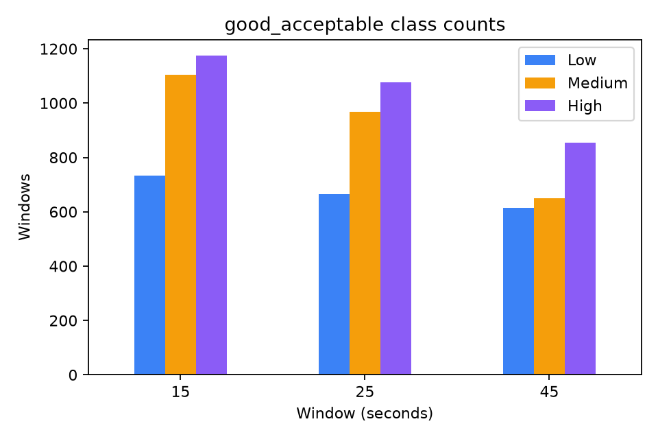
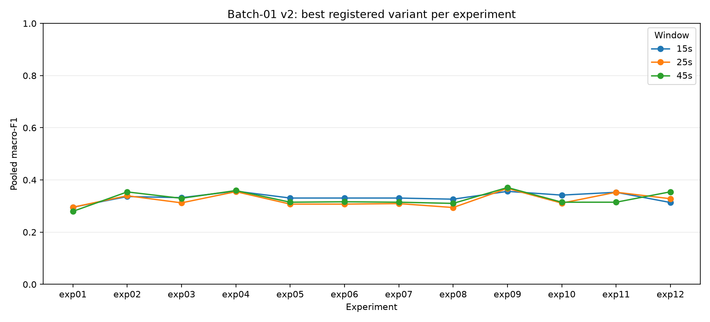

# Batch-01 pada Dataset Baru

## Ringkasan

Rangkaian ini menjalankan 36 kombinasi: exp01–exp12 pada good_acceptable dengan window 15, 25, dan 45 detik, semuanya step 5 detik. Setiap kombinasi menyelesaikan 13 outer fold. Notebook menyimpan output eksekusi lokal, bukan cell kosong atau skor simulasi.

Pada seleksi nested exp12, hasil macro-F1 teratas adalah 0.3546, dengan accuracy 0.3626 dan balanced accuracy 0.3557, pada window_45s_step_5s. Ini hasil OOF, bukan skor model refit pada data training.

Target berasal dari cognitive_load_label dataset v2. Model hanya memakai fitur sensor dan turunannya. Identitas peserta memisahkan data evaluasi; konteks CodeArrange mengatur reset history, bukan predictor. Tidak ada perubahan CSV sumber atau arsip old-dataset.

## Dataset

| window_seconds | windows | participants | Low | Medium | High |
|---|---|---|---|---|---|
| 15 | 3011 | 13 | 732 | 1105 | 1174 |
| 25 | 2711 | 13 | 666 | 968 | 1077 |
| 45 | 2118 | 13 | 614 | 650 | 854 |

Ketiga dataset mencakup 13 orang yang sama. Perubahan panjang window juga mengubah jumlah dan bagian waktu yang lolos filter. Perbandingan seluruh row dan perbandingan endpoint yang sama karena itu disajikan terpisah. all_data dan good_only tidak menjalani rangkaian training tambahan.

Langkah 5 detik membuat window saling overlap. Jumlah row tidak sama dengan jumlah pengamatan independen; seluruh rekaman seseorang tetap berada pada satu sisi pembagian train/test.

## Evaluasi dan Pemeriksaan Implementasi

LOPO menahan seluruh data satu orang sebagai test. Tuning menggunakan tiga inner GroupKFold dari orang training, dengan macro-F1 gabungan inner sebagai kriteria pemilihan. Imputasi, scaler, feature selection, dan resampling hanya fit training. Seed utama 42; ensemble mempertahankan 300 tree/iterasi.

Source runtime lama sudah dihapus sebelum pekerjaan ini. Implementasi baru mengikuti registry kandidat dan state artefak lama. Pemeriksaan regresi mencocokkan 65 kontrol preprocessing/prediksi, manifest 13 outer fold, serta objektif inner validation. Catatan lengkap tersedia pada [audit rekonstruksi](RECONSTRUCTION_AUDIT.json). Pemeriksaan ini mendukung kesamaan rancangan, bukan klaim source identik.

Metrik di bawah memakai prediksi OOF pooled. Macro-F1 memberi bobot sama pada tiga kelas. Metrik per orang juga tersedia; kelas tanpa support pada seseorang tetap kosong pada tabel kelas.

## Hasil per Eksperimen

Grafik merangkum varian teratas menurut macro-F1 pada setiap eksperimen. Untuk exp02–exp11, pemilihan baris teratas dari hasil test bersifat eksploratif. Exp12 mengevaluasi prosedur seleksi kandidat melalui inner validation setiap outer fold.

### exp01: Baseline

Dummy memakai kelas training terbanyak. XGBoost memakai parameter referensi tanpa tuning.

| window | model | accuracy | balanced_accuracy | macro_f1 |
|---|---|---|---|---|
| window_15s_step_5s | xgboost | 0.2979 | 0.3018 | 0.2953 |
| window_25s_step_5s | xgboost | 0.2969 | 0.3004 | 0.2955 |
| window_45s_step_5s | xgboost | 0.2786 | 0.2841 | 0.2796 |

[15s: metrik seluruh varian](outputs/exp01/window_15s_step_5s/full_06f6be8dccf3/metrics.csv); [25s: metrik seluruh varian](outputs/exp01/window_25s_step_5s/full_8026ed34df01/metrics.csv); [45s: metrik seluruh varian](outputs/exp01/window_45s_step_5s/full_fd84e0f568ba/metrics.csv).

### exp02: Algoritma

Menguji Logistic Regression, SVM RBF, Random Forest, Extra Trees, XGBoost, dan CatBoost. Registry memuat 66 kandidat parameter.

| window | model | accuracy | balanced_accuracy | macro_f1 |
|---|---|---|---|---|
| window_15s_step_5s | extra_trees | 0.3404 | 0.3375 | 0.3364 |
| window_25s_step_5s | logistic | 0.3430 | 0.3414 | 0.3395 |
| window_45s_step_5s | random_forest | 0.3683 | 0.3588 | 0.3541 |

Macro-F1 seluruh varian:

| model | 15s | 25s | 45s |
|---|---|---|---|
| catboost | 0.3147 | 0.3018 | 0.3141 |
| extra_trees | 0.3364 | 0.3310 | 0.3138 |
| logistic | 0.3236 | 0.3395 | 0.2967 |
| random_forest | 0.3211 | 0.3287 | 0.3541 |
| svm | 0.3249 | 0.3284 | 0.2885 |
| xgboost | 0.3110 | 0.2915 | 0.2890 |

[15s: metrik seluruh varian](outputs/exp02/window_15s_step_5s/full_cb94af28195a/metrics.csv); [25s: metrik seluruh varian](outputs/exp02/window_25s_step_5s/full_9d14aec7eb55/metrics.csv); [45s: metrik seluruh varian](outputs/exp02/window_45s_step_5s/full_75c71fd5b4a8/metrics.csv).

### exp03: Ablation sensor

Memisahkan kontribusi HRV, eye, gaze/eye state, dan iris pada XGBoost referensi.

| window | model | accuracy | balanced_accuracy | macro_f1 |
|---|---|---|---|---|
| window_15s_step_5s | hrv | 0.3484 | 0.3324 | 0.3322 |
| window_25s_step_5s | hrv | 0.3305 | 0.3134 | 0.3123 |
| window_45s_step_5s | hrv | 0.3395 | 0.3314 | 0.3296 |

Macro-F1 seluruh varian:

| model | 15s | 25s | 45s |
|---|---|---|---|
| eye | 0.2819 | 0.2814 | 0.2566 |
| hrv | 0.3322 | 0.3123 | 0.3296 |
| no_gaze_state | 0.2800 | 0.2808 | 0.2666 |
| no_iris | 0.3078 | 0.3054 | 0.3104 |
| original | 0.2953 | 0.2955 | 0.2796 |

[15s: metrik seluruh varian](outputs/exp03/window_15s_step_5s/full_88079f045c66/metrics.csv); [25s: metrik seluruh varian](outputs/exp03/window_25s_step_5s/full_c8c6dc635f49/metrics.csv); [45s: metrik seluruh varian](outputs/exp03/window_45s_step_5s/full_14af27dadf69/metrics.csv).

### exp04: Representasi fitur

Membandingkan original, clean, EAR gabungan, HRV absolut/rasio, log HRV, dan RobustScaler. Parameter model tetap.

| window | model | accuracy | balanced_accuracy | macro_f1 |
|---|---|---|---|---|
| window_15s_step_5s | logistic_absolute | 0.3610 | 0.3626 | 0.3571 |
| window_25s_step_5s | logistic_absolute | 0.3574 | 0.3618 | 0.3551 |
| window_45s_step_5s | logistic_absolute | 0.3593 | 0.3657 | 0.3594 |

Macro-F1 seluruh varian:

| model | 15s | 25s | 45s |
|---|---|---|---|
| logistic_absolute | 0.3571 | 0.3551 | 0.3594 |
| logistic_clean | 0.3307 | 0.3074 | 0.3147 |
| logistic_clean_robust | 0.3292 | 0.3101 | 0.3113 |
| logistic_ear | 0.2910 | 0.2765 | 0.2891 |
| logistic_log | 0.3278 | 0.3008 | 0.3147 |
| logistic_original | 0.3303 | 0.3074 | 0.3143 |
| logistic_ratio | 0.3484 | 0.3317 | 0.3201 |
| xgboost_absolute | 0.3101 | 0.3090 | 0.3180 |
| xgboost_clean | 0.3012 | 0.2950 | 0.2797 |
| xgboost_ear | 0.2919 | 0.2968 | 0.2985 |
| xgboost_log | 0.3012 | 0.2950 | 0.2797 |
| xgboost_original | 0.2953 | 0.2955 | 0.2796 |
| xgboost_ratio | 0.2774 | 0.2808 | 0.2625 |

[15s: metrik seluruh varian](outputs/exp04/window_15s_step_5s/full_d5b43f6b5ec5/metrics.csv); [25s: metrik seluruh varian](outputs/exp04/window_25s_step_5s/full_afc8018c94bb/metrics.csv); [45s: metrik seluruh varian](outputs/exp04/window_45s_step_5s/full_f7bea090bac3/metrics.csv).

### exp05: Class weight

Menguji bobot kesalahan kelas pada Logistic Regression dan XGBoost. Bobot dipilih di inner fold, tanpa menambah row.

| window | model | accuracy | balanced_accuracy | macro_f1 |
|---|---|---|---|---|
| window_15s_step_5s | logistic_control | 0.3341 | 0.3429 | 0.3307 |
| window_25s_step_5s | logistic_control | 0.3076 | 0.3231 | 0.3074 |
| window_45s_step_5s | logistic_control | 0.3234 | 0.3300 | 0.3147 |

Window 15s, selisih macro-F1 perlakuan terhadap kontrol: logistic: -0.0044, xgboost: -0.0152.

Window 25s, selisih macro-F1 perlakuan terhadap kontrol: logistic: -0.0018, xgboost: -0.0044.

Window 45s, selisih macro-F1 perlakuan terhadap kontrol: logistic: -0.0364, xgboost: +0.0188.

[15s: metrik seluruh varian](outputs/exp05/window_15s_step_5s/full_c114fe0be8c9/metrics.csv); [25s: metrik seluruh varian](outputs/exp05/window_25s_step_5s/full_8ddca04df9e2/metrics.csv); [45s: metrik seluruh varian](outputs/exp05/window_45s_step_5s/full_dd7084109557/metrics.csv).

### exp06: Random oversampling

Menguji pengulangan Low dengan random oversampling pada training. Target yang sudah tercapai menjadi no-op.

| window | model | accuracy | balanced_accuracy | macro_f1 |
|---|---|---|---|---|
| window_15s_step_5s | logistic_control | 0.3341 | 0.3429 | 0.3307 |
| window_25s_step_5s | logistic_control | 0.3076 | 0.3231 | 0.3074 |
| window_45s_step_5s | logistic_balanced | 0.3258 | 0.3338 | 0.3164 |

Jumlah outer fold dengan resampling aktif dan no-op:

| window_seconds | model | outer_folds | resampling_applied | no_op |
|---|---|---|---|---|
| 15 | logistic | 13 | 3 | 10 |
| 15 | xgboost | 13 | 11 | 2 |
| 25 | logistic | 13 | 5 | 8 |
| 25 | xgboost | 13 | 10 | 3 |
| 45 | logistic | 13 | 9 | 4 |
| 45 | xgboost | 13 | 10 | 3 |

Window 15s, selisih macro-F1 perlakuan terhadap kontrol: logistic: -0.0075, xgboost: +0.0129.

Window 25s, selisih macro-F1 perlakuan terhadap kontrol: logistic: -0.0038, xgboost: -0.0054.

Window 45s, selisih macro-F1 perlakuan terhadap kontrol: logistic: +0.0016, xgboost: -0.0003.

[15s: metrik seluruh varian](outputs/exp06/window_15s_step_5s/full_435ff4e3b823/metrics.csv); [25s: metrik seluruh varian](outputs/exp06/window_25s_step_5s/full_5527fc679175/metrics.csv); [45s: metrik seluruh varian](outputs/exp06/window_45s_step_5s/full_6c210023ce59/metrics.csv).

### exp07: SMOTE

Menguji interpolasi Low dengan SMOTE setelah preprocessing training. Tidak ada perubahan test atau CSV sumber.

| window | model | accuracy | balanced_accuracy | macro_f1 |
|---|---|---|---|---|
| window_15s_step_5s | logistic_control | 0.3341 | 0.3429 | 0.3307 |
| window_25s_step_5s | logistic_balanced | 0.3098 | 0.3285 | 0.3094 |
| window_45s_step_5s | logistic_control | 0.3234 | 0.3300 | 0.3147 |

Jumlah outer fold dengan resampling aktif dan no-op:

| window_seconds | model | outer_folds | resampling_applied | no_op |
|---|---|---|---|---|
| 15 | logistic | 13 | 3 | 10 |
| 15 | xgboost | 13 | 11 | 2 |
| 25 | logistic | 13 | 7 | 6 |
| 25 | xgboost | 13 | 11 | 2 |
| 45 | logistic | 13 | 10 | 3 |
| 45 | xgboost | 13 | 11 | 2 |

Window 15s, selisih macro-F1 perlakuan terhadap kontrol: logistic: -0.0045, xgboost: +0.0023.

Window 25s, selisih macro-F1 perlakuan terhadap kontrol: logistic: +0.0020, xgboost: +0.0112.

Window 45s, selisih macro-F1 perlakuan terhadap kontrol: logistic: -0.0001, xgboost: +0.0085.

[15s: metrik seluruh varian](outputs/exp07/window_15s_step_5s/full_f59fc85c6cd6/metrics.csv); [25s: metrik seluruh varian](outputs/exp07/window_25s_step_5s/full_01e3fb214e09/metrics.csv); [45s: metrik seluruh varian](outputs/exp07/window_45s_step_5s/full_b165b9765f1c/metrics.csv).

### exp08: Seleksi fitur

Memilih fitur melalui korelasi atau mutual information dalam training. Pilihan dapat berbeda antarouter fold.

| window | model | accuracy | balanced_accuracy | macro_f1 |
|---|---|---|---|---|
| window_15s_step_5s | logistic_selection | 0.3348 | 0.3418 | 0.3263 |
| window_25s_step_5s | xgboost_selection | 0.2947 | 0.3017 | 0.2943 |
| window_45s_step_5s | logistic_selection | 0.3130 | 0.3110 | 0.3102 |

[15s: metrik seluruh varian](outputs/exp08/window_15s_step_5s/full_287f9bf36c0f/metrics.csv); [25s: metrik seluruh varian](outputs/exp08/window_25s_step_5s/full_060ee43f8669/metrics.csv); [45s: metrik seluruh varian](outputs/exp08/window_45s_step_5s/full_f00a53e47909/metrics.csv).

### exp09: History kausal

Menambahkan rolling mean dan perubahan fitur sensor pada tiga/lima window secara kausal. Riwayat direset pada batas konteks/gap.

| window | model | accuracy | balanced_accuracy | macro_f1 |
|---|---|---|---|---|
| window_15s_step_5s | xgboost_history5 | 0.3514 | 0.3604 | 0.3563 |
| window_25s_step_5s | xgboost_history5 | 0.3644 | 0.3682 | 0.3676 |
| window_45s_step_5s | xgboost_history3 | 0.3631 | 0.3695 | 0.3710 |

Macro-F1 seluruh varian:

| model | 15s | 25s | 45s |
|---|---|---|---|
| logistic_history0 | 0.3307 | 0.3074 | 0.3147 |
| logistic_history3 | 0.3342 | 0.3128 | 0.3091 |
| logistic_history5 | 0.3312 | 0.3122 | 0.3074 |
| xgboost_history0 | 0.3012 | 0.2956 | 0.2802 |
| xgboost_history3 | 0.3504 | 0.3627 | 0.3710 |
| xgboost_history5 | 0.3563 | 0.3676 | 0.3683 |

Window 15s, selisih macro-F1 perlakuan terhadap kontrol: logistic: +0.0035, xgboost: +0.0492.

Window 25s, selisih macro-F1 perlakuan terhadap kontrol: logistic: +0.0053, xgboost: +0.0672.

Window 45s, selisih macro-F1 perlakuan terhadap kontrol: logistic: -0.0056, xgboost: +0.0909.

[15s: metrik seluruh varian](outputs/exp09/window_15s_step_5s/full_8ceefcb27714/metrics.csv); [25s: metrik seluruh varian](outputs/exp09/window_25s_step_5s/full_5cbccb9a6cd6/metrics.csv); [45s: metrik seluruh varian](outputs/exp09/window_45s_step_5s/full_ede93b73b14b/metrics.csv).

### exp10: Hierarchy

Menguji Low versus Elevated, kemudian Medium versus High. Probabilitas/threshold menentukan prediksi akhir.

| window | model | accuracy | balanced_accuracy | macro_f1 |
|---|---|---|---|---|
| window_15s_step_5s | logistic_hierarchy | 0.3467 | 0.3467 | 0.3419 |
| window_25s_step_5s | logistic_hierarchy | 0.3110 | 0.3243 | 0.3112 |
| window_45s_step_5s | logistic_direct | 0.3234 | 0.3300 | 0.3147 |

Window 15s, selisih macro-F1 perlakuan terhadap kontrol: logistic: +0.0113, xgboost: -0.0057.

Window 25s, selisih macro-F1 perlakuan terhadap kontrol: logistic: +0.0038, xgboost: +0.0019.

Window 45s, selisih macro-F1 perlakuan terhadap kontrol: logistic: -0.0220, xgboost: +0.0120.

[15s: metrik seluruh varian](outputs/exp10/window_15s_step_5s/full_736c850e4f20/metrics.csv); [25s: metrik seluruh varian](outputs/exp10/window_25s_step_5s/full_dc5e93f4c78d/metrics.csv); [45s: metrik seluruh varian](outputs/exp10/window_45s_step_5s/full_d8ec6ce57dbb/metrics.csv).

### exp11: Late fusion

Membandingkan fitur gabungan langsung dengan penggabungan probabilitas model HRV dan eye terpisah.

| window | model | accuracy | balanced_accuracy | macro_f1 |
|---|---|---|---|---|
| window_15s_step_5s | logistic_late | 0.3686 | 0.3539 | 0.3527 |
| window_25s_step_5s | logistic_late | 0.3659 | 0.3525 | 0.3529 |
| window_45s_step_5s | logistic_early | 0.3234 | 0.3300 | 0.3147 |

Window 15s, selisih macro-F1 perlakuan terhadap kontrol: logistic: +0.0221, xgboost: +0.0150.

Window 25s, selisih macro-F1 perlakuan terhadap kontrol: logistic: +0.0455, xgboost: +0.0035.

Window 45s, selisih macro-F1 perlakuan terhadap kontrol: logistic: -0.0045, xgboost: +0.0344.

[15s: metrik seluruh varian](outputs/exp11/window_15s_step_5s/full_3253426d164b/metrics.csv); [25s: metrik seluruh varian](outputs/exp11/window_25s_step_5s/full_1392d202bd4a/metrics.csv); [45s: metrik seluruh varian](outputs/exp11/window_45s_step_5s/full_2cc8951d72b6/metrics.csv).

### exp12: Nested selection

Menguji seleksi nested dari 154 kandidat. Model refit seluruh data disimpan terpisah dari evaluasi OOF.

| window | model | accuracy | balanced_accuracy | macro_f1 |
|---|---|---|---|---|
| window_15s_step_5s | nested_selection | 0.3135 | 0.3225 | 0.3136 |
| window_25s_step_5s | nested_selection | 0.3287 | 0.3330 | 0.3281 |
| window_45s_step_5s | nested_selection | 0.3626 | 0.3557 | 0.3546 |

Konfigurasi model refit seluruh data:

| window_seconds | model | variant | strategy | history | refit_inner_macro_f1 |
|---|---|---|---|---|---|
| 15 | logistic | clean | fusion | 0 | 0.3780 |
| 25 | xgboost | clean | base | 3 | 0.3666 |
| 45 | xgboost | clean | base | 3 | 0.4010 |

refit_inner_macro_f1 adalah kriteria pemilihan konfigurasi pada group validation seluruh data. Angka ini bukan skor generalisasi tambahan; skor evaluasi utama tetap OOF di atas. Parameter lengkap tersedia pada [final_configurations.csv](final_configurations.csv) dan final_selection.json tiap run.

[15s: metrik seluruh varian](outputs/exp12/window_15s_step_5s/full_283101608709/metrics.csv); [25s: metrik seluruh varian](outputs/exp12/window_25s_step_5s/full_870049d132df/metrics.csv); [45s: metrik seluruh varian](outputs/exp12/window_45s_step_5s/full_91495dec3178/metrics.csv).

## Evaluasi Ketahanan Exp12

| window_seconds | seed | accuracy | balanced_accuracy | macro_f1 |
|---|---|---|---|---|
| 15 | 17 | 0.3129 | 0.3219 | 0.3129 |
| 15 | 2026 | 0.3155 | 0.3245 | 0.3155 |
| 25 | 17 | 0.3309 | 0.3351 | 0.3303 |
| 25 | 2026 | 0.3279 | 0.3323 | 0.3274 |
| 45 | 17 | 0.3626 | 0.3557 | 0.3546 |
| 45 | 2026 | 0.3626 | 0.3557 | 0.3546 |

Seed 17/2026 mengulang fit konfigurasi outer yang terpilih pada seed utama, tanpa mencari seed terbaik. Bootstrap 1.000 kali mengambil sampel orang, bukan menganggap window overlap independen. Subset nonoverlap hanya menipiskan test OOF, tidak melatih ulang model.

| window_seconds | macro_f1_lower | macro_f1_upper | nonoverlap_macro_f1 | nonoverlap_windows |
|---|---|---|---|---|
| 15 | 0.2456 | 0.3610 | 0.3070 | 1144 |
| 25 | 0.2573 | 0.3782 | 0.3313 | 651 |
| 45 | 0.2877 | 0.3907 | 0.3406 | 321 |

Precision, recall, dan F1 exp12 per kelas:

| window_seconds | label | precision | recall | f1 | support |
|---|---|---|---|---|---|
| 15 | Low | 0.2642 | 0.3880 | 0.3143 | 732 |
| 15 | Medium | 0.3371 | 0.2950 | 0.3147 | 1105 |
| 15 | High | 0.3447 | 0.2845 | 0.3117 | 1174 |
| 25 | Low | 0.2915 | 0.3589 | 0.3217 | 666 |
| 25 | Medium | 0.3350 | 0.3440 | 0.3394 | 968 |
| 25 | High | 0.3556 | 0.2962 | 0.3232 | 1077 |
| 45 | Low | 0.3661 | 0.3762 | 0.3711 | 614 |
| 45 | Medium | 0.3095 | 0.2600 | 0.2826 | 650 |
| 45 | High | 0.3911 | 0.4309 | 0.4100 | 854 |

## Perbandingan Antarwindow pada Endpoint yang Sama

Tabel ini memakai irisan session_id, window_end, dan y_true antar15/25/45 detik dari prediksi OOF yang sudah ada. Panjang interval mentah tetap berbeda. Coverage menunjukkan proporsi row dataset masing-masing yang ikut perbandingan berpasangan ini.

| window | paired_windows | coverage | accuracy | balanced_accuracy | macro_f1 |
|---|---|---|---|---|---|
| window_15s_step_5s | 1925 | 0.6393 | 0.2982 | 0.3016 | 0.2941 |
| window_25s_step_5s | 1925 | 0.7101 | 0.3242 | 0.3276 | 0.3248 |
| window_45s_step_5s | 1925 | 0.9089 | 0.3647 | 0.3559 | 0.3543 |

Seluruh varian tersedia pada [paired_endpoint_metrics.csv](paired_endpoint_metrics.csv). Pemilihan window dari hasil cohort ini masih eksploratif.

## Membaca Hasil

Baris eksploratif dengan macro-F1 tertinggi adalah exp09/xgboost_history3, window_45s_step_5s, dengan accuracy 0.3631 dan macro-F1 0.3710. Nilai tertinggi prosedur nested exp12 adalah accuracy 0.3626 dan macro-F1 0.3546 pada window_45s_step_5s.

Baca peningkatan terhadap kontrol di dalam model dan window yang sama sebelum menyimpulkan manfaat balancing, fitur, atau fusion. Jumlah Low pada dataset baru sudah lebih besar, tetapi perubahan jumlah/label bukan bukti bahwa sinyal tiga kelas kini terpisah dengan baik. Metrik OOF dan recall kelas menunjukkan kemampuan yang tercapai pada evaluasi ini.

Perbedaan skor antarorang, ketidakpastian bootstrap, dan sensitivitas seed perlu dibaca bersama skor pooled. Rangkaian ini tidak membuktikan penyebab tunggal jika hasil masih rendah. Penambahan data terkontrol dan pengujian pada data independen tetap menjadi pekerjaan terpisah; laporan ini tidak mengubah rencana batch-02.

## Artefak dan Validasi

- [experiment_comparison.csv](experiment_comparison.csv): metrik seluruh model/varian pada 36 kombinasi.
- [best_per_experiment.csv](best_per_experiment.csv): ringkasan varian teratas per kombinasi.
- [VALIDATION.csv](VALIDATION.csv): pemeriksaan ulang metrik, coverage OOF, dan jumlah fold.
- [SEARCH_VALIDATION.csv](SEARCH_VALIDATION.csv): jumlah pencarian kandidat yang diharapkan/terlaksana dan pemeriksaan error.
- Notebook pada expNN/window_* menyimpan output cell lengkap. Setiap run menyimpan prediksi, manifest, pencarian kandidat, preprocessing, metrik kelas/orang, dan figure.
- Exp12 juga menyimpan seed sensitivity, bootstrap, nonoverlap, subset kualitas, learning curve, pencarian refit, schema input, dan pemeriksaan save/load model final.
- Bobot/cache/environment tetap lokal dan diabaikan Git. CSV/JSON/Markdown/figure dapat dibagikan. Checksum arsip dan sumber tidak berubah.
