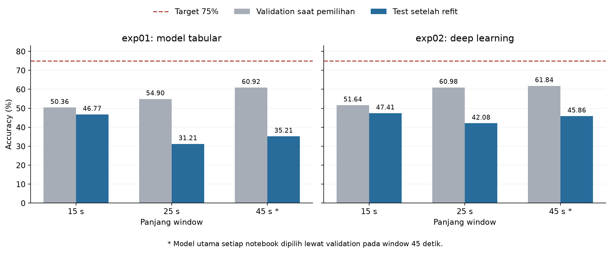
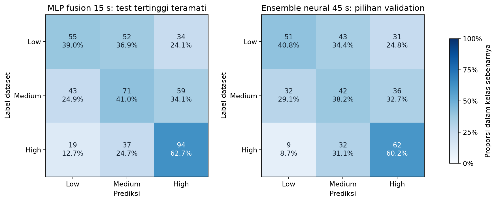
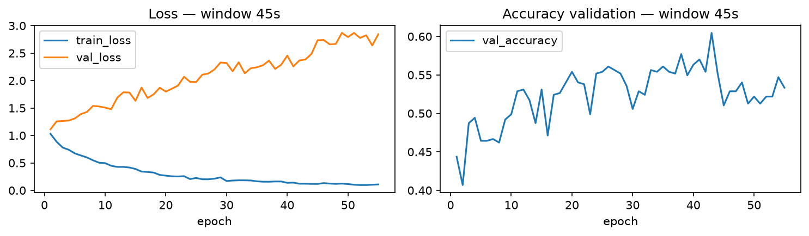

# Batch-03: Hasil Model Tabular dan Deep Learning

Tanggal rekap: 20 November 2026.

## Ringkasan

Belum ada finalist batch-03 yang mencapai target accuracy test 75%. Skor test tertinggi yang teramati adalah **47,41% accuracy dan 47,02% Macro-F1**, dari MLP fusion pada window 15 detik. Model tersebut menjawab benar 220 dari 464 window test dan salah pada 244 window, atau 52,59%.

Kedua notebook memilih window 45 detik sebagai model utama melalui validation. Pilihan utama exp01 mencapai accuracy test **35,21%**, sedangkan pilihan utama exp02 mencapai **45,86%**. Model 15 detik merupakan hasil test tertinggi setelah hasil dibaca, bukan pemenang utama yang ditetapkan sebelum evaluasi. Laporan ini mempertahankan perbedaan tersebut.

Hasil belum memenuhi sasaran penelitian pada evaluasi internal yang disepakati. Perekaman orang yang sama boleh muncul pada training dan test dalam batch ini; hasil yang rendah tetap muncul setelah pemisahan peserta tidak lagi menjadi cara evaluasi utama.

## 1. Data dan pembagian evaluasi

Kedua notebook memakai tiga good_acceptable dataset v2 setelah penggantian selektif Mon dan Alif. Hash ketiga CSV sesuai dengan file sumber lokal sekarang dan sama pada kedua run. Model memprediksi Low/Medium/High dari fitur sensor; identitas, difficulty, fase, dan soal tidak menjadi predictor.

Split memakai blok waktu 120 detik per sesi, kelas dominan blok, dan seed 42. Target pembagian blok mendekati 70/15/15. Purge menggunakan rentang pendukung konservatif 45 detik pada seluruh pilihan window. Training tidak berbagi interval pendukung dengan validation/test, dan validation tidak berbagi interval dengan test.

| Window / step | CSV awal | Training | Validation | Test | Purge |
|---|---|---|---|---|---|
| 15 / 5 detik | 3579 | 2131 | 550 | 464 | 434 |
| 25 / 5 detik | 3214 | 1878 | 510 | 423 | 403 |
| 45 / 5 detik | 2527 | 1424 | 435 | 338 | 330 |

Purge hanya mengecualikan baris dari eksperimen; CSV sumber tidak berubah. Window dalam bagian yang sama masih dapat overlap. Jumlah baris bukan jumlah pengamatan sensor independen. Window test 15, 25, dan 45 detik juga mempunyai cakupan berbeda, sehingga perbandingan antarwindow tidak memakai test yang identik. Perbandingan exp01 versus exp02 pada window yang sama memakai endpoint dan label test yang identik.

Seluruh pencarian memakai training untuk fitting dan validation untuk memilih kandidat. Setiap notebook kemudian mengunci satu finalist per-window dan satu model utama. Finalist menjalani refit pada training + validation sebelum evaluasi test. Skor validation berasal dari model sebelum refit; skor test berasal dari model sesudah refit.

## 2. Eksperimen yang dijalankan

### Exp01: model tabular dan ensemble

Tim menjalankan Logistic Regression, SVM RBF dengan kalibrasi probabilitas, KNN, Random Forest, Extra Trees, HistGradientBoosting, XGBoost, dan CatBoost. Penyaringan awal mencakup eye-only, HRV-only, dan fusion pada ketiga window. Dummy menjadi pembanding.

Optimasi berikutnya berfokus pada dua keluarga teratas tiap window. Kandidat mencakup tambahan rasio baseline, log HRV, scaler, mutual information, PCA, class/sample weight, ROS, SMOTE, interaksi derajat dua, hierarchy Low/Elevated lalu Medium/High, soft voting, dan late fusion. Ini pencarian bertahap, bukan tuning mendalam delapan algoritma sekaligus.

| Tahap tercatat | Kandidat unik |
|---|---|
| Penyaringan algoritma dan sensor | 72 |
| Tuning tambahan | 66 |
| Seleksi fitur tambahan | 18 |
| Balancing tambahan | 18 |
| Logistic Regression dengan interaksi | 18 |
| Hierarchy | 3 |
| Soft voting | 3 |
| Late fusion | 9 |
| Dummy | 3 |
| **Total exp01** | **210** |

Jumlah tuning tambahan tidak menghitung ulang kontrol. Uji gabungan seleksi fitur dan balancing menggunakan recipe yang sudah tersedia ketika kombinasi terbaiknya sama dengan kandidat sebelumnya. Cache mencegah fitting ganda dan tidak menambah hitungan kandidat unik. Ensemble menyimpan hasil gabungan probabilitas pada validation; refit komponennya berlangsung untuk finalist yang terpilih.

### Exp02: deep learning

Tim menjalankan MLP, MLP residual, dan Transformer tabular kecil pada eye-only dan fusion, dengan dua preset per arsitektur dan tiga window. Preset berbeda dalam ukuran, dropout, learning rate, dan penggunaan weighted loss; perbandingannya tidak mengisolasi pengaruh satu parameter saja.

| Tahap tercatat | Kandidat |
|---|---|
| Penyaringan neural | 36 |
| Pengulangan seed 17 dan 2026 | 6 |
| Rata-rata tiga seed | 3 |
| Voting dua arsitektur | 9 |
| **Total exp02** | **54** |

Pemilihan memakai kandidat seed 42, rata-rata tiga seed, dan voting arsitektur. Seed tambahan tidak dipilih sebagai kandidat tunggal berdasarkan skor terbaiknya. Maksimal 100 epoch dan patience 12; notebook memulihkan checkpoint accuracy validation terbaik, lalu Macro-F1 sebagai pemecah nilai sama.

Total kedua notebook adalah **264 catatan kandidat validation**, bukan 264 algoritma berbeda. Hanya **enam finalist** yang menjalani evaluasi test.

## 3. Hasil enam finalist

| Notebook | Window | Finalist | Accuracy validation | Accuracy test | Macro-F1 test | Balanced accuracy test |
|---|---|---|---|---|---|---|
| exp01 | 15 s | Soft voting LR interaksi, Extra Trees, Random Forest | 50,36% | 46,77% | 46,40% | 46,83% |
| exp01 | 25 s | Logistic Regression fusion, C=10 | 54,90% | 31,21% | 31,39% | 32,25% |
| exp01 | 45 s | Late fusion LR eye + Random Forest HRV **(utama exp01)** | 60,92% | 35,21% | 33,37% | 34,83% |
| exp02 | 15 s | MLP fusion, hidden 64–32 | 51,64% | 47,41% | 47,02% | 47,57% |
| exp02 | 25 s | Voting MLP fusion + Transformer eye | 60,98% | 42,08% | 40,94% | 43,50% |
| exp02 | 45 s | Voting Transformer fusion + MLP residual eye **(utama exp02)** | 61,84% | 45,86% | 45,82% | 46,39% |

### Konfigurasi utama exp01

Late fusion 45 detik menggabungkan Logistic Regression eye-only C=1 dan Random Forest HRV-only 300 tree. Bobot probabilitasnya 75% eye dan 25% HRV. Model eye memakai 21 fitur dengan median imputation dan StandardScaler; cabang HRV memakai RMSSD dan SDNN. Keduanya tidak memakai balancing atau tambahan rasio baseline.

Accuracy validation 60,92% turun menjadi 35,21% pada test. Pada kelas Medium, model mengenali hanya 13 dari 110 window, atau recall 11,82%. Accuracy test juga di bawah tebakan konstan Low sebesar 36,98%, meskipun Macro-F1 model masih lebih tinggi daripada tebakan satu kelas.

### Konfigurasi utama exp02

Voting neural 45 detik menggabungkan Transformer fusion token dimension 64 dan MLP residual eye-only width 128, masing-masing berbobot 50%. Keduanya memakai preset weighted loss dan seed 42. Epoch terbaik masing-masing adalah 43 dan 11; jumlah ini menjadi durasi refit komponennya.

Accuracy validation 61,84% turun menjadi 45,86% pada test. Model mengenali Low 40,80%, Medium 38,18%, dan High 60,19%. Kemampuan mengenali High lebih tinggi, tetapi Low dan Medium masih banyak tertukar.

### Skor test tertinggi yang teramati

MLP fusion 15 detik memakai **23 fitur**: 21 fitur eye dan RMSSD/SDNN. Konfigurasinya hidden layer 64–32, dropout 0,1, learning rate 0,001, AdamW dengan weight decay 0,0001, median imputation, dan StandardScaler. Model tidak memakai weighted loss, resampling, rasio baseline, atau history. Seed-nya 42.

Training awal mencapai epoch 87 dan memilih checkpoint epoch 75. Refit menggunakan 2.681 baris training + validation selama 75 epoch, lalu mengevaluasi 464 baris test. Model hasil refit inilah yang tersimpan sebagai model evaluasi.

| Kelas | Precision test | Recall test | F1 test | Support |
|---|---|---|---|---|
| Low | 47,01% | 39,01% | 42,64% | 141 |
| Medium | 44,38% | 41,04% | 42,64% | 173 |
| High | 50,27% | 62,67% | 55,79% | 150 |

Soft voting tabular 15 detik menjawab benar 217 dari 464 window, sedangkan MLP menjawab benar 220. Selisih accuracy 0,65 poin persentase hanya setara tiga prediksi benar tambahan. Ini belum menunjukkan keunggulan besar deep learning atas tabular pada window tersebut.

## 4. Perbandingan dengan Dummy

Pembanding berikut memilih kelas terbanyak pada training + validation, kemudian menerapkan tebakan yang sama pada test. Kelas tidak dipilih dari distribusi test.

| Window | Tebakan konstan | Accuracy Dummy test | Accuracy exp01 test | Accuracy exp02 test |
|---|---|---|---|---|
| 15 s | Medium | 37,28% | 46,77% | 47,41% |
| 25 s | High | 30,50% | 31,21% | 42,08% |
| 45 s | Low | 36,98% | 35,21% | 45,86% |

MLP 15 detik melampaui Dummy sebesar 10,13 poin persentase. Ada informasi prediktif yang dimanfaatkan model, tetapi hasil 47,41% masih menyisakan lebih dari separuh window test salah. Nilai tersebut belum mendekati target 75%.

## 5. Temuan dari variasi sensor dan algoritma

### Penyaringan input sensor

Tabel ini menunjukkan accuracy validation tertinggi pada penyaringan awal untuk setiap kelompok sensor. Algoritma pemenangnya dapat berbeda antarkelompok, sehingga tabel tidak mengisolasi efek penambahan sensor pada satu algoritma tetap.

| Window | Eye-only | HRV-only | Fusion |
|---|---|---|---|
| 15 s | 49,09% (Extra Trees) | 38,73% (Extra Trees) | 49,09% (Extra Trees) |
| 25 s | 53,92% (Logistic Regression) | 40,20% (HistGradientBoosting) | 54,51% (Logistic Regression) |
| 45 s | 58,16% (Logistic Regression) | 42,76% (Random Forest) | 59,08% (Random Forest) |

HRV-only menghasilkan skor penyaringan lebih rendah daripada kelompok eye/fusion pada ketiga window. Namun cabang HRV membantu memilih late fusion 45 detik pada validation. Perannya belum konsisten ketika model tersebut masuk test. Hasil ini tidak membuktikan bahwa rekaman HRV pasti rusak.

### Keluarga algoritma dan arsitektur

Angka berikut adalah accuracy validation tertinggi per keluarga dari kandidat yang benar-benar dijalankan. Sebagian keluarga mendapat tuning lanjutan, sedangkan keluarga lain hanya menjalani penyaringan. Kolom bukan perbandingan hyperparameter dengan anggaran yang sama.

| Keluarga | 15 s | 25 s | 45 s |
|---|---|---|---|
| HistGradientBoosting | 47,09% | 51,96% | 52,18% |
| XGBoost | 46,91% | 51,76% | 53,79% |
| CatBoost | 45,09% | 48,24% | 56,09% |
| Logistic Regression | 50,18% | 54,90% | 59,54% |
| SVM RBF | 33,45% | 36,27% | 32,41% |
| Random Forest | 48,55% | 52,35% | 59,08% |
| Extra Trees | 49,82% | 51,96% | 50,57% |
| KNN | 47,64% | 50,59% | 49,43% |

| Arsitektur neural tunggal | 15 s | 25 s | 45 s |
|---|---|---|---|
| MLP | 51,64% | 59,02% | 56,55% |
| MLP residual | 51,45% | 56,08% | 59,08% |
| Transformer tabular | 49,64% | 57,06% | 60,46% |

Logistic Regression dengan interaksi dan soft voting memberi hasil validation teratas tabular pada 15 detik. Logistic Regression fusion tanpa tambahan seleksi atau balancing menjadi finalist 25 detik. Pada 45 detik, late fusion mengungguli kandidat tunggal di validation.

Balancing, seleksi fitur, PCA, hierarchy, dan rata-rata seed telah dicoba. Perlakuan tersebut tidak menjadi pilihan utama kedua notebook. Pada exp02, rata-rata tiga seed tidak melampaui kandidat/voting terpilih. Ini hasil pada pencarian dan split sekarang, bukan kesimpulan bahwa metode-metode tersebut tidak dapat berguna pada konfigurasi lain.

## 6. Analisis hasil yang belum optimal

### 6.1 Model kompleks menunjukkan overfitting

Beberapa model mempelajari training jauh lebih baik daripada validation. Contoh dari checkpoint kandidat sebelum refit:

| Kandidat | Accuracy training | Accuracy validation |
|---|---|---|
| MLP fusion 15 s | 87,47% | 51,64% |
| MLP fusion 25 s | 89,72% | 59,02% |
| Transformer fusion 45 s | 98,10% | 60,46% |
| HistGradientBoosting eye 25 s | 100,00% | 51,96% |

Pada Transformer 45 detik, loss training turun dari 1,030 pada epoch pertama menjadi 0,121 pada checkpoint terbaik epoch 43. Loss validation justru naik dari 1,112 menjadi 2,385, lalu mencapai 2,845 pada epoch terakhir. Pola ini mendukung indikasi overfitting dan prediksi yang terlalu yakin pada sebagian jawaban salah.

Notebook menghentikan training berdasarkan accuracy validation, bukan loss validation. Ia memang memulihkan checkpoint accuracy terbaik; masalahnya, checkpoint dengan accuracy tertinggi dapat mempunyai cross-entropy yang jauh lebih buruk. Hal ini relevan untuk ensemble yang menggabungkan probabilitas.

### 6.2 Peringkat validation belum stabil terhadap test

| Notebook / window | Accuracy validation | Accuracy test | Penurunan |
|---|---|---|---|
| exp01 / 15 s | 50,36% | 46,77% | 3,60 poin |
| exp01 / 25 s | 54,90% | 31,21% | 23,70 poin |
| exp01 / 45 s | 60,92% | 35,21% | 25,71 poin |
| exp02 / 15 s | 51,64% | 47,41% | 4,22 poin |
| exp02 / 25 s | 60,98% | 42,08% | 18,90 poin |
| exp02 / 45 s | 61,84% | 45,86% | 15,98 poin |

Kedua notebook memilih 45 detik, sementara 15 detik mencatat test tertinggi. Pemilihan dari satu validation split belum memprediksi urutan performa test dengan baik. Seluruh pencarian 210 dan 54 kandidat menggunakan validation yang sama, sehingga sensitivitas pemilihan kandidat perlu diperiksa sebelum memperluas pencarian lagi.

Penurunan bukan hanya ciri model yang mencapai 100% training. Logistic Regression 25 detik mencatat training 57,29% dan validation 54,90%, tetapi test setelah refit hanya 31,21%. Karena itu, overfitting model kompleks bukan penjelasan tunggal.

Komposisi kelas 45 detik juga berubah: High mencakup 40,00% validation tetapi 30,47% test; Low berubah dari 28,74% menjadi 36,98%. Namun penyesuaian proporsi saja tidak menjelaskan seluruh penurunan. Jika recall per kelas validation tetap sama, accuracy terhitung pada proporsi test masih sekitar 59,34% untuk exp01 dan 60,30% untuk exp02, bukan 35,21% dan 45,86%. Ini perhitungan deskriptif dari confusion matrix, bukan eksperimen model baru.

Skor validation dan test di atas memakai model dengan fitting berbeda, karena finalist menjalani refit pada training + validation. Hasil yang tersedia belum memisahkan efek refit dari perbedaan bagian rekaman validation/test. Laporan ini tidak menetapkan refit sebagai penyebab pasti dan tidak menjalankan ulang model untuk mencari skor test yang lebih tinggi.

### 6.3 Jumlah kelas yang lebih seimbang belum menghasilkan pemisahan kelas yang baik

Pada MLP 15 detik, test berisi Low 141, Medium 173, dan High 150. Meskipun jumlahnya berdekatan, recall Low hanya 39,01% dan Medium 41,04%. High lebih baik pada 62,67%. Kesalahan model melibatkan beberapa kelas, sehingga kekurangan Low bukan penjelasan tunggal hasil batch ini.

Kualitas perekaman dan kemampuan klasifikasi adalah dua pemeriksaan berbeda. Hasil batch-03 menunjukkan bahwa pipeline yang diuji belum memanfaatkan fitur untuk memisahkan label dengan kuat. Metrik ini saja belum menentukan apakah penyebab dasarnya mutu sensor tertentu, representasi fitur, variasi antarbagiannya, atau hubungan label dengan sinyal fisiologis.

## 7. Prioritas tindak lanjut

1. **Pisahkan pengaruh refit.** Pada diagnostik terpisah, bandingkan prediksi checkpoint sebelum refit dengan model sesudah refit pada endpoint yang sama. Tujuannya menelusuri penurunan, bukan mengganti skor utama setelah melihat test.
2. **Periksa kestabilan pemilihan di validation.** Gunakan beberapa pembagian blok ber-purge di dalam bagian pengembangan. Pertahankan test sebagai evaluasi akhir dan jangan mencari seed yang kebetulan memberi test tinggi. Ini tidak mengharuskan kembali ke LOPO.
3. **Uji regularisasi dan aturan stopping neural.** Bandingkan stopping berdasarkan validation loss dengan aturan accuracy sekarang; periksa confidence/probabilitas sebelum menambah bobot ensemble atau durasi training.
4. **Audit fitur dan bagian rekaman yang menyumbang kesalahan.** Gunakan metadata hanya untuk penelusuran; jangan membuang baris karena model salah atau memasukkan ID, fase, dan difficulty untuk mengejar accuracy.

Menambah arsitektur lebih besar belum menjadi prioritas pertama. Batch ini sudah menunjukkan model yang mencapai training 87–100% tetapi tetap rendah pada validation/test. Perubahan berikutnya perlu menargetkan gap tersebut dan ketidakstabilan pemilihan, bukan hanya menaikkan kapasitas.

## 8. Pemeriksaan hasil dan sumber

Kedua run mempunyai penanda complete. Notebook tersimpan tidak memuat output exception atau warning, dan source code cell cocok dengan versi penyiapan di Git; perubahannya berupa hasil eksekusi. Run ID pada output notebook sesuai dengan folder hasil.

| Pemeriksaan | Hasil |
|---|---|
| Kandidat dengan metrik validation dihitung ulang | 210 exp01 + 54 exp02; cocok |
| Prediksi test diperiksa | Enam finalist; jumlah, endpoint, label, argmax probabilitas, confusion matrix, accuracy, Macro-F1, dan balanced accuracy cocok |
| Daftar kandidat pada CSV leaderboard | Cocok dengan record kandidat |
| Identitas dataset dan split | Hash CSV sama pada kedua run dan cocok dengan sumber lokal; hash split sama |
| Berkas ber-checksum | 850 berkas cocok; tidak ada checksum berbeda atau artefak yang hilang |
| Bobot model dalam salinan lokal | 201 file pkl exp01 dan 45 file pkl exp02 tersedia |
| Training ulang saat rekap | Tidak dilakukan |

Audit membaca JSON, CSV, probabilitas NPY, dan checksum berkas. Audit tidak memuat file pickle untuk menjalankan inference. Penanda complete juga sesuai dengan finalist dan test_summary masing-masing run.

Environment core sama pada kedua notebook. Exp01 memakai Python 3.13.18; exp02 memakai Python 3.13.16 dan PyTorch 2.14.1+cu130. Selisih patch Python ini dicatat sebagai konteks reproduksi, bukan ditetapkan sebagai penyebab perbedaan skor.

- [Hasil utama exp01](outputs/exp01/20261119T185251108907Z_2bc268ab/RESULTS.md), [test_summary exp01](outputs/exp01/20261119T185251108907Z_2bc268ab/test_summary.csv), dan [leaderboard validation exp01](outputs/exp01/20261119T185251108907Z_2bc268ab/validation_leaderboard.csv).
- [Hasil utama exp02](outputs/exp02/20261119T191445996307Z_f399c8da/RESULTS.md), [test_summary exp02](outputs/exp02/20261119T191445996307Z_f399c8da/test_summary.csv), dan [leaderboard validation exp02](outputs/exp02/20261119T191445996307Z_f399c8da/validation_leaderboard.csv).
- [Pemilihan finalist exp01](outputs/exp01/20261119T185251108907Z_2bc268ab/selection/record.json) dan [exp02](outputs/exp02/20261119T191445996307Z_f399c8da/selection/record.json).
- [Prediksi test MLP 15 detik](outputs/exp02/20261119T191445996307Z_f399c8da/final_w15_be01358bfb41959422a3/predictions.csv) dan [schema/konfigurasi model](outputs/exp02/20261119T191445996307Z_f399c8da/final_w15_be01358bfb41959422a3/feature_schema.json).

Model dengan skor test tertinggi berada pada `outputs/exp02/20261119T191445996307Z_f399c8da/final_w15_be01358bfb41959422a3/model.pkl`. Model utama exp02 berada pada `final_w45_a3126a45dd04aa33dfe1/model.pkl` di run yang sama. Bobot tersedia lokal/Drive tetapi mengikuti aturan Git yang mengabaikan pkl; pertahankan environment dan notebook yang sesuai saat memuatnya.

Angka batch-03 tidak dibandingkan langsung sebagai peningkatan algoritma atas batch-02 karena unit evaluasinya berubah dari pemisahan peserta menjadi blok waktu campuran. Kesimpulan batch ini tetap: **skor test tertinggi teramati 47,41%, model utama neural 45,86%, dan target 75% belum tercapai.**

