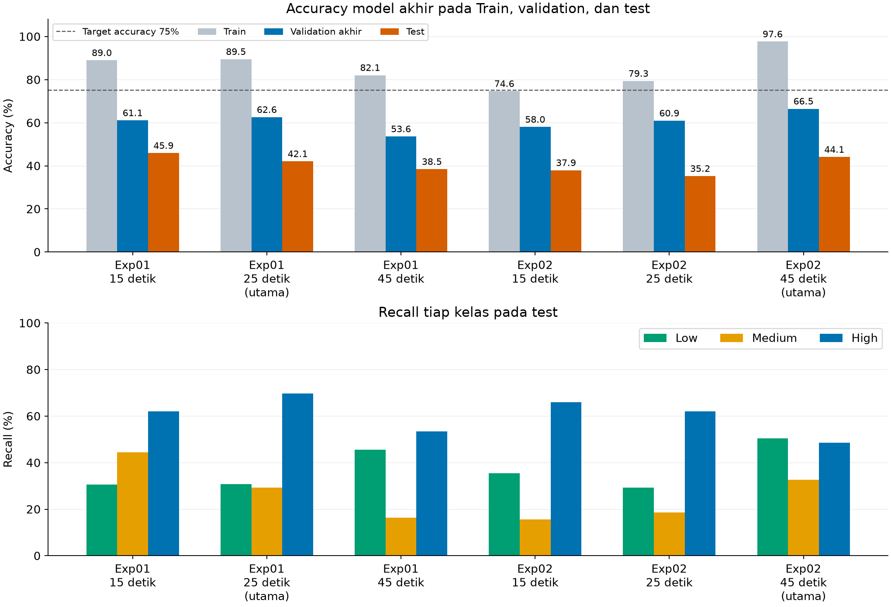
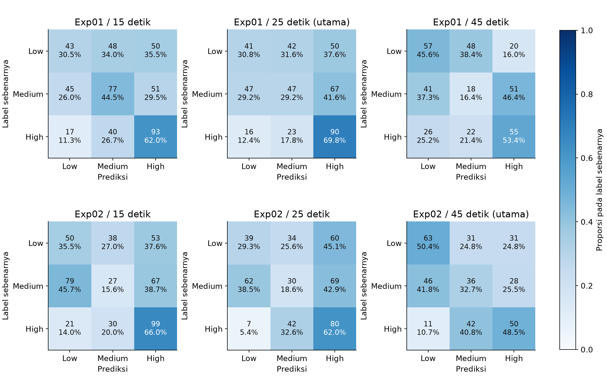

# Batch-04: Hasil Normalisasi Sensor dan Seleksi Model

Tanggal rekap: 20 November 2026.

## Ringkasan

Belum ada model akhir batch-04 yang mencapai target accuracy test 75%. Skor test tertinggi yang teramati adalah **45,91% accuracy dan 44,86% Macro-F1**, dari HistGradientBoosting fusion window 15 detik pada exp01. Model tersebut menjawab benar 213 dari 464 window dan salah pada 251 window, atau 54,09%.

Sebelum test dibuka, validation akhir memilih SVM window 25 detik sebagai model utama exp01 dan residual MLP window 45 detik sebagai model utama exp02. Accuracy test keduanya adalah **42,08%** dan **44,08%**. Model dengan test tertinggi dan model utama yang dipilih dari validation merupakan dua hasil berbeda; laporan ini tidak mengganti pemenang setelah melihat test.

Batch ini memperluas cakupan validation internal, mempertahankan tiga cabang normalisasi, memisahkan pemantau epoch neural, serta menguji bentuk model akhir sebelum test. Perbaikan prosedur tersebut belum menghasilkan peningkatan accuracy yang konsisten. Selisih validation–test masih 15,16–25,72 poin persentase, dan kelas Medium tetap sulit dikenali.

## 1. Run dan data

Rekap memakai kedua run selesai dengan pipeline `batch04-2.0.0` berikut:

| Notebook | Run | Model utama dari validation |
|---|---|---|
| Exp01 | `20261120T032808093791Z_41844d37` | SVM RBF, window 25 detik |
| Exp02 | `20261120T040350303624Z_6156e180` | Rata-rata probabilitas tiga seed residual MLP, window 45 detik |

Run ID pada output notebook sesuai dengan folder hasil. Keduanya memiliki status `complete`, hasil test, serta contoh inference model tersimpan. Notebook yang diperiksa tidak memuat output exception.

Kedua notebook memakai tiga `good_acceptable.csv` pada `analysis_sessions/dataset_fusion/output/v2_session_phase`. Hash dataset pada kedua run identik dan cocok dengan CSV sumber lokal saat rekap. Protokol label tetap mengikuti dataset v2: kelas Low mencakup fase yang telah dipetakan ke Low, sedangkan Medium dan High berasal dari pengerjaan aktif pada tingkat terkait. Metadata tidak menjadi predictor classifier.

| Window / step | Baris sumber | Low | Medium | High |
|---|---:|---:|---:|---:|
| 15 / 5 detik | 3.579 | 1.062 | 1.266 | 1.251 |
| 25 / 5 detik | 3.214 | 984 | 1.093 | 1.137 |
| 45 / 5 detik | 2.527 | 908 | 728 | 891 |

### Pembagian evaluasi

| Window | Train | Validation akhir | Test | Purged | Low / Medium / High pada test |
|---|---:|---:|---:|---:|---|
| 15 detik | 2.069 | 560 | 464 | 486 | 141 / 173 / 150 |
| 25 detik | 1.845 | 489 | 423 | 457 | 133 / 161 / 129 |
| 45 detik | 1.444 | 373 | 338 | 372 | 125 / 110 / 103 |

Split menggunakan blok waktu 120 detik dalam sesi. Dukungan konservatif 45 detik dipurge antarbagian dan antarwindow. Ini evaluasi internal dengan rekaman orang yang sama boleh hadir pada Train, validation, dan test, bukan evaluasi leave-one-participant-out.

Di dalam Train, lima fold bergantian menjadi validation internal. Setiap baris Train mendapat satu prediksi out-of-fold. Accuracy gabungan prediksi tersebut menentukan peringkat konfigurasi, diikuti Macro-F1, variasi accuracy fold, jumlah fitur, dan ID. Skor out-of-fold dipakai untuk tuning dan bukan skor evaluasi akhir yang terpisah dari proses seleksi.

Kandidat terpilih dilatih pada seluruh Train. Notebook lalu membandingkan model individual dan ensemble pada validation akhir. Accuracy validation akhir menentukan model per-window dan model utama, dengan Macro-F1 dan kriteria kestabilan/kompleksitas sebagai pemecah seri. Test memakai **bundle yang sama dengan validation akhir**, tanpa refit Train + validation.

Window dalam bagian yang sama masih dapat overlap. Jumlah baris tidak sama dengan jumlah pengamatan sensor independen. Ketiga window juga memiliki cakupan test berbeda; perbandingan antarwindow bukan perbandingan pada baris yang identik.

## 2. Perlakuan yang dijalankan

### Exp01: model tabular

Screening membandingkan Logistic Regression, SVM, HistGradientBoosting, XGBoost, dan CatBoost pada normalisasi global, session-centered, dan session-standardized. Setiap kombinasi memakai fusion 23 fitur serta nonspatial 11 fitur. Dua kontrol tambahan memakai Logistic Regression session-centered untuk eye saja dan HRV saja.

Pemimpin tiap normalisasi mendapat tuning terbatas. Tahap berikutnya membandingkan empat fitur relatif dan balanced class weight. Kelompok relative berisi 23 fitur fusion ditambah RMSSD/SDNN, perbedaan relatif EAR, variasi relatif EAR, serta variasi relatif ukuran iris. Class weight mengubah bobot kesalahan, bukan menambah baris data.

| Tahap | Konfigurasi unik |
|---|---:|
| Screening algoritma × normalisasi × kelompok fitur | 90 |
| Tuning tambahan | 34 |
| Fitur relatif | 9 |
| Class weight | 9 |
| Kontrol eye-only / HRV-only | 6 |
| Dummy | 3 |
| **Total exp01** | **151** |

Jumlah konfigurasi per-window adalah 51, 50, dan 50. Konfigurasi identik tidak dijalankan dua kali. Setelah fitting seluruh Train, exp01 membandingkan enam model individual, satu hard voting, dan satu rata-rata probabilitas per-window: **24 bentuk model pada validation akhir**. SVM memakai keputusan kelas langsung dan tidak masuk rata-rata probabilitas.

### Exp02: model neural

Screening membandingkan MLP 64–32, residual MLP width 64 dua block, dan Transformer tabular width 32 pada tiga normalisasi serta fusion/nonspatial. Training memakai AdamW, batch 128, gradient clipping, cosine learning-rate schedule, maksimum 120 epoch, dan patience 20.

Pemantau epoch diambil dari training fold, terpisah dari validation penilaian. Accuracy pemantau, Macro-F1, lalu cross-entropy menentukan durasi. Notebook kemudian melatih jaringan dari awal pada seluruh training fold selama durasi tersebut sebelum menghitung skor validation internal.

| Tahap | Konfigurasi unik |
|---|---:|
| Screening arsitektur × normalisasi × kelompok fitur | 54 |
| Paket regularisasi tambahan | 18 |
| Fitur relatif | 9 |
| Class weight | 9 |
| Dummy | 3 |
| **Total exp02** | **93** |

Masing-masing window memiliki 31 konfigurasi termasuk Dummy. Kandidat akhir menggunakan median epoch terbaik lima fold sebagai durasi fitting seluruh Train. Model seed 42 dibandingkan dengan rata-rata probabilitas seed 42/43/44: **36 bentuk model pada validation akhir**. Seed tambahan tidak dipilih secara individual berdasarkan test.

Total kedua eksperimen adalah **244 konfigurasi internal dengan 1.220 hasil fold**, lalu **60 bentuk model pada validation akhir**. Hanya enam pemenang per-window yang menjalani evaluasi test. Batch ini tidak memakai ROS atau SMOTE.

## 3. Hasil enam model akhir

| Notebook | Window | Model akhir | Accuracy Train | Accuracy validation akhir | Accuracy test | Macro-F1 test | Balanced accuracy test |
|---|---|---|---:|---:|---:|---:|---:|
| Exp01 | 15 s | HistGradientBoosting, fusion, global | 88,98% | 61,07% | **45,91%** | **44,86%** | 45,67% |
| Exp01 | 25 s | SVM RBF, relative, global, class weight **(utama)** | 89,49% | 62,58% | 42,08% | 40,87% | 43,26% |
| Exp01 | 45 s | Hard voting tiga konfigurasi | 82,06% | 53,62% | 38,46% | 37,33% | 38,45% |
| Exp02 | 15 s | Residual MLP nonspatial global, class weight, rata-rata tiga seed | 74,63% | 58,04% | 37,93% | 36,06% | 39,02% |
| Exp02 | 25 s | Residual MLP nonspatial global, seed 42 | 79,35% | 60,94% | 35,22% | 34,06% | 36,66% |
| Exp02 | 45 s | Residual MLP nonspatial global, rata-rata tiga seed **(utama)** | 97,65% | 66,49% | 44,08% | 43,83% | 43,89% |

Pada test yang sama per-window, tabular lebih tinggi pada 15 dan 25 detik; neural lebih tinggi pada 45 detik. Tidak ada keunggulan neural yang konsisten pada ketiga window.

### Model dengan test tertinggi: HistGradientBoosting 15 detik

Model memakai 23 fitur fusion dan normalisasi global, dengan 200 iterasi, learning rate 0,05, maksimum depth 3, maksimum tujuh leaf, minimum 40 sampel per leaf, dan L2=10. Model tidak memakai class weight atau fitur relatif.

Accuracy out-of-fold konfigurasi ini adalah 53,60%, dengan accuracy lima fold 58,74%, 53,81%, 52,59%, 47,96%, dan 55,01%. Setelah fitting seluruh Train, validation akhir mencapai 61,07%; test turun menjadi 45,91%.

| Kelas | Precision test | Recall test | F1 test | Support |
|---|---:|---:|---:|---:|
| Low | 40,95% | 30,50% | 34,96% | 141 |
| Medium | 46,67% | 44,51% | 45,56% | 173 |
| High | 47,94% | 62,00% | 54,07% | 150 |

Skor ini lebih tinggi daripada lima model akhir lainnya, tetapi masih salah pada lebih dari separuh test. Pengenalan Low hanya 43 dari 141 window.

### Model utama exp01: SVM 25 detik

SVM RBF memakai C=1 dan gamma=scale, 27 fitur relative fusion, normalisasi global, dan balanced sample weight. Accuracy out-of-fold 56,86% meningkat menjadi 62,58% pada validation akhir, kemudian turun ke 42,08% pada test.

Model mengenali Low 41/133, Medium 47/161, dan High 90/129. Ia memprediksi High pada 207 dari 423 window, atau 48,94%, padahal High sebenarnya hanya 30,50% test. Recall High 69,77% disertai precision 43,48%; banyak Low dan Medium salah diprediksi High.

### Model utama exp02: residual MLP 45 detik

Model menerima 11 fitur nonspatial: RMSSD, SDNN, blink rate, empat fitur EAR, dan empat fitur iris. Normalisasinya global. Konfigurasi memakai width 64 dua residual block, dropout 0,1, learning rate 0,001, weight decay 1e-4, tanpa label smoothing maupun class weight.

Epoch terbaik lima fold adalah 51, 44, 37, 56, dan 27. Median 44 menjadi durasi fitting seluruh Train untuk seed 42, 43, dan 44. Model akhir merata-ratakan probabilitas ketiganya; ini bukan penggabungan checkpoint dari fold yang berbeda.

Accuracy out-of-fold 60,53% diikuti training seluruh Train 97,65%, validation akhir 66,49%, dan test 44,08%.

| Kelas | Precision test | Recall test | F1 test | Support |
|---|---:|---:|---:|---:|
| Low | 52,50% | 50,40% | 51,43% | 125 |
| Medium | 33,03% | 32,73% | 32,88% | 110 |
| High | 45,87% | 48,54% | 47,17% | 103 |

Model menjawab benar 149/338 window dan salah pada 189 window. Dari 110 Medium, 46 diprediksi Low dan 28 diprediksi High; hanya 36 dikenali sebagai Medium.

Hard voting exp01 45 detik menggabungkan SVM RBF nonspatial global berbobot, Logistic Regression fusion global, dan SVM linear relative session-centered berbobot. Jadi ketiga komponen itu bukan tiga keluarga algoritma berbeda.

Angka pertama pada sel adalah jumlah window; persentasenya dihitung terhadap seluruh window pada label sebenarnya di baris tersebut.

## 4. Perbandingan dengan Dummy

Pembanding berikut memilih kelas terbanyak pada **Train**, bukan dari test, lalu menebak kelas tersebut pada seluruh test. Ia tidak menggunakan nilai sensor.

| Window | Tebakan Dummy | Accuracy Dummy test | Accuracy Exp01 | Selisih Exp01 | Accuracy Exp02 | Selisih Exp02 |
|---|---|---:|---:|---:|---:|---:|
| 15 s | Medium | 37,28% | 45,91% | +8,62 poin | 37,93% | +0,65 poin |
| 25 s | Medium | 38,06% | 42,08% | +4,02 poin | 35,22% | −2,84 poin |
| 45 s | Low | 36,98% | 38,46% | +1,48 poin | 44,08% | +7,10 poin |

Neural 15 detik hanya menambah tiga prediksi benar dibandingkan tebakan konstan Medium. Neural 25 detik justru memiliki accuracy lebih rendah daripada Dummy. Balanced accuracy dan Macro-F1 tetap penting karena Dummy hanya mengenali satu kelas, tetapi perbandingan ini memperlihatkan bahwa manfaat sensor pada beberapa model akhir masih kecil.

## 5. Hasil perlakuan tambahan

### Pengurangan fitur

Seluruh pemenang neural memakai nonspatial, sehingga gaze position, orientasi kepala, dan rasio eye-state tidak dipertahankan pada model neural akhir. Pada screening internal, hasil tertinggi nonspatial melampaui fusion di ketiga window:

| Window | OOF fusion terbaik pada screening neural | OOF nonspatial terbaik pada screening neural |
|---|---:|---:|
| 15 s | 52,30% | 54,62% |
| 25 s | 56,80% | 57,89% |
| 45 s | 55,96% | 58,59% |

Arsitektur pemenang tiap kelompok dapat berbeda. Tabel ini menunjukkan hasil pencarian per kelompok, bukan eksperimen yang mengisolasi pengaruh setiap fitur. Mengurangi fitur membantu peringkat internal neural, tetapi belum menghasilkan test yang kuat.

Kontrol eye-only/HRV-only pada exp01 memakai Logistic Regression session-centered, bukan seluruh keluarga algoritma. Accuracy OOF eye-only adalah 47,80%, 48,56%, dan 49,86%; HRV-only 40,89%, 40,92%, dan 32,69%. Hasil itu tidak cukup untuk menyatakan bahwa satu sensor tidak berguna pada semua konfigurasi.

### Normalisasi per sesi

Ketiga normalisasi mendapat kesempatan sampai validation akhir. Skor OOF tertinggi tetap berasal dari cabang global pada kedua eksperimen dan semua window. Pada neural, maksimum accuracy validation akhir setiap cabang adalah:

| Window | Global | Session-centered | Session-standardized |
|---|---:|---:|---:|
| 15 s | 58,04% | 47,32% | 47,32% |
| 25 s | 60,94% | 43,35% | 45,60% |
| 45 s | 66,49% | 46,38% | 50,67% |

Pemusatan dan standardisasi per sesi belum mengungguli global pada bagian pemilihan yang digunakan run ini. Ini tidak membuktikan bahwa normalisasi per sesi tidak dapat membantu pada bagian rekaman lain. Laporan tidak mengevaluasi ulang semua kandidat pada test untuk mencari pemenang pengganti.

### Fitur relatif, class weight, regularisasi, dan ensemble

- Relative fusion dan class weight menjadi bagian model utama tabular 25 detik, tetapi test-nya tetap 42,08%.
- Class weight menjadi bagian model neural 15 detik. Ia tidak membuat kelas Medium dikenali dengan baik: recall Medium hanya 15,61%.
- Regularisasi yang lebih ringan, dropout 0,1/weight decay 1e-4, menjadi induk model neural utama 45 detik. Training-nya tetap jauh lebih tinggi daripada validation/test.
- Rata-rata tiga seed dipilih pada neural 15 dan 45 detik; model tunggal dipilih pada 25 detik. Tidak ada aturan bahwa ensemble otomatis lebih baik.
- Hard voting terpilih pada tabular 45 detik, tetapi hanya melampaui Dummy sebesar lima prediksi benar pada test.
- Transformer telah diuji, tetapi tidak menjadi pemenang per-window pada validation akhir.

## 6. Analisis hasil yang belum optimal

### 6.1 Kesenjangan training dan evaluasi masih besar

| Model | Train | Validation akhir | Test | Penurunan validation–test |
|---|---:|---:|---:|---:|
| Exp01 / 15 s | 88,98% | 61,07% | 45,91% | 15,17 poin |
| Exp01 / 25 s | 89,49% | 62,58% | 42,08% | 20,50 poin |
| Exp01 / 45 s | 82,06% | 53,62% | 38,46% | 15,16 poin |
| Exp02 / 15 s | 74,63% | 58,04% | 37,93% | 20,10 poin |
| Exp02 / 25 s | 79,35% | 60,94% | 35,22% | 25,72 poin |
| Exp02 / 45 s | 97,65% | 66,49% | 44,08% | 22,41 poin |

Model mempelajari Train lebih baik daripada bagian rekaman yang tidak dipakai untuk fitting. Polanya paling kuat pada residual MLP 45 detik. Menambah kapasitas jaringan saja belum mempunyai dukungan dari hasil ini, karena jaringan yang sudah ada hampir menghafal Train tetapi tetap salah pada lebih dari separuh test.

Bundle model validation akhir dan test memiliki hash identik pada keenam kasus. Karena itu, **refit sesudah seleksi bukan penjelasan penurunan pada run ini**. Pergantian bentuk model setelah validation juga sudah dikeluarkan dari alur, tetapi gap tetap ada.

### 6.2 Masalah tidak hanya berada pada jumlah Low

Test berisi jumlah kelas yang berdekatan, tetapi recall Medium sangat rendah: 15,61–32,73% pada neural dan 16,36% pada hard voting tabular 45 detik. Pada model tabular 15 detik, Low tetap lemah pada 30,50%. Kesalahan melibatkan beberapa kelas.

Distribusi keluaran juga tidak selalu mengikuti distribusi label. Pada neural 25 detik, High diprediksi pada 209/423 window, atau 49,41%, sedangkan High sebenarnya 30,50%. Namun pada neural 45 detik, jumlah prediksi tiap kelas hampir seimbang dan accuracy tetap hanya 44,08%. Jadi membagi jumlah prediksi menjadi tiga kelompok seimbang tidak dengan sendirinya menghasilkan klasifikasi yang benar.

### 6.3 Perubahan proporsi kelas bukan penjelasan tunggal

Pada window 45 detik, High mencakup 39,68% validation akhir dan 30,47% test. Jika recall per kelas validation dipertahankan lalu hanya bobot proporsi kelas yang diganti menjadi proporsi test, accuracy neural terhitung **63,74%**, masih jauh di atas test aktual **44,08%**. Untuk SVM 25 detik, perhitungan yang sama menghasilkan 60,84%, dibandingkan test aktual 42,08%.

Ini perhitungan deskriptif dari recall validation, bukan training atau hasil model baru. Penurunannya tidak selesai dijelaskan hanya dengan pergeseran jumlah Low/Medium/High; kemampuan mengenali label pada bagian rekaman test juga berubah.

### 6.4 Keseimbangan agregat tidak menjamin cakupan rekaman yang merata

Audit metadata menemukan contoh pada sesi `faqih` di window 15 detik: Train memiliki 18 Medium, validation akhir tidak memiliki Medium, sedangkan test memiliki 67 Medium. Neural 15 detik salah pada seluruh 67 window test sesi itu. Satu bagian rekaman tersebut menyumbang 38,73% dari seluruh Medium test.

Pada window 45 detik, sesi yang sama memiliki lima Medium di Train, nol di validation akhir, dan 46 Medium di test. Jadi keseimbangan kelas seluruh dataset tidak memperlihatkan sendiri distribusi kelas dalam setiap bagian rekaman.

Ada pula 16, 16, dan 15 window test pada pilihan 15/25/45 detik yang kombinasi sesi × label-nya tidak muncul pada Train, meskipun ketiga label tetap tersedia secara global. Jumlah ini tidak cukup untuk menjelaskan seluruh kesalahan, tetapi menunjukkan bahwa bagian test tidak merupakan pengulangan seragam dari campuran Train.

Identitas di sini digunakan untuk menelusuri kesalahan, bukan sebagai predictor dan bukan alasan menghapus rekaman karena prediksinya salah.

### 6.5 Komposisi fase di dalam Low berbeda antarbagian

| Window | Low aktif di Train | Low aktif di validation akhir | Low aktif di test |
|---|---:|---:|---:|
| 15 s | 241/599, 40,23% | 61/168, 36,31% | 76/141, 53,90% |
| 25 s | 142/546, 26,01% | 29/153, 18,95% | 53/133, 39,85% |
| 45 s | 54/492, 10,98% | 12/137, 8,76% | 43/125, 34,40% |

Fase Low lainnya mencakup mixed dan fase nonaktif sesuai protokol dataset. Pada window 45 detik, mixed mengisi 423/492 Low Train, 124/137 Low validation, dan 82/125 Low test. Ini perubahan komposisi dalam label yang sama, bukan perubahan label oleh model.

Perbedaan tersebut perlu dibaca bersama hasil kelas lain. Medium dan High seluruhnya `active_task` pada ketiga bagian, tetapi keduanya tetap mengalami kesalahan. Komposisi fase Low bukan penjelasan tunggal hasil rendah.

## 7. Perbandingan terbatas dengan batch-03

Endpoint dan label test telah dicocokkan per-window: sama antara batch-03 dan batch-04. Dataset sumber juga sama. Namun perlakuan training, pembagian development, serta cara memilih dan membentuk model berubah, sehingga selisih di bawah menilai rangkaian pipeline, bukan mengisolasi pengaruh satu algoritma.

| Notebook / window | Accuracy test batch-03 | Accuracy test batch-04 | Perubahan |
|---|---:|---:|---:|
| Exp01 / 15 s | 46,77% | 45,91% | −0,86 poin |
| Exp01 / 25 s | 31,21% | 42,08% | +10,87 poin |
| Exp01 / 45 s | 35,21% | 38,46% | +3,25 poin |
| Exp02 / 15 s | 47,41% | 37,93% | −9,48 poin |
| Exp02 / 25 s | 42,08% | 35,22% | −6,86 poin |
| Exp02 / 45 s | 45,86% | 44,08% | −1,78 poin |

Dua hasil tabular meningkat, tetapi ketiga hasil neural turun. Skor test tertinggi yang teramati turun dari 47,41% pada batch-03 menjadi 45,91% pada batch-04. Dengan demikian, batch-04 belum menunjukkan peningkatan keseluruhan yang konsisten. Perbandingan ini deskriptif; window yang overlap tidak diperlakukan sebagai sampel independen untuk klaim signifikansi.

## 8. Kesimpulan dan arah pemeriksaan berikutnya

Hasil batch-04 **belum layak dinyatakan sebagai model akhir yang andal** untuk sasaran klasifikasi tiga tingkat cognitive load. Model dengan test tertinggi masih salah pada 54,09% window, dan model neural utama salah pada 55,92%. Ketimpangan jumlah Low bukan satu-satunya masalah yang terlihat.

Prioritas berdasarkan hasil saat ini:

1. **Telusuri pergeseran fitur dan cakupan label per bagian rekaman.** Contoh konsentrasi Medium di test menunjukkan bagian yang perlu diperiksa terlebih dahulu. Gunakan metadata untuk audit tanpa memasukkannya sebagai predictor.
2. **Periksa kestabilan penilaian antarblok di development.** Lima fold memperluas cakupan internal, tetapi belum menghilangkan gap terhadap test. Jangan mencari seed test yang menghasilkan skor tinggi.
3. **Fokuskan pemeriksaan fitur pada pemisahan Medium dari Low/High.** Recall Medium yang rendah muncul pada beberapa model, termasuk setelah memakai nonspatial dan class weight.
4. **Uji regularisasi dengan perubahan yang terukur.** Training 97,65% pada model neural utama menunjukkan kapasitas yang ada sudah besar terhadap Train. Arsitektur yang lebih besar bukan prioritas pertama.

Audit ini tidak menemukan kesalahan hitung metrik atau perubahan model antara validation akhir dan test. Hasil model saja tidak menetapkan bahwa sensor tertentu rusak, label pasti salah, atau target 75% mustahil. Tidak ada training ulang, penggantian label, penghapusan baris, ataupun perubahan notebook dalam rekap ini.

## 9. Pemeriksaan dan sumber

| Pemeriksaan | Hasil |
|---|---|
| Status run dan notebook | Kedua run complete; run ID cocok; tidak ada output exception |
| Identitas dataset | Ketiga hash CSV cocok dengan sumber lokal dan sama pada kedua run |
| Manifest split | Hash sama pada kedua run dan cocok dengan perhitungan ulang |
| Metrik internal | 151 + 93 konfigurasi, termasuk 755 + 465 hasil fold, dihitung ulang dan cocok |
| Validation akhir | Metrik 24 + 36 bentuk model dihitung ulang dari prediksi dan cocok |
| Metrik test | Keenam model dihitung ulang dari CSV prediksi dan cocok |
| Bundle validation/test | Hash identik pada keenam model akhir |
| Inference model tersimpan | Label test keenam model berhasil direproduksi; training accuracy akhir juga cocok |
| Selisih skor inference CPU | Tabular maksimum sekitar 1,24e-14; neural maksimum sekitar 5,95e-7; label tidak berubah |
| Checksum artefak | 3.640 file exp01 + 3.236 file exp02 cocok; tidak ada file hilang atau mismatch pada manifest checkpoint |
| Eksekusi saat rekap | Membaca hasil dan menjalankan inference; tidak melakukan fitting/training |

Environment kedua run memakai Python 3.13.16, NumPy 2.5.1, Pandas 3.0.3, SciPy 1.18.0, scikit-learn 1.9.1, cloudpickle 3.1.3, dan Matplotlib 3.11.0. Exp01 memakai XGBoost 3.4.1 dan CatBoost 1.2.10. Exp02 memakai PyTorch 2.14.1+cu130; reproduksi inference lokal memakai varian CPU 2.14.1.

### Sumber hasil

- [Test summary exp01](outputs/exp01/20261120T032808093791Z_41844d37/test_summary.csv), [OOF leaderboard exp01](outputs/exp01/20261120T032808093791Z_41844d37/validation_leaderboard.csv), dan [seleksi akhir exp01](outputs/exp01/20261120T032808093791Z_41844d37/selection_leaderboard.csv).
- [Test summary exp02](outputs/exp02/20261120T040350303624Z_6156e180/test_summary.csv), [OOF leaderboard exp02](outputs/exp02/20261120T040350303624Z_6156e180/validation_leaderboard.csv), dan [seleksi akhir exp02](outputs/exp02/20261120T040350303624Z_6156e180/selection_leaderboard.csv).
- [Identitas data/konfigurasi exp01](outputs/exp01/20261120T032808093791Z_41844d37/run.json), [exp02](outputs/exp02/20261120T040350303624Z_6156e180/run.json), serta [jumlah data pada split](outputs/exp01/20261120T032808093791Z_41844d37/split_counts.csv).
- [Pilihan model exp01](outputs/exp01/20261120T032808093791Z_41844d37/selection/record.json) dan [exp02](outputs/exp02/20261120T040350303624Z_6156e180/selection/record.json).
- [Prediksi model dengan test tertinggi](outputs/exp01/20261120T032808093791Z_41844d37/final_selection_w15_cd0712e0b9959ff682bb/predictions.csv), [prediksi model utama tabular](outputs/exp01/20261120T032808093791Z_41844d37/final_selection_w25_88b6c8fb15e3fcf08fcb/predictions.csv), dan [prediksi model utama neural](outputs/exp02/20261120T040350303624Z_6156e180/final_selection_w45_7619ce58dca40be5ec37/predictions.csv).
- [Ringkasan batch-03](../batch-03/SUMMARY.md) untuk konteks perbandingan; endpoint dan label test juga diperiksa langsung dari CSV prediksi kedua batch.

Bundle dengan test tertinggi berada di `outputs/exp01/20261120T032808093791Z_41844d37/final_selection_w15_cd0712e0b9959ff682bb/model.pkl`. Model utama neural berada di `outputs/exp02/20261120T040350303624Z_6156e180/final_selection_w45_7619ce58dca40be5ec37/model.pkl`. Bobot mengikuti aturan Git yang mengabaikan pkl; pertahankan salinan Drive dan environment yang sesuai saat memuatnya.
