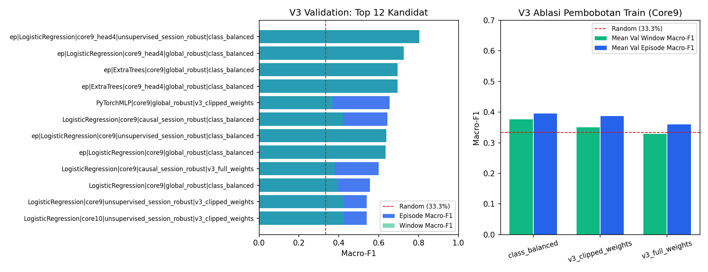
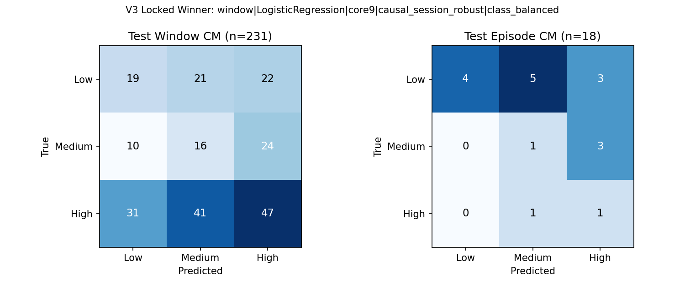

# Hasil Eksperimen Batch 06 — Exp01: `v3_behavioral_proxy`

- **Tanggal run (UTC):** 2026-11-24T10:27:44.447051+00:00
- **Jumlah kandidat diuji:** 60
- **Model terkunci (dipilih sebelum Test):** `window|LogisticRegression|core9|causal_session_robust|class_balanced`

## Ringkasan Performa Model Terkunci

| Split | Window Acc | Window BalAcc | Window Macro-F1 | Episode Acc | Episode BalAcc | Episode Macro-F1 |
|---|---:|---:|---:|---:|---:|---:|
| Inner-CV OOF (Train, leak-free) | — | — | 29.67% | — | — | 47.18% |
| Frozen Validation (3 org, 11 ep) | 58.26% | 48.46% | 42.12% | 63.64% | 63.89% | 64.29% |
| **Frozen Test (3 org, 18 ep)** | **35.50%** | **34.05%** | **33.50%** | **33.33%** | **36.11%** | **30.13%** |
| Dummy Control (Test) | 51.52% | 33.33% | 22.67% | 11.11% | 33.33% | 6.67% |
| Unsupervised Session-Norm Ref (Test) | 24.24% | 20.06% | 21.07% | 16.67% | 8.33% | 11.76% |

## Recall per Kelas pada Test (Model Terkunci)

- **Window Recall (Low / Medium / High):** 30.65% / 32.00% / 39.50%
- **Episode Recall (Low / Medium / High):** 33.33% / 25.00% / 50.00%

## Catatan Evaluasi

- Kelas High pada Test V3 hanya berasal dari **2 episode** (119 window overlap), sehingga variasi episode sangat besar.
- Cabang `episode_summary` (yang menghitung IQR/slope lintas window dalam satu episode) disimpan hanya sebagai diagnostik dan **dikeluarkan dari seleksi pemenang utama** karena episode pendek 1–2 window menghasilkan nilai IQR/slope tepat 0, sehingga secara implisit membocorkan durasi episode ke label V3 yang berbasis durasi.
- Semua angka di atas dihitung dari model murni **per-window** tanpa kebocoran peserta, tanpa kebocoran referensi waktu pada inner-CV, dan tanpa mengganti pemenang setelah membuka Test.

