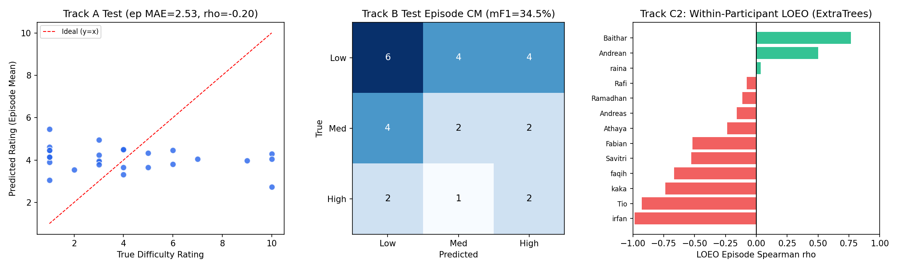
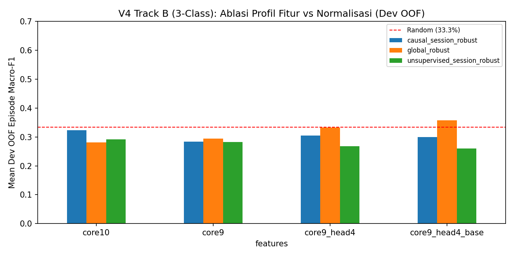

# Hasil Eksperimen Batch 06 — Exp02: `v4_self_reported_rating`

- **Tanggal run (UTC):** 2026-11-24T10:31:11.638912+00:00
- **Pembagian peserta:** 13 Development / 4 Held-Out Test (Athaya, Baithar, Sullivan, Tio)

## Track A: Regresi Rating Kesulitan (1–10)
- **Pemenang terkunci (Dev OOF):** `window|Ridge|core9_head4_base|causal_session_robust|episode_equalized_clipped`

| Evaluasi | Window MAE | Window $R^2$ | Episode MAE | Episode $R^2$ | Episode Spearman $\rho$ |
|---|---:|---:|---:|---:|---:|
| Dev 5-Fold OOF (13 org) | 2.969 | -0.403 | 2.330 | -0.081 | -0.138 |
| **Held-Out Test (4 org)** | **2.768** | **-0.326** | **2.528** | **-0.136** | **-0.196** |
| Dummy Mean (Test) | 2.527 | -0.002 | 2.969 | -0.293 | +0.000 |
| Unsup Session-Norm Ref (Test) | 2.921 | -0.566 | 2.589 | -0.206 | -0.396 |

## Track B: Klasifikasi 3-Kelas (`1–3` Low, `4–6` Med, `7–10` High)
- **Pemenang terkunci (Dev OOF):** `window|LogisticRegression|core10|causal_session_robust|episode_equalized_clipped`

| Evaluasi | Window Acc | Window BalAcc | Window Macro-F1 | Episode Acc | Episode BalAcc | Episode Macro-F1 |
|---|---:|---:|---:|---:|---:|---:|
| Dev 5-Fold OOF (13 org) | 37.73% | 36.37% | 36.15% | 43.43% | 45.46% | 41.75% |
| **Held-Out Test (4 org)** | **36.16%** | **35.13%** | **35.49%** | **37.04%** | **35.95%** | **34.53%** |
| Dummy Control (Test) | 40.55% | 33.33% | 19.23% | 18.52% | 33.33% | 10.42% |
| Unsup Session-Norm Ref (Test) | 25.75% | 24.51% | 24.54% | 18.52% | 20.48% | 15.02% |

## Track C1: Biner Ekstrem Lintas-Peserta (`1–3` vs `7–10`)
- **Pemenang terkunci (Dev OOF):** `LogisticRegression|core9_head4_base|global_robust`
- **Dev OOF:** Window AUC = 0.700, BalAcc = 64.69% | Episode AUC = 0.739, BalAcc = 72.54%
- **Held-Out Test:** Window AUC = **0.562**, BalAcc = **53.96%** | Episode AUC = **0.714**, BalAcc = **62.14%**

## Track C2: Diagnostik Kalibrasi Dalam-Peserta (Leave-One-Episode-Out)

| Model | Peserta layak | Dummy ep-MAE | LOEO ep-MAE | Median ep-Spearman $\rho$ | Peserta $\rho > 0$ | Mean Binary AUC |
|---|---:|---:|---:|---:|---:|---:|
| ExtraTreesReg | 13 | 1.671 | 2.063 | -0.237 | 3/13 | 0.333 |
| Ridge | 13 | 1.671 | 1.939 | -0.116 | 5/13 | 0.583 |

