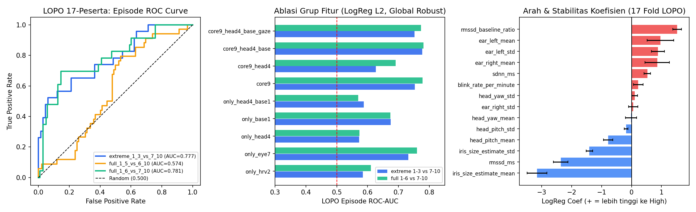
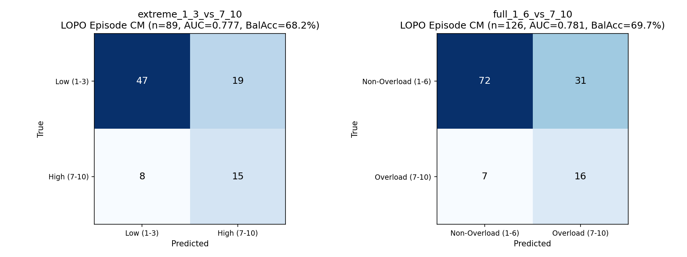
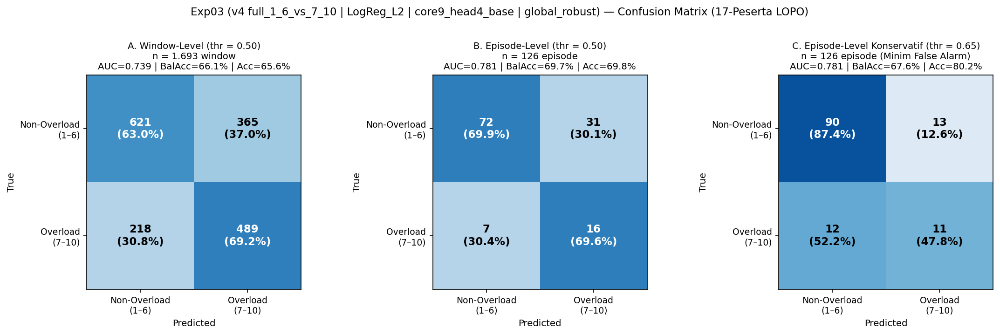
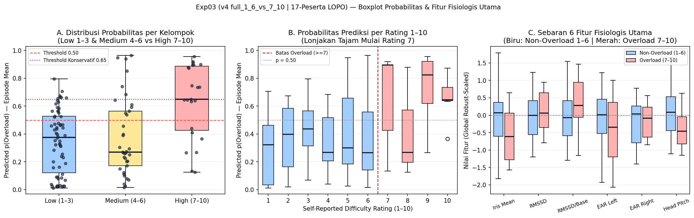
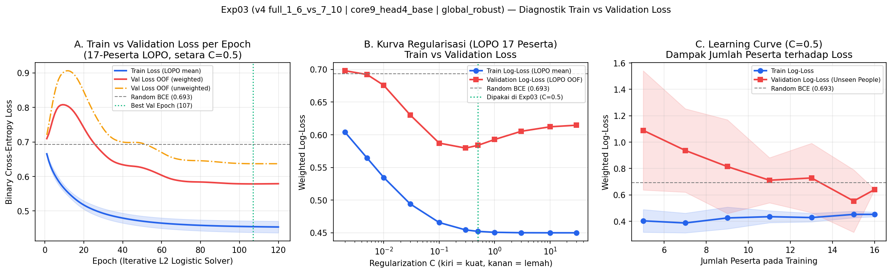

# Hasil Eksperimen Batch 06 — Exp03: Deep-Dive Deteksi Biner Overload (`v4_self_reported_rating`)

- **Tanggal run (UTC):** 2026-11-24T11:22:10.037032+00:00
- **Evaluasi utama:** Leave-One-Participant-Out (LOPO) pada seluruh 17 peserta + cluster-bootstrap 95% CI + verifikasi silang pada Held-Out Test beku Exp02 (13 Dev -> 4 Test).

## 1. Perbandingan 3 Skema Biner (LOPO 17 Peserta — Kandidat Operasional Terbaik)

| Skema Biner | Model Terbaik (Operasional) | Win AUC | Ep AUC (95% CI) | Ep BalAcc | Ep Acc | Ep Sens / Spec | MWU p-value |
|---|---|---:|---|---:|---:|---:|---:|
| `extreme_1_3_vs_7_10` | `LogReg_L1|core9_head4_base|global_robust` | 0.752 | **0.784** | 67.46% | 68.54% | 65.2% / 69.7% | 0.0000 |
| `full_1_5_vs_6_10` | `ExtraTrees_Shallow|core9|causal_session_robust` | 0.582 | **0.643** | 60.84% | 56.35% | 70.6% / 51.1% | 0.0070 |
| `full_1_6_vs_7_10` | `LogReg_L2|core9_head4_base|global_robust` | 0.739 | **0.781 (0.647–0.894)** | 69.73% | 69.84% | 69.6% / 69.9% | 0.0000 |

## 2. Verifikasi Silang pada Held-Out Test Beku (13 Dev -> 4 Test)

| Skema Biner | Model Terkunci (dari Dev LOPO) | Dev LOPO Ep AUC | Test Ep AUC | Test Ep BalAcc | Test Ep Acc |
|---|---|---:|---:|---:|---:|
| `extreme_1_3_vs_7_10` | `Blend_LR_ET|core9_head4|causal_session_robust` | 0.735 | **0.629** | 58.57% | 57.89% |
| `full_1_5_vs_6_10` | `ExtraTrees_Shallow|core9|causal_session_robust` | 0.620 | **0.693** | 65.71% | 62.96% |
| `full_1_6_vs_7_10` | `LogReg_L2|core9|global_robust` | 0.739 | **0.773** | 60.45% | 48.15% |

## 3. Audit Faktor Perancu (`LogReg_L2 | core9_head4_base | global_robust`)

| Skema Biner | Full Ep AUC | Non-Missing Baseline Ep AUC | Spearman(pred, waktu sesi) | Partial $r$ (kontrol waktu) | Partial $p$ |
|---|---:|---:|---:|---:|---:|
| `extreme_1_3_vs_7_10` | 0.777 | 0.804 | +0.140 | +0.435 | 0.0000 |
| `full_1_5_vs_6_10` | 0.574 | 0.571 | +0.119 | +0.092 | 0.3032 |
| `full_1_6_vs_7_10` | 0.781 | 0.802 | +0.112 | +0.387 | 0.0000 |

