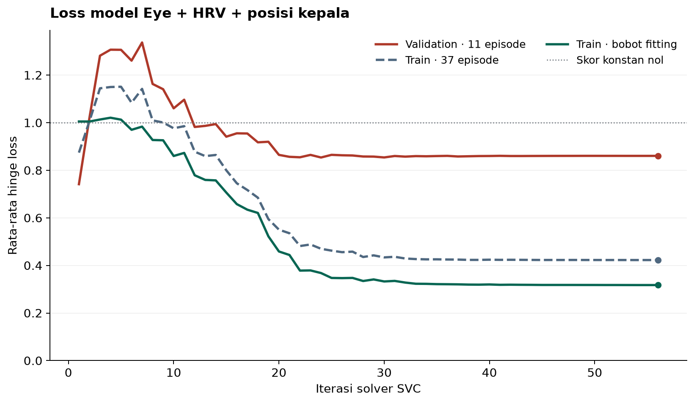

# Exp09 · apakah model menangkap beban kognitif?

Pada data v3, model Eye + HRV + posisi kepala belajar membedakan sebagian episode yang dikategorikan tim sebagai High dan Non-High berdasarkan waktu pengerjaan dan kesalahan manual. Loss pada peserta validation tetap lebih tinggi daripada pada peserta fitting. Karena label v3 adalah proxy perilaku, hasil ini mengukur prediksi proxy. Menghubungkan skor dengan pengalaman beban kognitif peserta masih memerlukan bukti independen.

## Kurva training dan validation

Model exp08 menggunakan SVC RBF dengan C=1. Kurva direkonstruksi dengan fitting ulang dari kondisi awal yang sama pada batas iterasi 1 sampai 55. Titik ke-56 berasal dari model yang dibiarkan konvergen. Seluruh 48 skor held-out (37 LOPO Train dan 11 validation) cocok dengan exp08 hingga toleransi numerik 10⁻¹². Garis validation mengikuti 11 episode pada tiga peserta yang sama sepanjang kurva. Pemilihan checkpoint tidak memakai garis ini. Model dievaluasi pada skor keputusan asli, sebelum penerapan ambang exp08. [Dokumentasi SVC](https://scikit-learn.org/stable/modules/generated/sklearn.svm.SVC.html)

Untuk label bertanda y (High = +1, Non-High = −1) dan skor menuju High sebesar f, hinge loss satu episode adalah **max(0, 1 − y × f)**. Prediksi benar dengan margin kecil masih menyumbang loss. Pada grafik, garis hijau memakai bobot fitting kelas/peserta/episode. Garis putus-putus dan garis merah memberi bobot sama pada setiap episode sehingga dapat dibandingkan langsung. Skor konstan nol menghasilkan loss 1. Loss ini adalah komponen kesalahan margin. Fungsi objektif SVM juga memuat penalti kompleksitas model, sehingga hinge loss sendiri dapat berfluktuasi selama optimisasi. [Formulasi SVM](https://scikit-learn.org/stable/modules/svm.html#mathematical-formulation)

| Iterasi aktual | Train berbobot | Train per episode | Validation per episode |
|---:|---:|---:|---:|
| 1 | 1,005 | 0,874 | 0,741 |
| 8 | 0,927 | 1,010 | 1,163 |
| 16 | 0,658 | 0,745 | 0,955 |
| 32 | 0,328 | 0,429 | 0,857 |
| 56 | **0,317** | **0,423** | **0,861** |

Setelah iterasi 32, perubahan validation loss hanya sekitar 0,003 hingga konvergensi. Selisih akhir antar-rata-rata per episode adalah 0,438. Optimisasi selesai, sementara pemisahan pada peserta lain masih lemah. Sebelas observasi validation terlalu sedikit untuk menunjuk satu penyebab tunggal dari selisih itu. [Nilai semua titik](outputs/loss_20261124T120138Z_dfccaf89/loss.csv)

## Apakah High mendapat skor lebih tinggi?

Keempat resep memakai episode, referensi, bobot, dan fold exp08. Setiap fold belajar scaler dan model dari peserta fitting dan membangun ulang label dari referensi waktu inner-Train. Kontrol linear menggunakan seluruh fitur dengan C=1. Dua kontrol RBF memakai subset fitur dan parameter C=1 serta gamma=scale seperti model gabungan. Kolom AUC gabungan pada LOPO membandingkan skor yang berasal dari model fold berbeda. Pemeriksaan dalam peserta di bawah hanya membandingkan skor dari model fold yang sama.

| Resep | Accuracy LOPO Train | Accuracy validation | AUC gabungan LOPO / validation | Pasangan terurut benar dalam peserta, LOPO / validation |
|---|---:|---:|---:|---:|
| RBF Eye + HRV + posisi kepala (exp08) | 70,3% | 54,5% | 0,699 / 0,607 | 12/16 · 7/7 |
| Linear Eye + HRV + posisi kepala | 56,8% | 54,5% | 0,530 / 0,571 | 4/16 · 7/7 |
| RBF Eye + HRV | 54,1% | 54,5% | 0,622 / 0,571 | 10/16 · 6/7 |
| RBF posisi kepala | 75,7% | 63,6% | 0,717 / 0,750 | 9/16 · 7/7 |

Satu pasangan terdiri dari satu episode High dan satu Non-High milik peserta yang sama. Hanya lima peserta Train dan dua peserta validation mempunyai kedua jenis episode. Enam dari tujuh pasangan validation berasal dari satu peserta. Pasangan juga dapat berbagi episode sehingga tujuh pasangan tidak setara dengan tujuh peserta independen.

Kepala saja menghasilkan accuracy tertinggi, sedangkan model gabungan memberi urutan yang lebih baik pada pasangan Train. Pola ini konsisten dengan adanya informasi postur atau konteks tugas dalam prediksi dan belum menjelaskan apakah perubahan tersebut mencerminkan usaha mental. Eksperimen menggunakan validation yang sudah beberapa kali diperiksa. Perbandingan ini bersifat eksploratif. [Metrik lengkap](outputs/loss_20261124T120138Z_dfccaf89/metrics.csv) · [Hasil per peserta yang memiliki pasangan](outputs/loss_20261124T120138Z_dfccaf89/within_person.csv)

## Prioritas penelitian

1. **Periksa pengaruh jenis soal.** Audit tambahan menggabungkan ID prediksi dengan `puzzle_set` pada bukti episode v3. Jika orang dan set soal harus sama, hanya tersisa lima pasangan Train (empat terurut benar oleh model gabungan) serta satu pasangan validation (terurut benar). Jika orang dan identitas soal persis harus sama, jumlahnya nol di kedua evaluasi. Laporkan cakupan ini bersama hasil. Data saat ini memiliki sedikit pembanding untuk memisahkan perubahan tuntutan soal dari respons peserta.
2. **Uji kesesuaian dengan ukuran usaha mental independen.** Jika arsip tim memiliki penilaian usaha mental yang dapat ditautkan ke episode, gunakan hanya sebagai kriteria evaluasi yang telah ditetapkan sebelumnya. Ukur apakah skor sensor naik saat peserta melaporkan usaha mental yang lebih tinggi, dengan pengelompokan peserta dan pengendalian jenis soal bila ada pasangan yang layak. Penilaian kesulitan soal dan kombinasi waktu/kesalahan masing-masing mengukur hal berbeda dari laporan usaha mental. Paket v3 sendiri hanya menyediakan proxy perilaku. Penelitian Paas dan rekan memberi contoh penggunaan rating usaha mental sebagai bukti tambahan. [Paas, Van Merriënboer & Adam, 1994](https://pubmed.ncbi.nlm.nih.gov/7808878/)
3. **Pertahankan kontrol posisi kepala saat mengubah representasi sensor.** Kandidat lanjutan yang dapat memakai rekaman lama adalah perubahan Eye/HRV dari segmen awal ke segmen berikutnya dengan durasi tetap, dinilai pada episode dan peserta yang sama. Laporkan berapa episode pendek kehilangan cakupan serta bandingkan ranking dalam peserta terhadap kontrol kepala dan median episode saat ini. Kenaikan accuracy lintas peserta saja belum cukup untuk menetapkan peningkatan validitas pengukuran.

## Reproduksi

Jalankan [notebook exp09](EyeHeartCognitiveLoad.ipynb) di Colab CPU menggunakan `DATASET_ROOT = PROJECT_ROOT / 'Dataset'` dan kedua CSV v2 serta paket v3 yang dipakai exp08. Grafik tampil di notebook. Sel terakhir juga menyimpan PNG, CSV loss, metrik, skor episode, hasil pasangan, dan manifest dalam satu ZIP. [ZIP run lokal](outputs/loss_20261124T120138Z_dfccaf89.zip)
