# Laporan Batch 08 — Model Final Deteksi Overload Programmer

Tanggal eksekusi: 27 November 2026 · Eksekusi lokal (Python 3.14.6, scikit-learn 1.7.2) · Seluruh notebook berjalan tanpa error.

## 1. Ringkasan

Batch 08 adalah batch pemodelan terakhir. Batch ini menghasilkan dua model final untuk mendeteksi **episode overload**, yaitu soal yang dinilai peserta sangat sulit (rating ≥ 7 pada skala 1–10), dari sinyal **eye tracking webcam dan HRV**:

| Model | Input | AUC episode (CI 95%) | Balanced accuracy (CI 95%) | Akurasi | Overload tertangkap · alarm palsu |
|---|---|---:|---:|---:|---:|
| **Track A-ens** — model ilmiah | Sensor saja (eye + HRV) | **0,826** (0,69–0,93) | **0,768** (0,63–0,88) | 78,6% | 17/23 · 21/103 |
| **Track B3** — model untuk IDE | Sensor + waktu tugas berjalan | **0,890** (0,77–0,97) | **0,840** (0,75–0,91) | **84,9%** | 19/23 · 15/103 |
| Batch 06, model biner terbaik | Sensor saja | 0,778 (0,64–0,90) | 0,741 | 65,9% | 20/23 · 40/103 |
| Tebakan "selalu tidak overload" | — | 0,500 | 0,500 | 81,7% | 0/23 · 0/103 |

Angka diukur dengan **nested leave-one-participant-out (LOPO)** pada 17 peserta: setiap peserta dinilai oleh model yang tidak pernah melihat datanya, termasuk saat memilih konfigurasi dan ambang.

- **Kedua model melampaui Batch 06.** B3 melampauinya secara signifikan (ΔAUC +0,112, p = 0,029; Δbalanced accuracy +0,100, p = 0,042).
- **B3 adalah model pertama sejak target overload dipakai yang akurasinya melampaui tebakan mayoritas** (84,9% vs 81,7%). Alarm palsunya turun dari 40 menjadi 15 dari 103 episode normal.
- **Sinyal sensor bukan kebetulan.** Uji permutasi 200 kali pada seluruh pipeline memberi p = 0,005. Sensor juga menambah informasi di atas tingkat soal, durasi, dan waktu dalam sesi (p ≈ 10⁻⁶).
- **Deteksi dini memungkinkan.** Pada 60 detik pertama sebuah tugas, AUC sudah 0,90. Dalam simulasi alarm, B3 menangkap 83% episode overload dengan alarm palsu 14%, rata-rata ±2,5 menit sebelum peserta selesai atau timeout.

## 2. Latar: posisi setelah Batch 06

Batch 06 menguji dua sumber label baru, V3 (proxy perilaku) dan V4 (rating peserta). Hasilnya:

1. **Klasifikasi tiga kelas dan regresi rating 1–10 tetap di sekitar peluang acak.** Macro-F1 Test V3 30%, V4 35%, dan MAE regresi 2,5.
2. **Sinyal yang konsisten muncul pada tugas biner V4**, rating 1–6 vs 7–10. Logistic Regression `core9 · global_robust` mencapai AUC episode 0,778 pada LOPO 17 peserta.
3. **Model biner itu masih punya tiga kelemahan:**
   - akurasi 65,9% di bawah tebakan mayoritas 81,7%;
   - ambang tetap 0,50 menghasilkan 40/103 alarm palsu;
   - pemilihan konfigurasi belum sepenuhnya terpisah dari peserta yang dinilai.

Batch 08 menetapkan model biner Batch 06 itu sebagai **pembanding resmi** dan menargetkan perbaikan pada AUC dan balanced accuracy di 126 episode yang sama. Kriteria lulus disepakati sebelum run: AUC > 0,778 dan balanced accuracy > 0,741.

> Catatan untuk tim: model pembanding ini identik dengan referensi pada Batch 07 (`win_logreg_core9_global · fixed_050`), dan seluruh rekomendasi diagnosis Batch 07 dijalankan di batch ini.

## 3. Dataset

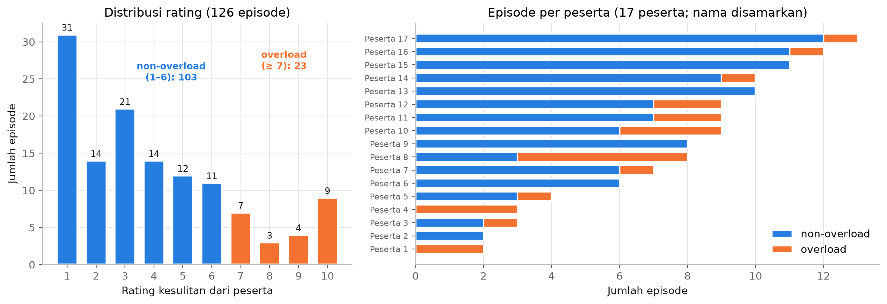

| Dataset | Dipakai di | Isi | Label |
|---|---|---|---|
| **V4** `v4_self_reported_rating` | exp01–exp03 (**semua hasil utama**) | 1.693 window 15 s (step 5 s), 126 episode, 17 peserta | **overload = rating ≥ 7** (23 episode dari 12 peserta), non-overload = rating 1–6 (103) |
| **V3** `v3_behavioral_proxy` | exp04 (validasi silang) | 37 episode LOPO Train, 10 validasi, 18 Test | High vs Non-High (Low + Medium), dihitung ulang per fold |
| v2 `all_data.csv` 15 s | exp02, exp04 (input pendukung, bukan label) | Window berkualitas good/acceptable | — |

v2 dipakai untuk dua hal:
1. **Median riwayat sensor** sebelum tugas dimulai (≤12 window dari sesi yang sama), sebagai dasar normalisasi personal.
2. **±4.300 window pengerjaan aktif** dari 22 peserta, termasuk 5 peserta yang tidak ada di V4, untuk melatih skor bantu "kesulitan soal". Peserta yang sedang dinilai selalu dikeluarkan.

Kelas sangat tidak seimbang: hanya 18% episode adalah overload. Karena itu metrik utama adalah **AUC dan balanced accuracy**; akurasi selalu dibandingkan dengan tebakan mayoritas 81,7%. Tidak ada dataset baru yang dibangun: label biner dibentuk di kode dari V3/V4 yang sudah ada.

## 4. Pipeline pemodelan

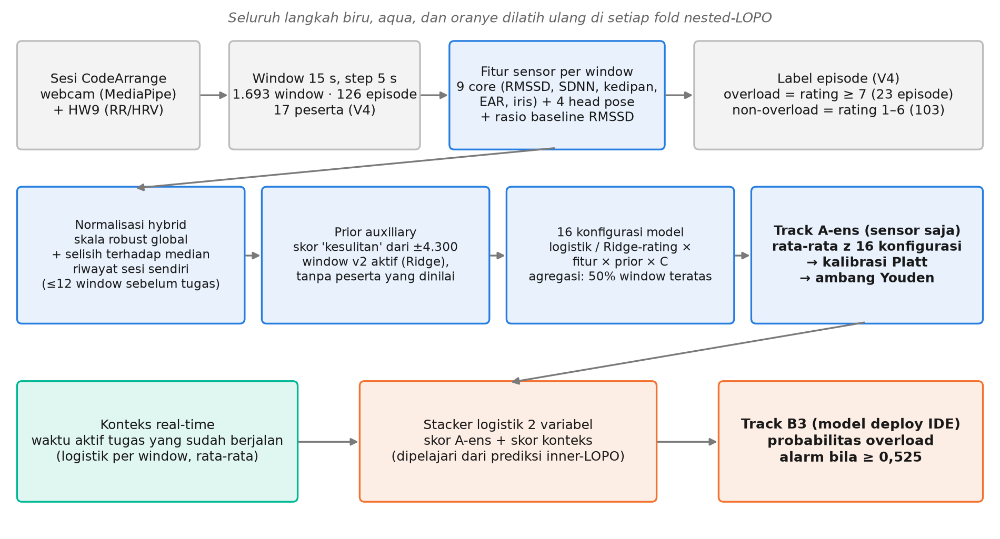

**Fitur per window**, dari definisi dataset:
- 9 fitur core: RMSSD, SDNN, laju kedipan, rata-rata dan simpangan EAR kiri/kanan, rata-rata dan simpangan estimasi ukuran iris
- 4 statistik posisi kepala
- rasio RMSSD terhadap baseline

Fitur gaze tidak dipakai karena validasi kalibrasi hanya lolos pada 4 dari 23 rekaman.

**Komponen baru dibanding Batch 06:**

| Komponen | Batch 06 | Batch 08 |
|---|---|---|
| Normalisasi | Skala robust global | **Hybrid**: skala robust global + selisih terhadap median riwayat sesi peserta sendiri sebelum tugas dimulai |
| Informasi tambahan | — | **Prior auxiliary**: skor "kesulitan" dari model Ridge yang dilatih pada ±4.300 window v2 aktif |
| Target pelatihan | Biner | Biner **dan** regresi rating 1–10 (skor rating dipakai untuk peringkat) |
| Agregasi window → episode | Rata-rata semua window | **Rata-rata 50% window teratas**, lebih peka terhadap fase sulit di dalam tugas |
| Model | Satu konfigurasi | **Ensemble 16 konfigurasi** (fitur × target × prior × regularisasi), skor z dirata-ratakan |
| Kalibrasi & ambang | Ambang tetap 0,50 | Kalibrasi Platt seimbang dan **ambang Youden** dari prediksi inner |
| Konteks | — | Model B3: **stacking** skor sensor + waktu aktif tugas yang sudah berjalan |

**Evaluasi nested LOPO.** Untuk setiap peserta yang dinilai (outer), semua keputusan di atas dibuat dari LOPO di dalam 16 peserta lainnya (inner). Model lalu dilatih ulang pada 16 peserta dan baru memprediksi peserta outer. Tidak ada informasi peserta outer yang ikut ke statistik normalisasi, prior, seleksi, kalibrasi, maupun ambang.

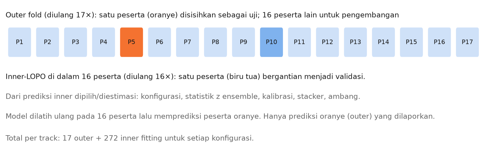

## 5. Eksperimen dan hasil

### 5.1 Exp01 — Pembanding

Model biner terbaik Batch 06 dijalankan ulang di environment Batch 08 dan menghasilkan **AUC 0,77797, identik dengan Batch 06**, sehingga perbandingan sah. Pembanding tanpa sensor pada episode yang sama:

| Pembanding | AUC | Balanced accuracy | Keterangan |
|---|---:|---:|---|
| Batch 06 (LogReg core9, ambang 0,50) | 0,778 | 0,741 | Pembanding resmi |
| Waktu aktif tugas berjalan (nested) | 0,818 | 0,811 | Tersedia real-time di IDE |
| Durasi akhir episode | 0,816 | — | Baru diketahui setelah tugas selesai |
| Menit sejak sesi dimulai | 0,819 | — | Artefak urutan protokol (soal sulit selalu terakhir) |
| Tingkat set soal (easy/medium/hard) | 0,776 | — | Tidak tersedia di IDE nyata |
| Tebakan mayoritas | 0,500 | 0,500 | Akurasi 81,7% |

Waktu dan konteks tugas saja sudah sangat informatif. Itu sebabnya ada dua track: **A (sensor saja)** untuk klaim ilmiah, dan **B (sensor + waktu berjalan)** untuk dipakai di IDE.

### 5.2 Exp02 — Model utama

Iterasi berlangsung tiga ronde ([ROUNDS.md](ROUNDS.md)). Semua seleksi tetap di inner-LOPO, dan model utama ronde 3 ditetapkan sebelum hasilnya terlihat.

| Ronde | Perubahan | Track A (sensor) AUC / BalAcc | Track deploy AUC / BalAcc |
|---|---|---:|---:|
| 1 | Pool 648 konfigurasi, seleksi satu konfigurasi per fold | 0,799 / 0,760 | 0,835 / 0,780 |
| 2 | Pool 16 konfigurasi (pola seleksi ronde 1) + stacking sensor + konteks | 0,802 / 0,760 | 0,887 / 0,855 |
| **3 (final)** | Ensemble rata-rata 16 konfigurasi (A-ens) + stacking (B3) | **0,826 / 0,768** | **0,890 / 0,840** |

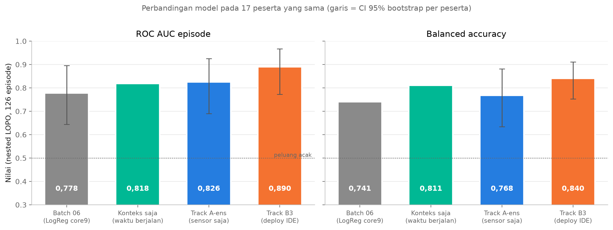

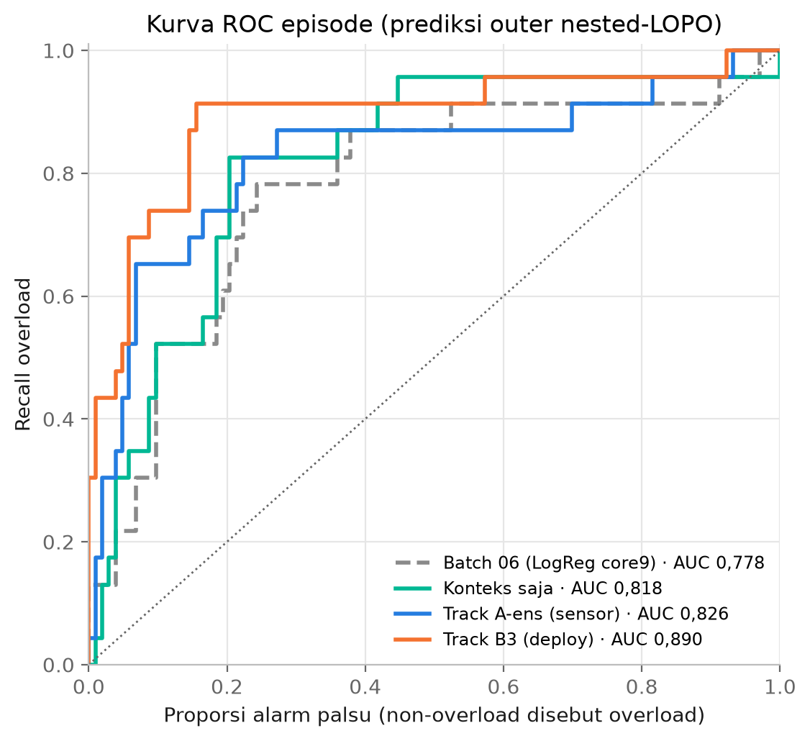

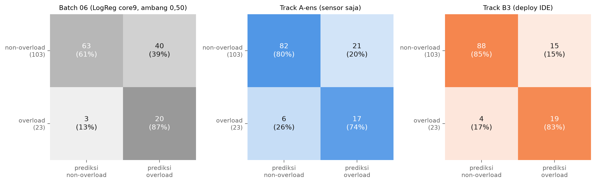

**Uji yang menyertai hasil:**

| Uji | Hasil |
|---|---|
| Permutasi (label diacak 200×, seluruh pipeline nested diulang) | 0/200 permutasi mencapai AUC asli; **p = 0,005**. AUC null rata-rata 0,465, persentil-95 0,638 |
| Kontribusi sensor di atas tingkat soal + durasi + waktu sesi | AUC 0,884 → 0,946; χ² = 24,1; **p = 9 × 10⁻⁷** |
| Kontribusi sensor di atas model waktu berjalan | AUC 0,818 → 0,894; **p = 2 × 10⁻⁶** |
| A-ens vs Batch 06 (bootstrap berpasangan per peserta) | ΔAUC +0,048 (CI −0,05 s.d. +0,14); Δbalanced accuracy +0,027. Positif, belum signifikan |
| B3 vs Batch 06 | ΔAUC +0,112 (p = 0,029); Δbalanced accuracy +0,100 (p = 0,042) |
| B3 vs waktu berjalan saja | ΔAUC +0,072 (p = 0,058); Δbalanced accuracy +0,029 |
| Skor sensor vs durasi di dalam kelas yang sama | ρ ≈ 0,00. Skor tidak sekadar mengukur lama pengerjaan |

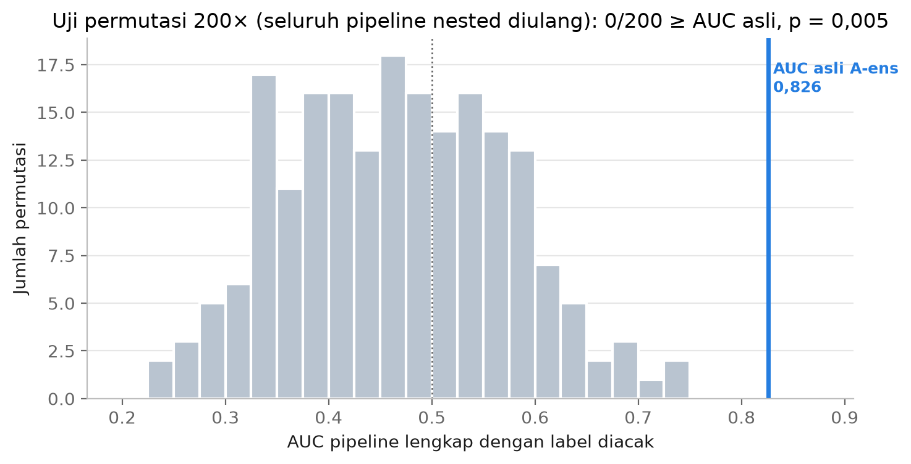

**Sensitivitas definisi overload.** Rating ≥ 7 adalah batas terbaik. Rating 6 berperilaku lebih mirip non-overload.

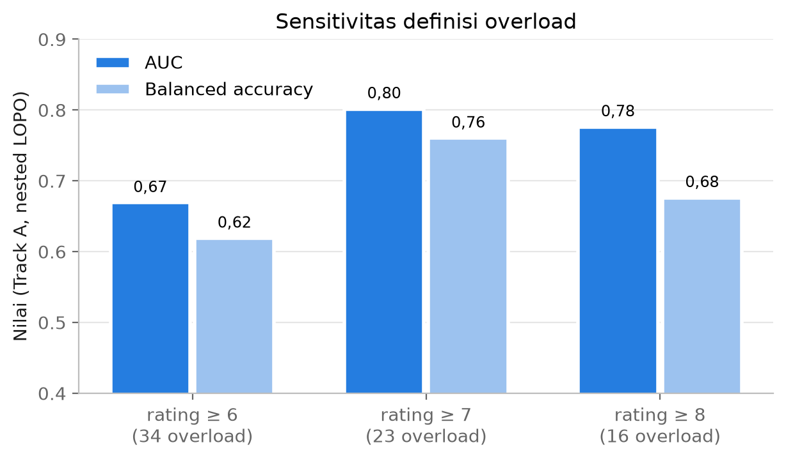

### 5.3 Exp03 — Deteksi dini dan alarm online

IDE perlu bereaksi selama tugas berjalan, bukan setelah selesai. Exp03 menilai model hanya dari window yang sudah selesai pada waktu T, memakai model, kalibrasi, dan ambang setiap fold dari exp02, tanpa fitting baru.

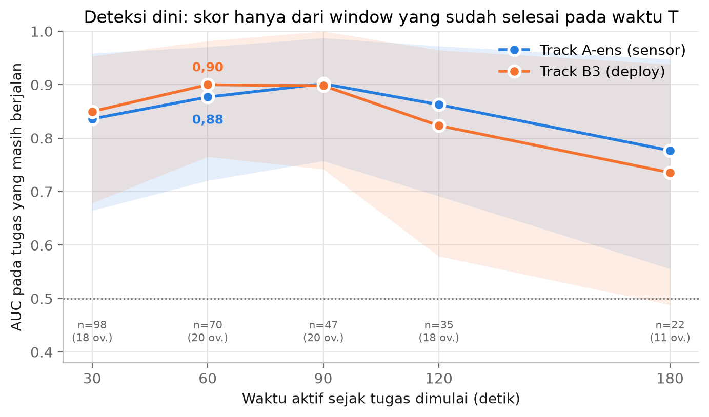

| Aturan alarm | Overload tertangkap | Alarm palsu | Median waktu alarm | Median waktu sebelum tugas berakhir |
|---|---:|---:|---:|---:|
| **B3 (sensor + waktu)** | **82,6%** | **13,6%** | 63 s | 147 s |
| Timer saja, alarm palsu disamakan | 56,5% | 13,6% | 165 s | — |
| A-ens (sensor saja) | 69,6% | 22,3% | 23 s | 160 s |
| Timer saja, alarm palsu disamakan | 78,3% | 22,3% | 97 s | — |

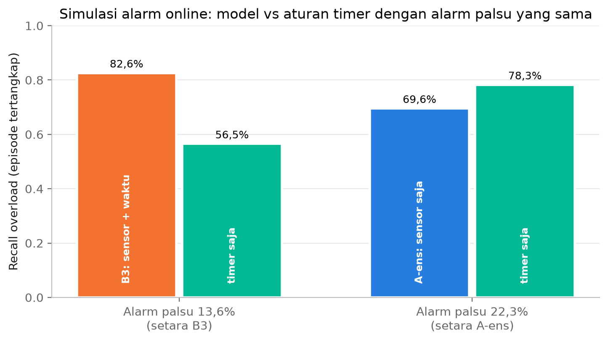

Gabungan sensor + waktu menangkap overload lebih banyak dan lebih awal daripada timer dengan tingkat alarm palsu yang sama. **Sensor saja belum lebih baik daripada timer** untuk keputusan alarm, sehingga alarm IDE sebaiknya memakai B3.

### 5.4 Exp04 — Validasi silang V3

1. **V3 tidak dapat dipelajari dari sensor.** Pipeline yang sama dilatih pada label V3 (High vs Non-High, dihitung ulang per fold) menghasilkan AUC 0,43 (LOPO Train), 0,10 (validasi), dan 0,66 (Test, 2 episode High). Hasil V3 Batch 06 (AUC LOPO 0,699) berasal dari representasi median episode yang ikut merekam lama pengerjaan, padahal label V3 sendiri didefinisikan dari lama pengerjaan.
2. **Skor sensor V4 justru mengenali kesulitan perilaku V3.** Pada 40 episode yang memiliki label V3 dan V4, skor A-ens mencapai AUC 0,78 untuk V3 High dan 0,93 untuk rating ≥ 7.

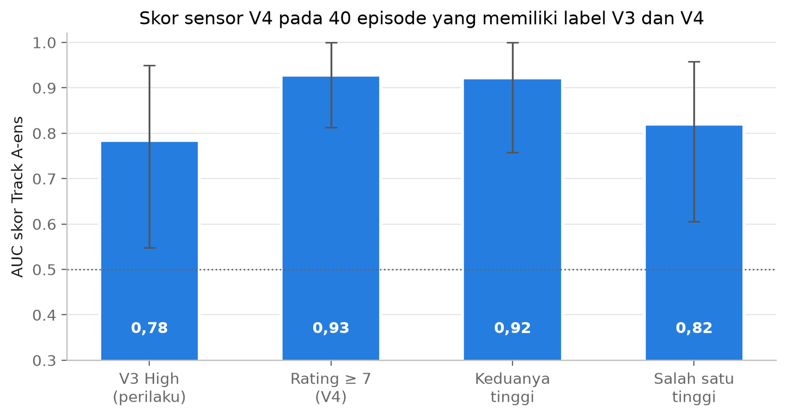

## 6. Perbandingan dengan Batch 06

| Tugas | Batch 06 (hasil terbaik) | Batch 08 |
|---|---|---|
| V3 tiga kelas | Test: macro-F1 30,1%, akurasi 33,3% | Tidak dilanjutkan (V3 tidak dapat dipelajari, §5.4) |
| V3 biner High vs Non-High | LOPO AUC 0,699; Test AUC 0,500 | LOPO AUC 0,43 tanpa kebocoran durasi; V3 dipakai hanya sebagai validasi silang |
| V4 regresi rating 1–10 | Test MAE 2,53 (Spearman −0,20) | Dipakai di dalam ensemble sebagai skor peringkat |
| V4 tiga kelas | Test: macro-F1 34,5%, akurasi 37,0% | Tidak dilanjutkan; fokus ke biner |
| **V4 biner (rating ≥ 7), sensor saja** | AUC 0,778; BalAcc 0,741; akurasi 65,9%; 40/103 alarm palsu | **AUC 0,826; BalAcc 0,768; akurasi 78,6%; 21/103 alarm palsu** |
| **V4 biner, untuk IDE** | — | **AUC 0,890; BalAcc 0,840; akurasi 84,9%; 15/103 alarm palsu** |
| Deteksi saat tugas berjalan | Belum diukur | AUC 0,90 pada 60 s pertama; recall alarm 83% dengan alarm palsu 14% |
| Bukti statistik | CI bootstrap | CI bootstrap, permutasi pipeline lengkap (p = 0,005), uji kontribusi sensor |

## 7. Keterbatasan

Rincian ada di [DIAGNOSIS.md](DIAGNOSIS.md). Ringkasnya:
1. **Sampel kecil.** 17 peserta dan 23 episode overload, sehingga CI lebar dan keunggulan A-ens atas Batch 06 belum signifikan.
2. **Kohort yang sama dipakai sepanjang Batch 01–08.** Angka nested LOPO kemungkinan sedikit optimistis untuk pengguna baru.
3. **Sebagian sinyal membedakan antar-orang**, tidak hanya kondisi sesaat. AUC dalam peserta A-ens 0,71, dan hanya 10 peserta yang memiliki kedua kelas.
4. **Urutan soal selalu easy → medium → hard.** Pengaruhnya sudah dikontrol secara statistik, tetapi belum diacak di protokol.
5. **Label adalah rating kesulitan subjektif**, bukan pengukuran beban kognitif langsung.

## 8. Model final untuk IDE

[final_model/b8_overload_model.json](final_model/b8_overload_model.json) berisi model B3 dan kalibrasi A-ens yang dilatih ulang pada seluruh 17 peserta. Semua komponennya linear dan disimpan sebagai parameter JSON; inferensinya numpy murni ([final_model/b8_inference.py](final_model/b8_inference.py)), tanpa scikit-learn atau pickle. Hasilnya identik dengan model scikit-learn (selisih maksimum 3,6 × 10⁻¹⁵; [verification.json](final_model/verification.json)).

**Input per tugas:**
- Window 15 s (step 5 s) berisi 9 fitur core, 4 fitur posisi kepala, dan rasio RMSSD baseline.
- Waktu aktif tugas yang sudah berjalan.
- Median fitur dari ≤12 window berkualitas sebelum tugas dimulai. Boleh kosong; model memakai fallback.

**Rekomendasi pemakaian:**
1. Picu bantuan ringan ketika probabilitas B3 ≥ **0,525**, setelah minimal 2 window (±20 detik).
2. Tampilkan skor A-ens sebagai indikator fisiologis pendamping, bukan pemicu intervensi tersendiri.
3. Kinerja yang diharapkan pada pengguna baru adalah angka nested LOPO di laporan ini. AUC in-sample model refit (0,94) bukan ukuran kinerja.

## 9. Integritas dan reproduksi

- **Reproduksi pembanding:** model Batch 06 direproduksi tepat (AUC 0,77797).
- **Notebook vs skrip:** run notebook mereproduksi run skrip secara identik (selisih < 1e-12).
- **Audit independen:** AUC dan balanced accuracy keenam track dihitung ulang dari file prediksi, dan setiap episode terbukti diprediksi tepat sekali oleh fold pesertanya sendiri.
- **Hash input:** hash SHA-256 semua input tercatat di `manifest.json` setiap run.

| Eksperimen | Run resmi |
|---|---|
| exp01 | `exp01_reference/outputs/reference_20261127T031942Z_2fb708e7` |
| exp02 | `exp02_nested_main/outputs/nested_round3_20261127T031955Z_8703732e` (termasuk `permutation_result.json`) |
| exp03 | `exp03_early_detection/outputs/early_20261127T032946Z_96acf8b7` |
| exp04 | `exp04_v3_crosscheck/outputs/v3check_20261127T033440Z_4cf196ee` |
